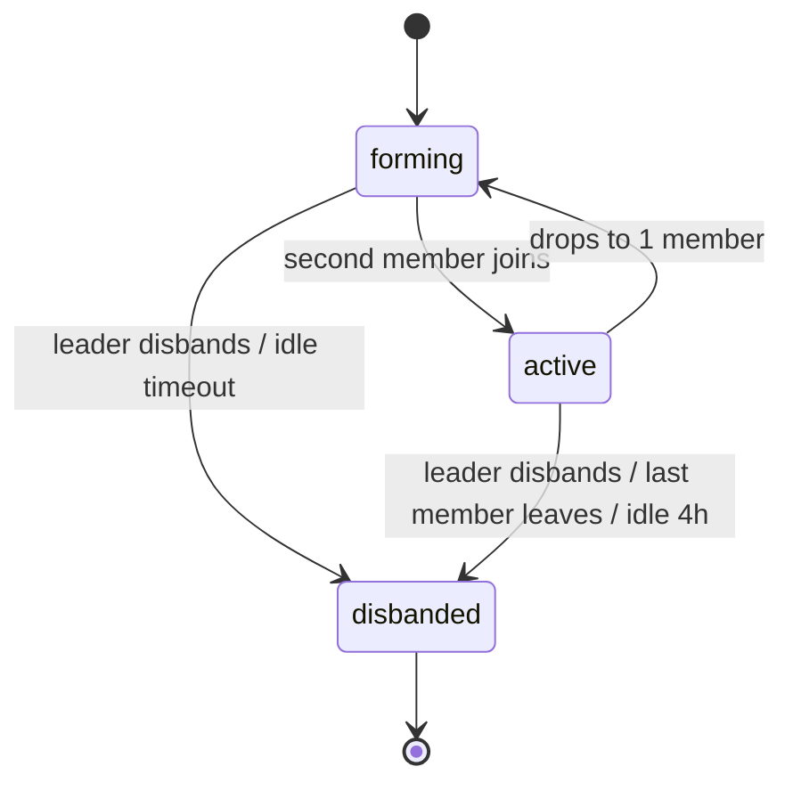
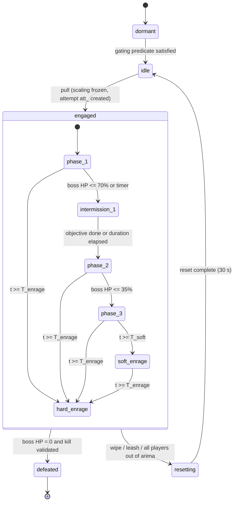

# Legends of the Shattered Frontier — Raid Part 1: Groups, Scaling and Encounters
### Version 1.0 — Expanded Technical Design Authority edition (2026-10-17)

> Status: Design target; not implemented. Names per Shared Registry v1.0.
>
> Entry: [Raid Architecture](../Legends_Shattered_Frontier_Raid_Architecture_v1.0.md) · Registry: [Shared Registry](../Legends_Shattered_Frontier_Shared_Registry_v1.0.md)

This part defines raid size classes and the flexible scaling formula, the four raid difficulties and their tuning deltas, the RaidGroup (`rgp_`), and raid encounter design: phases, intermissions, enrage, the mechanic catalog with server validation, and boss behavior models. Raid encounters run on the **Dungeon spec, Encounter framework**; everything below is an explicit extension of it.

---

## 1. Raid size classes

| `group_size_class` | Reference size `N_ref` | Flex range `normal`–`heroic` | `mythic` | Typical content |
| --- | --- | --- | --- | --- |
| `raid_small` | 10 | 6–10 | not offered at launch | Single-wing "strike" raids, 3–5 bosses, tier-opening and catch-up raids |
| `raid_large` | 20 | 10–25 | fixed 20 | Flagship tier raids, 7–10 bosses in 2–3 wings |

Rules:

1. A raid definition declares exactly one `group_size_class`; it never changes after publish.
2. The RaidGroup may hold up to `RAID_GROUP_MAX` = 25 members regardless of class. Instance entry is capped at the class maximum (10 for `raid_small`; 25 for `raid_large` below mythic; 20 on mythic). Members beyond the cap stay outside ("bench") and may swap in when no encounter is `engaged`.
3. Below the flex minimum, entry is allowed (for trash, travel, and re-entry after disconnects) but scaling uses `N_min` (§2.2), so an undersized group faces minimum-size tuning instead of an easier fight.
4. Mythic (`raid_large`) requires exactly 20 members inside the instance to **pull** a boss (`tune.raid.mythic_size` = 20). Deaths and disconnects after the pull do not change tuning. This is the competitive, fixed-tuning format used for realm-first races (Part 2, Realm firsts).

Tuning keys: `tune.raid.small_ref_size` (10), `tune.raid.large_ref_size` (20), `tune.raid.small_flex_min` (6), `tune.raid.small_flex_max` (10), `tune.raid.large_flex_min` (10), `tune.raid.large_flex_max` (25), `tune.raid.mythic_size` (20).

---

## 2. Flexible scaling

### 2.1 Principles

- **Per-player challenge is constant.** A raid of N players should need about the same per-player output and execution as a raid of `N_ref`. Small groups get a slight discount (less redundancy), large groups a slight premium (more redundancy, more loot rolls).
- **Damage per hit is never scaled by size.** A tank buster or raid-wide pulse deals the same damage to each player at any N. Size scales *quantity* (boss health, add count, target count, pooled damage), never *lethality per player*.
- **Scaling is frozen at engage.** `instance-server` computes all scaled values when the encounter moves `idle → engaged`, using `N_eng`, and never changes them during the attempt.

### 2.2 Variables

| Symbol | Meaning | Default / source |
| --- | --- | --- |
| `N` | Members currently inside the instance, connected, and not in a "released spirit outside" state | runtime |
| `N_eng` | `clamp(N, N_min, N_max)` sampled at engage; on mythic always 20 | runtime |
| `N_ref` | Reference size of the raid's size class | 10 or 20 |
| `N_min`, `N_max` | Flex bounds of the size class | §1 |
| `γ` | Health scaling exponent | `tune.raid.flex_hp_exponent` = 1.05 |
| `H_ref` | Authored boss (or phase-pool) health at `N_ref` for the difficulty | encounter definition, §2.5 |
| `a_ref` | Authored add count per wave at `N_ref` | encounter definition |
| `a_min` | Minimum adds per wave | encounter definition (default 1) |
| `t_ref`, `t_min`, `t_max` | Authored target count for targeted mechanics and its bounds | encounter definition |
| `D_pool_ref` | Authored pooled damage of a split (soak) mechanic at `N_ref` | encounter definition |

### 2.3 Formulas

```text
s            = N_eng / N_ref                                      (size ratio)
hp_mult      = s ^ γ
H            = round(H_ref × hp_mult)                             (boss / phase health pool)
adds         = max(a_min, round(a_ref × s))                       (adds per wave)
add_hp_corr  = (a_ref × s) / adds                                 (per-add health multiplier, corrects rounding)
targets      = clamp(round(t_ref × s), t_min, t_max)              (targeted mechanic victims)
D_pool       = round(D_pool_ref × s)                              (pooled soak damage, split across soakers)
shield       = round(S_ref × hp_mult)                             (boss absorb shields; S_ref authored)
cres_charges = 1 + floor(N_eng / 10)                              (combat resurrections per attempt)
```

`round` is round-half-to-even on integers. Every scaled value is written to the attempt record (`raid_attempt_details.scaling`, Part 3) so analytics and replays can reproduce the fight.

Per-player health share check (authoring lint): `H / N_eng` must stay within ±3% of `H_ref / N_ref` across the whole flex range for `γ` in [1.00, 1.08]; the linter rejects encounter definitions that override `γ` outside that band.

### 2.4 Worked example

`raid_large`, `normal`, `H_ref` = 1,100,000, `a_ref` = 6, `t_ref` = 4 (`t_min` 2, `t_max` 6), `D_pool_ref` = 240,000.

| N_eng | s | hp_mult | H | H per player | adds (corr) | targets | D_pool | cres |
| --- | --- | --- | --- | --- | --- | --- | --- | --- |
| 10 | 0.50 | 0.4830 | 531,265 | 53,126 | 3 (1.000) | 2 | 120,000 | 2 |
| 14 | 0.70 | 0.6876 | 756,390 | 54,028 | 4 (1.050) | 3 | 168,000 | 2 |
| 20 | 1.00 | 1.0000 | 1,100,000 | 55,000 | 6 (1.000) | 4 | 240,000 | 3 |
| 25 | 1.25 | 1.2640 | 1,390,427 | 55,617 | 8 (0.9375) | 5 | 300,000 | 3 |

At 14 players: `0.7^1.05 = e^(1.05 × ln 0.7) = e^(−0.37451) = 0.6876`; `a_ref × s = 4.2` → 4 adds each with ×1.05 health, so total add health equals 4.2 reference adds. Per-player boss health is 1.8% below the reference at 14 and 1.1% above it at 25.

### 2.5 Authoring the reference health (`H_ref`)

Boss health at `N_ref` is derived, not guessed. The raid tuning model uses a **reference DPS curve**, fitted to Combat's canonical `DPS_ref(100, i)` (Combat spec, Reference throughput) and still confirmed by encounter simulation before each tier ships. Resolved (2026-10-17): `D0` 1,500 → 246 and `g` 1.006 → 1.0053 (Combat `DPS_ref`); `H_ref` values shrink ≈ 6.1× (1,500 / 246 = 6.10 at ilvl 420) with `T_target` unchanged.

```text
dps_ref(ilvl) = D0 × g ^ (ilvl − 420)
RaidDPS_ref   = Σ_roles count_r × f_r × dps_ref(ilvl_entry)
H_ref         = round(T_target × RaidDPS_ref × u)
T_enrage      = round(T_target × e_slack)
```

| Symbol | Meaning | Default | Key |
| --- | --- | --- | --- |
| `D0` | Sustained single-target DPS of a damage-role character at ilvl 420 with on-level skills (= Combat `DPS_ref(100, 420)` 245.7, rounded) | 246 | `tune.raid.dps_ref_base` |
| `g` | DPS growth per ilvl (Combat ≈ 0.53 % per epic ilvl) | 1.0053 | `tune.raid.dps_ref_growth` |
| `f_r` | Role DPS factor: `damage` 1.0, `support` 0.7, `tank` 0.5, `healer` 0.35 | — | `tune.raid.role_dps_factor` |
| `count_r` | Reference composition at `N_ref`=20: 2 tank, 4 healer, 2 support, 12 damage (Σ f = 15.8); at 10: 1 / 2 / 1 / 6 (Σ f = 7.9) | — | `tune.raid.reference_composition` |
| `ilvl_entry` | Expected average ilvl of a group entering the difficulty | normal 405, veteran 418, heroic 432, mythic 447 | `tune.raid.entry_ilvl` |
| `T_target` | Intended kill time (s) for an on-gear group | normal 360, veteran 390, heroic 420, mythic 450 | per encounter, default `tune.raid.target_kill_seconds` |
| `u` | Uptime fraction (movement, intermissions excluded from boss damage) | 0.85 / 0.88 / 0.90 / 0.92 | `tune.raid.uptime` |
| `e_slack` | Hard-enrage slack over target kill time | 1.35 / 1.25 / 1.18 / 1.12 | `tune.raid.enrage_slack` |

Worked example (20-player boss, all four difficulties):

| Difficulty | ilvl_entry | dps_ref | RaidDPS_ref | T_target | u | H_ref | ratio vs normal | T_enrage |
| --- | --- | --- | --- | --- | --- | --- | --- | --- |
| normal | 405 | 227.2 | 3,589.8 | 360 | 0.85 | 1.10 M | 1.00 | 486 s |
| veteran | 418 | 243.4 | 3,845.7 | 390 | 0.88 | 1.32 M | 1.20 | 488 s |
| heroic | 432 | 262.1 | 4,141.2 | 420 | 0.90 | 1.57 M | 1.43 | 496 s |
| mythic | 447 | 283.7 | 4,482.5 | 450 | 0.92 | 1.86 M | 1.69 | 504 s |

`dps_ref(405) = 246 × 1.0053^−15 = 246 × 0.9238 = 227.2` (Combat epic 405: 227.7, −0.2 %); `RaidDPS = 15.8 × 227.2 = 3,589.8`; `H_ref = 360 × 3,589.8 × 0.85 = 1,098,467 ≈ 1.10 M`. Veteran: `246 × 1.0053^−2 = 243.4`, `390 × 15.8 × 243.4 × 0.88 = 1,319,851`; heroic: `246 × 1.0053^12 = 262.1`, `420 × 15.8 × 262.1 × 0.90 = 1,565,366`; mythic: `246 × 1.0053^27 = 283.7`, `450 × 15.8 × 283.7 × 0.92 = 1,855,738`. Ratios 1.2015 / 1.4250 / 1.6894 round to 1.20 / 1.43 / 1.69 (were 1.21 / 1.45 / 1.74 with `g` 1.006). The ratio column is the default `tune.raid.difficulty_hp_mult`. For a 10-player boss, Σ f halves, so H_ref halves.

Raid bosses are NPC tier `world_boss` with `npc_armor_class` `heavy` (Combat spec, Creature-tier rule): armor, resistances and attack ratings use the normal level-based NPC values with no tier multiplier on armor or ratings (Resolved (2026-10-17): replaces the former "Tier 4 (20.0×) baseline" wording), and their health is set by `H` from this section (the tier multiplier does not apply to raid boss health). Mitigation and damage formulas are unchanged.

---

## 3. Difficulty tiers and tuning deltas

| Aspect | `normal` | `veteran` | `heroic` | `mythic` |
| --- | --- | --- | --- | --- |
| Audience | All endgame characters; first look at the story | Organized pick-up and casual guild groups | Committed guilds | Top guilds; realm races |
| Size | flex | flex | flex | fixed 20 (`raid_large` only) |
| Loot ilvl (registry power ladder) | 420 | 430 | 445 | 460 |
| Entry ilvl (recommended; enforced only for listings) | 405 | 418 | 432 | 447 |
| Boss health vs normal | 1.00 | 1.20 | 1.43 | 1.69 |
| Boss damage vs normal (`tune.raid.difficulty_dmg_mult`) | 1.00 | 1.20 | 1.45 | 1.75 |
| Mechanic set | core only | core + 1 escalation per phase | core + all escalations | heroic set + mythic-only mechanic(s) + altered phase |
| Failure lethality | most single failures survivable | one failure lethal to the failer | some failures lethal to subgroup | many failures wipe the raid |
| Enrage | hard only | hard only | soft + hard | soft + hard, tighter slack |
| Combat resurrection | `1 + floor(N/10)` | same | same | same (always 3 at 20) |
| Lockout kind (Part 2) | loot | loot | loot (+ optional progress save) | progress + loot |
| Frontier Resolve (catch-up) | yes | yes | yes | no until the next tier releases |
| Attunement (Part 2) | none | none | first-time attunement or account skip | heroic final boss kill (account-wide) |
| Realm first tracked | no | no | final boss only | every boss |
| Pity key multiplier step (Part 2) | 1.0 | 1.0 | 1.0 | 0.8 |

**Escalation** is a deterministic modification of a core mechanic (one more soak, a shorter interval, a debuff that also slows). Every escalation is an authored mechanic entry in the encounter definition with `min_difficulty`. Content linter: each difficulty must add at least one mechanic or escalation over the one below; mythic must contain at least one mechanic that does not exist on heroic.

---

## 4. Raid group (`rgp_`)

### 4.1 Model

A **RaidGroup** is owned by `group-service` (hot state in Redis, durable snapshot in PostgreSQL `group`). It extends the **Dungeon spec, Group service and LFG** party model: same membership invariants (one active group per character; party and raid group are mutually exclusive), larger capacity, subgroups, ranks, loot settings, and a council roster.

| Field | Description |
| --- | --- |
| `raid_group_id` | `rgp_` ULID |
| `realm_id` | Raids are realm-scoped at launch |
| `state` | registered `raid_group_state`: `forming`, `active`, `disbanded` |
| `leader_character_id` | exactly one `leader` |
| `members[]` | ≤ 25; each: `character_id`, `raid_rank`, `subgroup` (1–5), `combat_role`, `joined_at`, `online` |
| `loot_mode` | `personal` (default), `group_need_greed`, `master_loot`, `council` |
| `loot_master_character_id` | required for `master_loot` and `council`; must be `leader` or `assistant` |
| `council_character_ids[]` | 2–4 members for `council` (in addition to the loot master) |
| `loot_threshold_rarity` | items at or above go to the mode; below go `personal` (default `epic`) |
| `target_raid_id`, `target_difficulty` | optional; set by listing or leader |
| `guild_id` | set when ≥ `tune.raid.guild_credit_share` (0.8) of members are in one guild (recomputed on change) |
| `version` | optimistic concurrency counter |

Lifecycle: `forming` (created, < 2 members or no target) → `active` (≥ 2 members) → `disbanded` (leader disbands, last member leaves, or idle 4 h with no instance). A party converts in place to a raid group via `ConvertPartyToRaid` (party ID is closed, members keep order, subgroup 1 = former party). A raid group never converts back to a party.



### 4.2 Subgroups

- Five subgroups of `tune.raid.subgroup_size` = 5. New members fill the lowest subgroup with space.
- Subgroups are the unit of party-scoped effects (Combat spec, leadership/aura effects that say "party" apply to the subgroup) and of subgroup mechanics (`positional_split`, §6).
- Moves and swaps are atomic (`MoveRaidMember` with expected `version`); allowed for `leader` and `assistant`, and blocked while any encounter in the group's run is `engaged` (subgroup-scoped buffs and assignments are frozen at engage).

### 4.3 Ranks and permissions

Proposed enum `raid_rank`: `leader` (exactly 1), `assistant` (0–`tune.raid.assistant_max` = 4), `member`.

| Action | leader | assistant | member |
| --- | --- | --- | --- |
| Invite / accept application | ✓ | ✓ | — |
| Remove member | ✓ | ✓ (members only) | — |
| Promote/demote assistant, transfer leadership | ✓ | — | — |
| Move members between subgroups | ✓ | ✓ | — |
| Start ready check, pull timer, world markers | ✓ | ✓ | — |
| Set target raid/difficulty, create listing | ✓ | ✓ | — |
| Change `loot_mode`, loot master, council roster, threshold | ✓ | — | — |
| Reset instance (non-mythic, no engaged encounter) | ✓ | — | — |
| Extend own mythic/heroic lockout (Part 2) | ✓ (self) | ✓ (self) | ✓ (self) |
| Disband | ✓ | — | — |

Loot-setting guards (anti-ninja, Part 3): loot mode, loot master, and council roster changes are rejected while any encounter is `engaged`, and any change takes effect only after `tune.raid.loot_change_cooldown_seconds` = 60 seconds; kills within that window use the previous settings.

Leadership failover: if the leader is offline for `tune.raid.leader_failover_seconds` = 120, leadership passes to the longest-tenured online assistant, else the longest-tenured online member. Failover never transfers loot-master status; `master_loot`/`council` fall back to `personal` until the new leader sets them.

### 4.4 Ready checks

Ready checks extend the Dungeon spec ready check (same RPC, same event `group.ready_check.completed`) with raid fields.

- Initiated by `leader` or `assistant`; duration `tune.group.ready_check_s` = 30 (Dungeon spec, Groups part, Ready checks); cooldown 10 s.
- Responses (`ready_check_response`): `ready`, `not_ready`, `no_response` (timeout or offline).
- Raid extras recorded per member: `subgroup`, `combat_role`, `in_instance`, `ilvl_equipped` (read from inventory-service snapshot), consumable-buff flags reported by instance-server.
- Result `all_ready` = every in-instance member `ready`. Mythic: a pull is allowed without a ready check (leaders decide), but analytics tracks pulls without a passing ready check in the previous 120 s.

### 4.5 Raid listing board

Group-service exposes realm-wide raid listings (no automated matchmaking for raids at launch): `raid_id`, `difficulty`, `progress` (bosses killed in the leader's current run), role slots wanted, minimum ilvl, voice requirement flag, note (moderated by chat-service filters), expiry 2 hours. Applicants see their own lockout conflicts before applying (instance-service `CheckRaidEligibility`).

---

## 5. Encounter design

### 5.1 Framework extension

Raid encounters are encounter definitions (`encounter/<slug>`) run by the Dungeon spec, Encounter framework and its `encounter_state` machine (`dormant`, `idle`, `engaged`, `defeated`, `resetting`). Raid adds:

| Extension | Where | Purpose |
| --- | --- | --- |
| Phase sub-states inside `engaged` | instance-server | Multi-phase bosses and intermissions |
| Scaling freeze at `idle → engaged` | instance-server | §2 |
| Arena seal | instance-server | 5 s after engage, arena entrances close; late joiners cannot enter |
| Enrage controller | instance-server | Soft and hard enrage |
| Mechanic validators | instance-server | Server-authoritative pass/fail per mechanic instance (§6) |
| Kill evidence bundle | instance-server → instance-service | Data required for kill validation (Part 3, Security considerations) |
| Combat-res pool | instance-server | `cres_charges` per attempt |
| Gating predicate | instance-service | Wing/boss gating (Part 2) evaluated before `dormant → idle` |

### 5.2 Encounter state machine with raid phases

`dormant` (gated or not yet reachable) → `idle` (pullable) → `engaged` → `defeated` | `resetting` → `idle`. Inside `engaged`, raid encounters run an authored phase graph.



The diagram shows a typical three-phase boss; the phase graph is data (`phases[]` in the definition, §8). Phase names are free-form per encounter; the canonical `encounter_state` remains `engaged` throughout, and every transition emits `encounter.phase.changed`.

### 5.3 Phases and intermissions

- **Triggers:** `hp_below` (fraction of `H`), `time_elapsed` (seconds since engage or since phase start), `objective` (e.g. all adds dead, all conduits intercepted), or `any_of` combinations. A phase may have a `min_duration` to prevent skip by burst (anti-exploit: damage beyond the threshold during `min_duration` is absorbed by a server-side clamp).
- **Intermissions:** the boss is untargetable and does not count toward `T_target` uptime. Each intermission has an objective and a max duration; failing the objective by the max duration triggers its authored penalty (raid-wide damage, a stacking boss buff, or a wipe on mythic).
- **Phase-carried state:** debuff stacks, assignments, and add counts carry across phases only when the definition says so (`carry: [...]`).
- **Health pools:** a phase may use the boss's health (threshold transitions) or its own pool (`H_ref` per phase), each scaled by `hp_mult`.

### 5.4 Enrage

```text
T_soft  = round(T_enrage × soft_fraction)            soft_fraction default 0.85 (heroic), 0.80 (mythic)
soft_dmg_mult(t) = 1 + soft_step × floor((t − T_soft) / soft_interval)    for t ≥ T_soft
hard enrage at T_enrage: boss gains +1000% damage and the authored wipe ability
```

| Key | Default |
| --- | --- |
| `tune.raid.soft_enrage_fraction` | heroic 0.85, mythic 0.80 (none below heroic) |
| `tune.raid.soft_enrage_step` | 0.10 |
| `tune.raid.soft_enrage_interval_seconds` | 10 |

Example (heroic, `T_enrage` 496): `T_soft = 422 s`; at t = 452 s the boss deals ×1.30 damage; at 496 s the hard enrage wipes the raid. Enrage timers are fixed per difficulty and do not scale with N (health already does).

### 5.5 Team mechanics and role coordination

Raid mechanics are designed around four coordination layers, and every encounter must exercise at least three:

1. **Role duties:** tanks (taunt swaps, positioning, add pickup), healers (spot vs raid healing, dispels), support (interrupt rotations, buffs, crowd control), damage (priority targets, burst windows).
2. **Assignments:** server-generated per-attempt assignments (who soaks which orb, which subgroup takes which platform). Assignments are deterministic from the attempt seed and published to clients so raid UIs and leaders can call them; random assignment never selects the same player twice in a row for the same mechanic when avoidable.
3. **Subgroup tasks:** positional splits by subgroup, subgroup soaks, subgroup-scoped debuffs.
4. **Raid-wide execution:** stacks, spreads, movement patterns, burst on a shield.

Role coordination is supported, not enforced: there are no classes, so mechanics key off declared `combat_role` for *assignment* only. A player declared `healer` who is assigned a dispel but has no dispel ability is a raid composition problem, surfaced by the ready check (`missing_capabilities[]`: instance-server lists mechanic capabilities such as `dispel_magic`, `interrupt`, `taunt` that no in-instance member possesses).

### 5.6 Wipes, resets, and leash

- **Wipe:** all `N_eng` players dead, or no living player inside the arena volume for 5 s → attempt outcome `wiped` → encounter `resetting` (boss evades to spawn at full health, adds despawn, arena opens) → `idle` after 30 s.
- **Leash:** if the boss is moved outside its arena volume (+`tune.raid.leash_margin_m` = 5 m), it evades and the attempt ends as `invalidated` with a `security.detection.raised` report (`detector/raid_leash_exploit`, illustrative) — leashing is never a legitimate strategy.
- **Abandon:** if the run closes or all players leave the instance mid-attempt, outcome `abandoned`.
- **Release/resurrection:** released players respawn at the raid's last checkpoint and cannot re-enter a sealed arena until the attempt ends.

---

## 6. Mechanic catalog and server validation

Proposed enum `raid_mechanic_kind`. Each mechanic instance in an attempt gets an `instance_seq` (monotonic per attempt). Validators run on the instance-server tick (30 Hz authority tick per Network spec) and produce one result per mechanic instance: `passed`, or `failed` with attributed `character_id`s, emitting `encounter.mechanic.failed` (batched, Part 3).

| Kind | Description | Scaling with N | Server validation rule | Failure attribution |
| --- | --- | --- | --- | --- |
| `soak` | Pooled damage split among players inside a zone | `D_pool` | At resolve tick, count living players inside zone volume (server positions); damage each = `D_pool / max(1, k)`; fail if `k < required_soakers` | Assigned soakers not inside; if unassigned, all players within 15 m who were not in another soak |
| `spread` | Players must be ≥ r apart | — | At resolve, any pair within r on server positions → both take splash | Each player whose splash hit another |
| `stack` | Damage split among players near target | `D_pool` | Same as soak, centered on target player | Players > r from target who were not assigned elsewhere |
| `interrupt` | A cast must be interrupted | — | Cast completes uninterrupted → fail; interrupts validated by ability cast record and range/LOS server check | Assigned interrupter for that cast index (rotation) |
| `add_priority` | Specific add must die before deadline | `adds`, `add_hp_corr` | Add alive at deadline → fail (penalty applied) | Raid (no individual), recorded with damage-share on add |
| `tank_swap` | Stacking debuff forces taunt swap | — | Tank holds boss with stacks ≥ threshold at next hit → fail | Tank with stacks; co-tank if taunt available and unused |
| `frontal` | Cone/line attack | — | Hit test on server position at resolve | Each player hit who was not the designated target |
| `dispel` | Harmful effect must be removed in time | `targets` | Effect expires naturally or ticks to max → fail | Assigned healer/support; else nearest eligible dispeller |
| `kite` | Player or add must stay ahead of a chaser | — | Chaser reaches target → fail | Kite target |
| `intercept` | Beam/projectile must be blocked by a player | `targets` | Beam path ray-cast from source to destination on server; first player hit counts; none → fail | Assigned interceptor |
| `assignment` | Puzzle: each assigned player must interact with matching object (color/rune) | `targets` | Interaction RPC validated: correct object, in range, in window | Assigned player who used wrong/no object |
| `debuff_pass` | Debuff must move to another player before expiry | `targets` | Transfer occurs by proximity on server; expiry on any player → fail; same player receiving twice in `cooldown` → fail | Holder at expiry |
| `positional_split` | Subgroups must occupy assigned platforms | subgroups used = `min(5, ceil(N/5))` | At resolve, each platform needs ≥ `min_per_platform` of its subgroup; others count as missing | Members of subgroup not on its platform |
| `dps_check` | Break a shield or kill a target within a window | `shield` | Shield/health > 0 at window end → fail (penalty or wipe) | Raid; damage share recorded |

Validation rules common to all mechanics:

1. **Positions are server positions** after movement validation (Security spec, speed envelope). Client-reported hit/miss is ignored.
2. **Resolve ticks are authoritative** and recorded with `server_tick`; latency compensation follows Network spec rewind limits (max 200 ms); there is no compensation for avoidable damage beyond that window.
3. **Immunities:** player immunity effects can negate personal damage but never count as success for raid-wide pass conditions (e.g. an immune player does not complete a soak alone unless the mechanic says `immune_counts: true`).
4. **Deterministic RNG:** target selection uses `PCG32(seed = hash(attempt_id, mechanic_id, instance_seq))`; the seed is stored, making assignments reproducible for disputes and replays.
5. **Failure budget:** analytics uses `encounter.mechanic.failed` to compute failure rates; tuning never reads them live (no dynamic difficulty).

### 6.1 Per-difficulty lethality

| Kind | normal | veteran | heroic | mythic |
| --- | --- | --- | --- | --- |
| `soak` short by one | +25% split damage | +50% | lethal to soakers | raid-wide pulse, likely wipe |
| `interrupt` missed | boss heals 2% | 5% raid damage | 15% raid damage + debuff | wipe |
| `tank_swap` missed | tank takes ×1.5 | ×2.0 | tank dies | tank dies + cleave |
| `dps_check` failed | penalty phase | penalty phase | raid-wide 60% HP | wipe |

---

## 7. Boss behavior models

Raid bosses are NPCs (`npc/<slug>`, AI spec, NPC AI) driven by an encounter script layered on the AI runtime:

| Layer | Model | Owner |
| --- | --- | --- |
| Encounter timeline | Per-phase authored schedule: ability `at` / `every` / `after` events with jitter `±j` s seeded per attempt | Raid (encounter definition) |
| Ability priority | When several abilities are ready, highest priority wins; ties broken by authored order | Raid |
| Target selection | Utility scoring (AI spec, Utility AI): threat rank (Combat spec, Threat & Aggro), distance, role, debuff state, "not targeted last time" | AI runtime, raid-authored weights |
| Movement | Navigation within arena volume; never pathing outside arena (leash) | AI runtime |
| Add behavior | Behavior trees per add `npc/<slug>`; adds inherit attempt seed | AI runtime |
| Threat | Combat spec unchanged (1 damage = 1 threat, healing 0.5, taunt = forced top threat); raids add `threat_reset_on_phase` per phase flag | Combat |

Timeline determinism: given `(content_version, encounter_id, difficulty, N_eng, seed)`, the ability schedule up to the first player-dependent branch is identical. This supports server replays for exploit review and lets PTR tooling simulate fights.

Script safety: encounter scripts are data (JSON), not code. Allowed operations are a closed set (`cast`, `summon`, `move_to`, `set_phase`, `apply_effect`, `assign`, `open_gate`, `emit_mechanic`). New operations require an instance-server release; this keeps content packs free of executable logic (Security spec, content signing).

---

## 8. Encounter definition (content JSON)

Illustrative slugs. Published in content packs by `content-catalog-service`; validated by the raid content linter (Part 4).

```json
{
  "id": "encounter/ashen_citadel_warden",
  "kind": "encounter",
  "raid_id": "raid/ashen_citadel",
  "wing": "outer_bastion",
  "order": 1,
  "boss_npc_id": "npc/ashen_warden",
  "arena": { "volume_id": "ashen_citadel/arena_warden", "seal_after_seconds": 5, "leash_margin_m": 5 },
  "difficulties": {
    "normal":  { "h_ref": 6630000, "t_target": 360, "dmg_mult": 1.00 },
    "veteran": { "h_ref": 8040000, "t_target": 390, "dmg_mult": 1.20 },
    "heroic":  { "h_ref": 9630000, "t_target": 420, "dmg_mult": 1.45 },
    "mythic":  { "h_ref": 11530000, "t_target": 450, "dmg_mult": 1.75 }
  },
  "flex": { "hp_exponent": 1.05 },
  "phases": [
    { "name": "phase_1", "trigger": { "type": "engage" }, "timeline": [
        { "ability": "ability/warden_cinder_slam", "every": 20, "jitter": 1.5, "mechanic": "frontal" },
        { "ability": "ability/warden_brand", "every": 30, "mechanic": "tank_swap", "params": { "stack_threshold": 3 } },
        { "ability": "ability/ember_soak", "at": 25, "every": 40, "mechanic": "soak",
          "params": { "d_pool_ref": 240000, "required_soakers": 4, "radius_m": 4 } }
    ]},
    { "name": "intermission_1", "trigger": { "type": "hp_below", "value": 0.70 }, "boss_targetable": false,
      "max_duration": 45, "objective": { "type": "kill_adds", "adds": { "npc": "npc/cinder_acolyte", "a_ref": 6, "a_min": 2 } },
      "penalty": { "normal": "raid_damage_20pct", "mythic": "wipe" } },
    { "name": "phase_2", "trigger": { "type": "objective_or_timeout" }, "min_duration": 20, "timeline": [
        { "ability": "ability/warden_chain_brand", "every": 25, "mechanic": "debuff_pass",
          "params": { "t_ref": 4, "t_min": 2, "t_max": 6, "expiry": 8 }, "min_difficulty": "veteran" },
        { "ability": "ability/warden_heat_shield", "at": 30, "mechanic": "dps_check",
          "params": { "s_ref": 900000, "window": 12 }, "min_difficulty": "heroic" }
    ]},
    { "name": "phase_3", "trigger": { "type": "hp_below", "value": 0.35 }, "timeline": [
        { "ability": "ability/citadel_collapse", "every": 18, "mechanic": "positional_split",
          "params": { "min_per_platform": 3 }, "min_difficulty": "mythic" }
    ]}
  ],
  "enrage": { "soft": { "heroic": 0.85, "mythic": 0.80 }, "hard_ability": "ability/warden_inferno" },
  "loot_table_by_difficulty": {
    "normal": "loot/ashen_warden_normal", "veteran": "loot/ashen_warden_veteran",
    "heroic": "loot/ashen_warden_heroic", "mythic": "loot/ashen_warden_mythic"
  },
  "reward_bundle_by_difficulty": {
    "normal": "reward/ashen_warden_normal", "veteran": "reward/ashen_warden_veteran",
    "heroic": "reward/ashen_warden_heroic", "mythic": "reward/ashen_warden_mythic"
  },
  "gating": { "requires_defeated": [] },
  "achievements": ["achievement/warden_no_brand_failures"]
}
```

Linter rules (summary; full list Part 4): every phase reachable; every `mechanic` value in `raid_mechanic_kind`; `h_ref` within ±10% of the §2.5 formula unless `tuning_override_reason` is set; at least one mechanic or escalation added per difficulty step; mythic has a mythic-only mechanic; every difficulty has a loot table and reward bundle; `min_duration` present on any phase whose trigger is `hp_below`.
