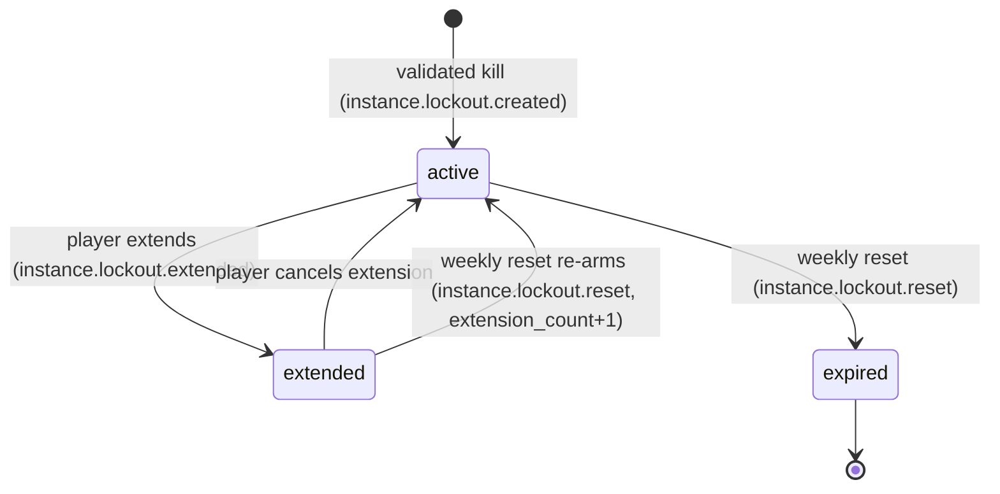
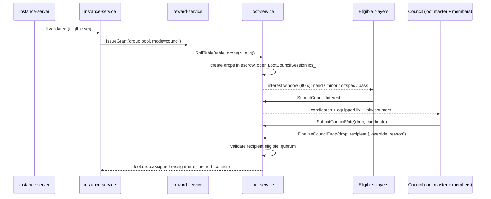
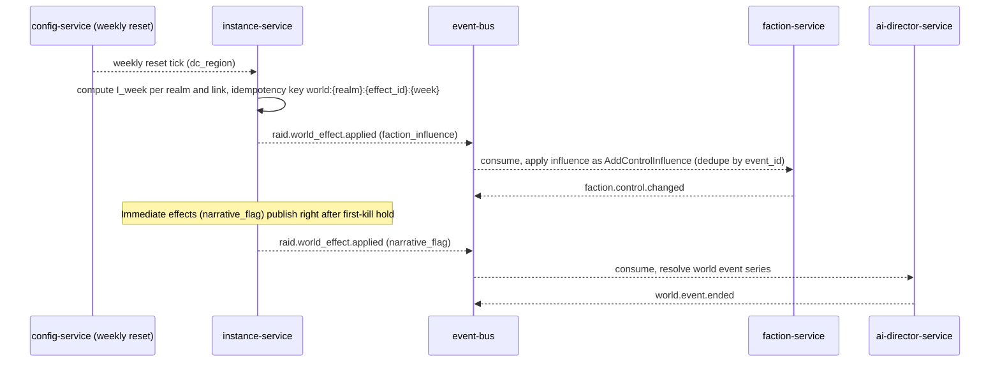

# Legends of the Shattered Frontier — Raid Part 2: Lockouts, Progression, Loot and World
### Version 1.0 — Expanded Technical Design Authority edition (2026-10-17)

> Status: Design target; not implemented. Names per Shared Registry v1.0.
>
> Entry: [Raid Architecture](../Legends_Shattered_Frontier_Raid_Architecture_v1.0.md) · Registry: [Shared Registry](../Legends_Shattered_Frontier_Shared_Registry_v1.0.md)

This part defines the raid lockout policy on top of the **Dungeon spec, Lockout framework**; raid progression (tiers, wings, gating, attunement and skips, realm firsts, catch-up, nerfs, RaidProgress `rpr_`); raid loot assignment; world integration; and economic targets.

---

## 1. Lockout policy

### 1.1 Lockout kinds

The Dungeon spec, Lockout framework provides the `Lockout` entity (`lck_`), its states (`lockout_state`: `active`, `extended`, `expired`), weekly expiry at the datacenter region's weekly reset (Registry, Resets), and the `instance.lockout.*` events. Raids use the registered `lockout_kind` values:

| Kind | Key | Created when | Effect |
| --- | --- | --- | --- |
| `loot` | (`character_id`, `raid_id`, `difficulty`, `encounter_id`) | The character is reward-eligible at a validated kill of that encounter | Character receives no further boss rewards (loot, gold, marks, fragments, pity) from that encounter at that difficulty until reset. They may still participate and count toward scaling. |
| `progress` | (`character_id`, `raid_id`, `difficulty`) + `run_id` | First validated kill of any encounter in a run whose `save_mode` = `progress` (always on mythic; optional on heroic) | Character may only enter that `run_id` at that difficulty until the lockout expires. The run's per-encounter defeated set persists across server teardown. |

A progress lockout never replaces loot lockouts; both are created on a mythic kill. Both are base `instance.lockouts` rows distinguished by the Dungeon framework's `scope_key` column (`encounter_id` for `loot`, `'progress'` for `progress`); the live-lockout unique index is `(character_id, content_id, difficulty, scope_key)`.

### 1.2 Policy by difficulty

| Difficulty | Run model | `loot` lockout | `progress` lockout | Extend |
| --- | --- | --- | --- | --- |
| `normal` | Fresh run per group; any group may be joined any time | per encounter | never | n/a |
| `veteran` | Same as normal | per encounter | never | n/a |
| `heroic` | Fresh run per group by default; leader may create with `save_mode: progress` | per encounter | only in `progress` runs | yes, for progress lockouts |
| `mythic` | Saved run | per encounter | always | yes |

### 1.3 Cross-difficulty rules

1. Loot lockouts are independent per difficulty: in one week a character can be reward-eligible for the same boss once on each of `normal`, `veteran`, `heroic`, and `mythic`.
2. A mythic or heroic progress lockout restricts only runs of that same raid and difficulty.
3. Switching difficulty inside a run is allowed only among `normal`, `veteran`, `heroic`, only by the leader, only when no encounter is `engaged` and the run has no progress lockouts. Defeated state is tracked per (run, difficulty, encounter); switching does not carry kills across difficulties.
4. Runs never switch into or out of `mythic`.
5. Lockouts are per character; an account's other characters are unaffected (account-sharing risk is handled in Part 3, Security considerations).
6. A character who joins a run after an encounter was defeated gets no lockout for that encounter.
7. On a progress-saved run, joining requires either no progress lockout for that (raid, difficulty) or one pointing at this `run_id`. Joining a different saved run is rejected with `RAID_PROGRESS_LOCKED`.

### 1.4 Save and extend

- **Save:** creating a progress lockout ("saving" the character) happens automatically on first eligible kill in a progress run. A confirmation dialog is shown on entry to a progress run whose defeated set is non-empty ("You will be saved to this raid with N/8 bosses defeated").
- **Extend:** a character with an `active` progress lockout may set it to `extended` any time before reset (`ExtendRaidLockout`). At reset:
  - `extended` → `active` with `expires_at` = next weekly reset, same `run_id`; the run's defeated set is kept, so remaining bosses are still available and previously defeated ones stay dead. Loot lockouts expire as normal, but bosses already dead in the run cannot be re-killed, so extension trades loot for progression time.
  - `active` → `expired`; the character can join any run next week.
- Extension count: `tune.raid.max_consecutive_extensions` = 3. A run whose members all let their progress lockouts expire is reset (defeated set cleared) and closed (`instance_run_state` `closed`).
- Un-extend: allowed until reset (`extended` → `active`).



`loot` lockouts use only `active` → `expired`.

### 1.5 Eligibility check (normative)

A character `c` is **reward-eligible** for encounter `e` at difficulty `d` in run `r` at kill time if all hold:

1. `c` was inside the instance at engage and at kill (or died during the attempt inside the sealed arena);
2. `c` was a RaidGroup member at engage and at kill;
3. no `active`/`extended` `loot` lockout exists for (`c`, raid, `d`, `e`);
4. for progress runs: `c`'s progress lockout for (raid, `d`) is absent or points at `r`;
5. `c` has not been flagged ineligible by the kill validator (AFK detection: zero ability casts and zero movement for the last 60% of the attempt → ineligible, Part 3).

Loot lockouts are written in the same transaction as the attempt result for exactly the eligible set, before any reward call. Rewards are then requested with idempotency key `raidkill:{attempt_id}:{character_id}`.

---

## 2. Raid progression

### 2.1 Tier structure

A **raid tier** is the unit of raid progression. It spans two seasons (≈ 24 weeks, `tune.raid.tier_length_weeks`) and contains:

| Component | Example (illustrative) |
| --- | --- |
| One flagship `raid_large` | `raid/ashen_citadel`, 8 bosses in 3 wings (Outer Bastion 3, Ember Halls 3, Throne of Cinders 2) in `corrupted_frontier` |
| Optionally one `raid_small` strike raid | `raid/frostfang_hollow`, 4 bosses in 1 wing in `frozen_north` |
| One tier set | `item_set/ashen_citadel_regalia` — 5 pieces (`head`, `shoulders`, `chest`, `hands`, `legs`) |
| One legendary path stage | `legendary_path/ashbringer_reforged` raid stage (Itemization spec, Legendary paths) |
| Achievements | per-boss "no failure" feats, "Ahead of the Curve" (heroic final boss), "Cutting Edge" (mythic final boss before next tier) |
| World links | faction/region effects (§4) |

The raid definition holds the wing graph:

```json
{
  "id": "raid/ashen_citadel",
  "kind": "raid",
  "group_size_class": "raid_large",
  "tier": 1,
  "biome": "corrupted_frontier",
  "difficulties": ["normal", "veteran", "heroic", "mythic"],
  "wings": [
    { "id": "outer_bastion", "encounters": ["encounter/ashen_citadel_warden", "encounter/ashen_citadel_twin_forges", "encounter/ashen_citadel_gatekeeper"] },
    { "id": "ember_halls", "requires_wing": "outer_bastion", "encounters": ["encounter/ashen_citadel_choir", "encounter/ashen_citadel_brood", "encounter/ashen_citadel_alchemist"] },
    { "id": "throne_of_cinders", "requires_wing": "ember_halls", "encounters": ["encounter/ashen_citadel_regent", "encounter/ashen_citadel_cinder_king"] }
  ],
  "attunement": { "heroic": "quest_chain/ashen_citadel_attunement", "mythic": { "account_kill": { "encounter": "encounter/ashen_citadel_cinder_king", "difficulty": "heroic" } } },
  "tier_set": "item_set/ashen_citadel_regalia",
  "token_slots_by_encounter": {
    "encounter/ashen_citadel_twin_forges": "head", "encounter/ashen_citadel_gatekeeper": "shoulders",
    "encounter/ashen_citadel_choir": "chest", "encounter/ashen_citadel_brood": "hands",
    "encounter/ashen_citadel_alchemist": "legs", "encounter/ashen_citadel_cinder_king": "any"
  },
  "world_links": "see §4.2"
}
```

### 2.2 Release schedule (relative tier weeks)

| Tier week | normal / veteran | heroic | mythic |
| --- | --- | --- | --- |
| 0 | wing 1 | all wings | — |
| 1 | wing 2 | all | all wings |
| 2 | wing 3 | all | all |
| 8 | — | token conversion opens (§3.4) | — |
| 10 | Frontier Resolve begins (§2.6) | same | — |
| 12 | heroic attunement removed (`tune.raid.attunement_removed_week`) | — | — |
| next tier week 0 | — | — | Frontier Resolve at cap; mythic realm-first tracking closed |

LiveOps schedules the absolute dates (LiveOps spec, Event calendar); this table is the policy. Wing release is enforced by `ff.raid.<raid_slug>_wing_<n>` flags read by instance-service gating.

### 2.3 Wing and boss gating

Gating is a predicate evaluated by instance-service when the run is provisioned and after every kill; it drives the Dungeon encounter framework's `dormant → idle` transition.

```text
available(e, run, d) =
     wing_released(wing(e), d)
 AND wing_unlocked(wing(e), run, d)
 AND order_ok(e, run, d)

wing_unlocked(w, run, d) = requires_wing(w) is null
     OR last_encounter(requires_wing(w)) ∈ defeated(run, d)
     OR skip_unlocked(account, raid, d)

order_ok(e, run, d) =
     d ∈ {normal, veteran}: e is the wing's first encounter OR first(wing(e)) ∈ defeated(run, d)
     d ∈ {heroic, mythic}:  every earlier encounter in wing(e) ∈ defeated(run, d)
```

**Skip:** when any character on an account defeats the raid's final encounter at difficulty `d`, reward-service grants the account-wide unlock `raid_skip:<raid_slug>:<d>` (Character spec, Account-wide unlocks). `skip_unlocked(account, raid, d)` is true if the run **leader's** account holds the unlock for `d` or a higher difficulty. Skip opens later wings; it never marks bosses defeated.

### 2.4 Attunement

| Difficulty | Requirement | Removal |
| --- | --- | --- |
| normal, veteran | none (Character Level 100) | — |
| heroic | completion of the raid's attunement quest chain (Quest spec, quest type `raid`) by the character, or account unlock `raid_attuned:<raid_slug>` from any character | tier week 12 |
| mythic | account has defeated the final encounter on heroic this tier (`raid_skip:<raid_slug>:heroic`) | never during the tier |

Attunement is checked at instance entry (`CheckRaidEligibility`) and again at engage for late joiners.

### 2.5 Realm firsts

Tracked for every mythic encounter and the heroic final encounter (`ff.raid.realm_first_enabled`).

- **Scope:** per realm and per datacenter region (`scope`: `realm`, `dc_region`). Mythic realm-first tracking closes when the next tier releases.
- **Ordering:** by the server `ended_at` of the defeating attempt; ties broken by the `att_` ULID.
- **Hold:** a candidate first kill is held `tune.raid.first_kill_hold_seconds` = 900 while automated kill validation runs (Part 3, Security considerations). If no invalidation occurs, instance-service writes `raid_first_kills` and publishes `raid.progress.first_kill_recorded`.
- **Credit:** to the guild when the run's RaidGroup has `guild_id` at engage (≥ 80% of `N_eng` in one guild; mythic: ≥ 16 of 20), otherwise to the RaidGroup. Roster (character IDs) is stored.
- **Rewards:** feat-of-strength achievement and title (`title/realm_first_<raid_slug>`, illustrative) granted via reward-service to the roster.
- **Revocation:** if the attempt is later `invalidated`, the record is revoked through registered event `raid.first_kill.revoked`, titles are revoked through reward-service (`reward.grant.revoked`), and the next valid kill is promoted and published.
- **Pre-nerf marker:** the record stores `tuning_version`; leaderboards show whether the kill preceded a nerf (§2.7).

### 2.6 Catch-up: Frontier Resolve

An in-instance buff applied to all players inside the raid on `normal`, `veteran`, `heroic`, increasing health, damage done, and healing done by `R(w)`.

```text
R(w) = 0                                                    if w < w_start
R(w) = min(R_cap, R_step × (1 + floor((w − w_start) / w_int)))   otherwise
```

| Symbol | Meaning | Default | Key |
| --- | --- | --- | --- |
| `w` | Tier week (0 = tier release) | — | from LiveOps tier calendar |
| `w_start` | First week with buff | 10 | `tune.raid.resolve_start_week` |
| `w_int` | Weeks per step | 3 | `tune.raid.resolve_interval_weeks` |
| `R_step` | Increase per step | 0.05 | `tune.raid.resolve_step` |
| `R_cap` | Maximum | 0.30 | `tune.raid.resolve_cap` |

Worked example: w = 9 → 0; w = 10 → 5%; w = 12 → 5%; w = 13 → 10%; w = 22 → 0.05 × (1 + 4) = 25%; w ≥ 25 → 30%. Mythic receives `R_cap` only once the next tier releases. Leaders may opt out per run (`resolve_opt_out`) for achievement or challenge runs; opting out is recorded on attempts. Frontier Resolve modifies player stats through the Combat spec effect system (a standard multiplicative buff), not by editing boss health, so `H` and kill-time metrics stay comparable.

Other catch-up mechanics: account-wide skip (§2.3), attunement removal (§2.4), token conversion (§3.4), bonus rolls (§3.6).

### 2.7 Nerf schedule

Nerfs are tuning versions published through config-service (`config.tuning.published`) that change `tune.raid.encounter.<encounter_slug>.*` values (health, damage, mechanic parameters).

| Rule | Policy |
| --- | --- |
| Normal/veteran | Hotfix any time if `m_raid_kill_rate_first_week` < 50% of target |
| Heroic | Not before the heroic final boss has a region first in ≥ 2 datacenter regions or tier week 3, whichever first |
| Mythic | Not before the encounter's first `dc_region` first in every region or tier week 6, whichever first; only for bugs or exploit fixes before that |
| Magnitude | Health/damage nerfs in steps of 5–10%; no step > 15% |
| Recording | Every attempt stores `tuning_version`; realm-first records show pre/post-nerf |
| Communication | LiveOps announcement (`liveops.announcement.published`) ≥ 24 h before planned nerfs; hotfixes for exploits are immediate |

### 2.8 Guild raid progress records (`rpr_`)

RaidProgress summarizes a team's progress on one raid and difficulty within a tier. Owner is a guild (`gld_`) if the kill was guild-credited (§2.5 rule), otherwise the RaidGroup (`rgp_`). One record per (owner, raid, difficulty, tier).

| Field | Description |
| --- | --- |
| `raid_progress_id` | `rpr_` |
| `owner_kind`, `owner_id` | `guild`/`raid_group`, `gld_`/`rgp_` |
| `realm_id`, `raid_id`, `difficulty`, `tier` | key |
| `encounters[]` | per encounter: `first_kill_at`, `first_kill_attempt_id`, `kill_count`, `wipe_count_before_first_kill`, `best_kill_seconds`, `best_kill_attempt_id`, `best_phase_reached` (progress on unkilled bosses: lowest boss HP fraction reached) |
| `bosses_defeated` | count of encounters with a kill this tier (e.g. "5/8") |
| `updated_at`, `version` | concurrency |

Update rules: wipes increment `wipe_count_before_first_kill` until first kill and update `best_phase_reached`; validated kills update kill fields and publish registered `raid.progress.updated`; invalidated attempts are subtracted. Guild records are public (`p0_public`) for leaderboards; RaidGroup-owned records are visible to members only.

---

## 3. Loot

### 3.1 Principles

- All raid loot is rolled by `loot-service` against `loot/<slug>` tables assigned per encounter and difficulty (Itemization spec, Loot tables), triggered by `reward-service` grants with source `raid_reward` (items via `loot_drop` provenance as defined by Itemization).
- Only reward-eligible characters (§1.5) contribute to drop counts, receive personal loot, or may receive group-mode assignments.
- Item level per Registry power ladder: `normal` 420, `veteran` 430, `heroic` 445, `mythic` 460; rarity ceiling `epic`. All bosses in a difficulty drop the same ilvl.
- Raid gear binds `on_pickup` with an **eligible-trade window**: tradeable to other reward-eligible characters of the same kill for `LOOT_TRADE_WINDOW` = 120 min (`tune.loot.trade_window_minutes`, Itemization spec, Group loot trade window); instance-service passes the kill's reward-eligible set as `trade_eligible_character_ids` on `IssueGrant`.

### 3.2 Loot modes

| `loot_mode` | Who decides | Drop count | Notes |
| --- | --- | --- | --- |
| `personal` (default) | loot-service per character | each eligible character rolls with `p_eff` (§3.5) | Ideal for pick-up groups |
| `group_need_greed` | players roll | `drops(N_elig)` | Need allowed only if the item's slot is equippable and the character does not already own that item definition at ≥ that ilvl |
| `master_loot` | loot master | `drops(N_elig)` | Assign within 300 s; fallback below |
| `council` | loot master + council vote | `drops(N_elig)` | Raid only; §3.3 |

```text
drops(N_elig) = floor(N_elig × q) + Bernoulli(frac(N_elig × q))       q = tune.raid.group_loot_per_player = 0.20
```

Example: 17 eligible → 3.4 → 3 items plus a 40% chance of a 4th. Personal mode uses `p_base` 0.22 vs group 0.20 because personal drops cannot be routed to the best recipient; expected per-character upgrade value is tuned to match.

**Fallbacks:** if the loot master or council fails to finalize within the window, the item goes to `group_need_greed` among characters who declared interest, else to a uniformly random eligible character. Every assignment emits `loot.drop.assigned`.

### 3.3 Council loot

Council requires `ff.raid.council_loot_enabled`, a loot master, and 2–4 council members, all set at least 60 s before engage (Part 1, Ranks and permissions).



Rules:

1. **Quorum:** finalize requires the loot master plus ≥ 1 council vote for the same recipient, or a loot-master override with a non-empty `override_reason` (audited, counted in `m_raid_council_override_rate`).
2. Recipient must be reward-eligible for this kill; council members may vote for themselves, but self-assignment by the loot master requires ≥ 1 other council vote (no override).
3. Window: `tune.raid.council_window_seconds` = 300 after the interest window.
4. Council data visible to council: declared interest, equipped ilvl in slot, pity counter, items received this tier from this raid. Players see the final assignment and, after finalize, the vote tally (transparency reduces disputes).
5. Session state lives in loot-service (LootCouncilSession `lcs_`, table `loot.council_sessions`; Itemization spec, Group loot modes, `council`).

### 3.4 Tier tokens and conversion

- Token items (`item_category` `token`) per slot and difficulty, e.g. `item/ashen_conqueror_head_token` (illustrative). Redeemed at the raid quartermaster for the `item_set` piece in the character's chosen armor weight, at the token's difficulty ilvl.
- Token bosses and slots from `token_slots_by_encounter` (§2.1). On a token boss, a dropped item is a token with probability `tune.raid.token_share` = 0.30; the final boss (`any`) 0.50 with a uniformly random slot.
- **Conversion:** from tier week 8 (`tune.raid.conversion_start_week`), once per week per character, one raid item of difficulty `d` from this tier converts into the set piece of a chosen missing slot at `d` (Itemization spec owns the operation: inventory-service `ConvertTierItem`, sink `tier_conversion_input`, source `tier_conversion_output`; Item model part, Raid tier-set conversion).

### 3.5 Bad-luck protection (pity)

Uses loot-service pity counters (Itemization spec, Pity). Raid configures:

| Setting | Value |
| --- | --- |
| `pity_key` | `raid:<raid_slug>:<difficulty>` (per character) |
| Increment | +1 per reward-eligible kill on which the character received no item |
| Reset | on receiving any item from that raid and difficulty |
| Personal mode | `p_eff = min(p_cap, p_base + pity × p_step × m_d)` |
| Group modes | when `pity ≥ T_pity`, the character receives one extra personal drop on the kill (outside `drops(N)`), counter resets, `loot.pity.triggered` |

| Key | Default |
| --- | --- |
| `tune.raid.personal_loot_chance` (`p_base`) | 0.22 |
| `tune.raid.pity_step` (`p_step`) | 0.04 |
| `tune.raid.pity_cap` (`p_cap`) | 0.60 |
| `tune.raid.pity_difficulty_mult` (`m_d`) | 1.0, mythic 0.8 |
| `tune.raid.pity_group_threshold` (`T_pity`) | 8 |

Worked example (heroic, personal): after 5 dry kills, `p_eff = 0.22 + 5 × 0.04 × 1.0 = 0.42`; after 10 dry kills, `min(0.60, 0.62) = 0.60`. Mythic after 5: `0.22 + 5 × 0.04 × 0.8 = 0.38`.

### 3.6 Bonus rolls

Before or during an attempt, a character may commit `tune.raid.bonus_roll_cost` = 250 `currency/frontier_marks` (registered sink `raid_bonus_roll`) to one boss per difficulty per week. On a reward-eligible kill the character gets an extra personal roll at `p_base` (pity applies and updates). On a wipe, marks are not spent (commitment is released). Limited to `tune.raid.bonus_rolls_per_week` = 2. The weekly marks cap bounds total bonus-roll volume.

### 3.7 Legendary components

Raids feed legendary paths with fragments granted by reward bundles (not loot rolls — deterministic):

| Difficulty | Fragments per non-final boss | Final boss | Full-clear week (8 bosses) |
| --- | --- | --- | --- |
| normal | 0 | 0 | 0 |
| veteran | 1 | 2 | 9 |
| heroic | 2 | 4 | 18 |
| mythic | 3 | 6 | 27 |

Example item `item/ashen_core_fragment` (illustrative), binding `on_pickup`, stored as progress in LegendaryProgress (`lgp_`) by inventory-service. The raid stage of `legendary_path/ashbringer_reforged` requires `tune.raid.legendary_fragments_required` = 200 fragments plus a heroic-or-higher kill of the final boss. Pace: heroic 200/18 ≈ 11.1 weeks; mythic ≈ 7.4 weeks; veteran ≈ 22.2 weeks. Fragments respect loot lockouts (one grant per boss per difficulty per week). Stage advancement is published by inventory-service (`item.legendary.stage_advanced`).

---

## 4. World integration

### 4.1 Effect model

Raid outcomes produce **world effects** that other services apply. Instance-service computes and publishes them; it never writes faction or world state.

| Effect type | Trigger | Consumer | Result |
| --- | --- | --- | --- |
| `faction_influence` | Weekly realm influence (§4.3) at weekly reset | faction-service | Influence points toward FactionControl of linked `world_region`, applied through the registered `faction-service.AddControlInfluence` contract (AI spec, Faction AI) |
| `narrative_flag` | First validated kill of the final encounter on a realm at any difficulty | ai-director-service, quest-service | Sets the realm-scoped flag (keyed by `realm_id` + flag name, e.g. `ashen_citadel.cinder_king_fallen`); consumers query `GetNarrativeFlags` and absent flags evaluate false |
| `world_event_trigger` | Narrative flag set, or heroic realm first | ai-director-service | Ends or starts world event series (e.g. stop `world_event/ashen_incursion`, start aftermath events) |
| `regional_buff` | ≥ `buff_kill_threshold` heroic+ final-boss kills on the realm in a week | zone-server via config-service | Region-wide buff for 7 days (e.g. +5% gathering yield in the linked region) |
| `vendor_unlock` | Narrative flag | world hub NPCs (content) | Hub vendor stock unlock |

### 4.2 Raid world links (content)

```json
{
  "raid_id": "raid/ashen_citadel",
  "world_links": [
    { "effect_id": "ashen_influence", "type": "faction_influence", "faction_id": "faction/greenhold_wardens",
      "world_region_id": "world_region/corrupted_frontier_ashlands", "k": 4.0, "i0": 20, "cap": 15 },
    { "effect_id": "king_fallen", "type": "narrative_flag", "flag": "ashen_citadel.cinder_king_fallen",
      "trigger": { "encounter": "encounter/ashen_citadel_cinder_king", "min_difficulty": "normal", "first_on_realm": true } },
    { "effect_id": "incursion_end", "type": "world_event_trigger", "world_event_id": "world_event/ashen_incursion",
      "action": "resolve_series", "trigger": { "flag": "ashen_citadel.cinder_king_fallen" } },
    { "effect_id": "ashlands_respite", "type": "regional_buff", "buff_id": "effect/ashlands_respite", "duration_days": 7,
      "trigger": { "encounter": "encounter/ashen_citadel_cinder_king", "min_difficulty": "heroic", "weekly_kills_on_realm": 3 } }
  ]
}
```

### 4.3 Weekly influence formula

```text
I_week(realm) = Σ over validated kills k on the realm this week:  w_diff(k) × w_boss(k)
influence     = min(cap, k_inf × ln(1 + I_week / I0))              rounded to 2 decimals
```

| Symbol | Default | Key |
| --- | --- | --- |
| `w_diff` | normal 1.0, veteran 1.5, heroic 2.5, mythic 4.0 | `tune.raid.world_diff_weight` |
| `w_boss` | final encounter 3.0, others 1.0 | `tune.raid.world_boss_weight` |
| `k_inf` | 4.0 | per link `k` |
| `I0` | 20 | per link `i0` |
| `cap` | 15 influence points / week | per link `cap` |

Kills are counted once per kill (per run), not per character. Worked example: a realm records 30 normal kills (10 of them final boss), 12 heroic kills (3 final), 2 mythic non-final kills. `I = (20×1 + 10×3)×1.0 + (9×1 + 3×3)×2.5 + 2×4.0 = 50 + 45 + 8 = 103`. `influence = 4 × ln(1 + 103/20) = 4 × ln(6.15) = 4 × 1.8165 = 7.27`. The log keeps high-population realms from saturating control; the cap bounds weekly swings. Faction-service decides how influence points map to control (AI spec).

### 4.4 Application flow



Effects are published only for validated kills, after the first-kill hold where applicable. If a kill is invalidated after an effect was published, instance-service publishes a compensating `raid.world_effect.applied` with `reversal_of` set (narrative flags are not reverted if another valid kill exists).

---

## 5. Economic targets

### 5.1 Faucets per boss kill (per reward-eligible character)

Using the Registry shared reward scaling functions at L = 100 (`gold_reward(100, 1)` = 101,504 copper ≈ 10.15 gold).

| Difficulty | gold weight `w_g` | gold per boss | marks weight `w_m` | marks per boss | Full clear (8 bosses) gold / marks |
| --- | --- | --- | --- | --- | --- |
| normal | 0.50 | 50,752 c (5.08 g) | 1.0 | 50 | 40.6 g / 400 |
| veteran | 0.75 | 76,128 c (7.61 g) | 1.2 | 60 | 60.9 g / 480 |
| heroic | 1.00 | 101,504 c (10.15 g) | 1.5 | 75 | 81.2 g / 600 |
| mythic | 1.25 | 126,880 c (12.69 g) | 2.0 | 100 | 101.5 g / 800 |

Keys: `tune.raid.gold_weight`, `tune.raid.marks_weight`. Marks are subject to `FRONTIER_MARKS_WEEKLY_CAP` (1,500) across all sources; a heroic full clear supplies 40% of the cap, leaving room for dungeons and quests. Raid weights stay below 5.0 (no LiveOps economy review needed). Gold sinks in raids: repair costs on death (Itemization spec, Durability), consumables bought from vendors, bonus rolls (marks). Target: a progression night (≈ 3 h, ~25 wipes) costs 30–60 gold in repairs per character, so progression guilds run net-negative gold until farm, then net-positive.

### 5.2 Gear pace targets (full clear, personal loot, with pity)

| Metric | normal | veteran | heroic | mythic |
| --- | --- | --- | --- | --- |
| Expected items per character per full clear (8 bosses, incl. pity, excl. bonus rolls) | 2.0 | 2.0 | 2.0 | 1.9 |
| Weeks to average ilvl ≥ difficulty ilvl − 5 | 6 | 7 | 8 | 10 |
| Weeks to 4-piece tier set, p50 / p90 (with conversion from week 8) | 8 / 9 | 8 / 9 | 8 / 9 | 9 / 10 |
| Weeks to 5-piece tier set, p50 / p90 | 9 / 10 | 9 / 10 | 9 / 10 | 10 / 11 |
| Without conversion (reference), 4-piece / 5-piece p50 | 10 / 17 | 10 / 17 | 10 / 17 | 11 / 19 |
| Weeks to legendary raid stage | — | 22.2 | 11.1 | 7.4 |

The tier-set rows come from a Monte Carlo of the token model (§3.4) with personal-loot pity (§3.5): 5 token bosses at token share 0.30, final boss 0.50 random slot, one conversion per week from week 8. They must be re-validated by Analytics against `m_raid_tier_set_weeks` after each tier.

### 5.3 Participation and difficulty distribution targets (end of tier week 8)

| Metric | Target |
| --- | --- |
| Share of level-100 weekly actives with ≥ 1 raid kill per week | 45–60% |
| Share of raid kills by difficulty (normal / veteran / heroic / mythic) | 45% / 30% / 20% / 5% |
| Guilds with heroic final boss kill | 15–25% of raiding guilds |
| Guilds with mythic final boss kill before next tier | 1–3% of raiding guilds |
| Median attempts to first kill, heroic final boss | 40–80 |
| Median attempts to first kill, mythic final boss | 200–400 |
| Average flex size on `raid_large` normal/veteran | 14–20 |
