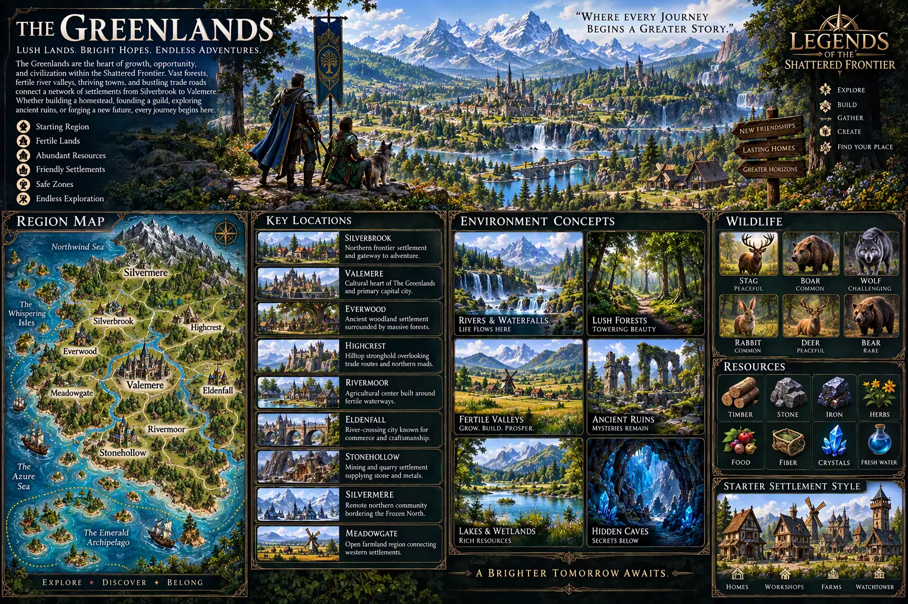
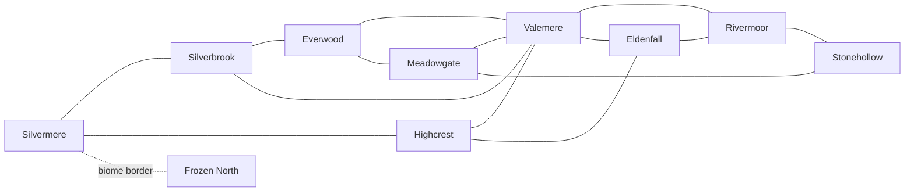

# Legends of the Shattered Frontier — Region: The Greenlands
### Version 0.1 — Region definition (2026-10-19)

This is the first region definition written to the [Zone Definition Standard](../World-Simulation/Legends_Shattered_Frontier_World_Zone_Definition_Standard_v0.1.md). Fields and limits come from the [World Simulation Architecture](../Legends_Shattered_Frontier_World_Simulation_Architecture_v1.0.md). Items marked **proposed** are design choices made here that still need confirming after a graybox traversal test.

## 1. Source of truth

[`concept-art/Greenlands-Region-v2.webp`](../concept-art/Greenlands-Region-v2.webp), adopted 2026-10-19, is the source of truth for the Greenlands map, settlement names and locations.

**Superseded:** [`Designer (6).png`](../concept-art/Designer%20(6).png). It is still a valid reference for mood, palette and settlement style, but not for geography or names. These names from it are **retired** and must not be used for new content: Sunmeadow, Greenhollow, Stonebridge, Emerald Fields, Whisperwood Forest, Clearwater Lake, Clearwater Falls.

**Illustrative names in other specs.** Slugs such as `greenhold_*` and `greenlands_south` in the AI, Economy and Registry examples are illustrative only, per the Shared Registry. New content uses the names in this document.

## 2. Identity

| Item | Value |
| --- | --- |
| Region id | `world_region/greenlands` (**proposed**: one region for the whole mainland; see open decision 2) |
| Biome | `greenlands` (Registry canonical) |
| Continent | `continent/shattered_mainland` (Registry example; confirm when continents are defined) |
| Role | The starting region. The heart of growth, opportunity and civilization in the Shattered Frontier. |
| Tagline | "Where every journey begins a greater story." |
| Pillars | Starting region, fertile lands, abundant resources, friendly settlements, safe zones, endless exploration |
| Player verbs | Explore, build, gather, create, find your place |
| Tone | Lush, bright and welcoming: vast forests, fertile river valleys, thriving towns and busy trade roads. Danger exists but is readable. |

## 3. Geography (read from the concept map)

- **North:** a snow-capped mountain range along the whole northern edge. The Northwind Sea lies to the north-west.
- **Rivers:** a main river runs from the northern mountains south through the centre of the region to the southern coast, with branches and lakes along it. Waterfalls mark where it drops from the highlands.
- **West and south coasts:** the Whispering Isles lie off the west coast. The Azure Sea lies to the south-west, and the Emerald Archipelago to the south.
- **Roads:** a road network links every mainland settlement, with Valemere at the centre.
- **Neighbouring biome:** the Frozen North lies beyond the northern mountains, reached through Silvermere.

## 4. Key locations

| Settlement | Position on map | Description (concept) | Archetype |
| --- | --- | --- | --- |
| **Silverbrook** | North-west | Northern frontier settlement and gateway to adventure | Starter |
| **Valemere** | Centre, on the main river | Cultural heart of the Greenlands and primary capital city | Hub / capital |
| **Everwood** | West | Ancient woodland settlement surrounded by massive forests | Frontier / wilderness (forest) |
| **Highcrest** | North-east | Hilltop stronghold overlooking trade routes and northern roads | Frontier / wilderness |
| **Rivermoor** | South-east of centre | Agricultural centre built around fertile waterways | Frontier / wilderness (farmland, wetlands) |
| **Eldenfall** | East | River-crossing city known for commerce and craftsmanship | Hub (trade and crafting) |
| **Stonehollow** | South | Mining and quarry settlement supplying stone and metals | Resource |
| **Silvermere** | Far north, under the mountains | Remote northern community bordering the Frozen North | Border |
| **Meadowgate** | South-west | Open farmland connecting the western settlements | Frontier / wilderness (farmland) |

**Starting point (confirmed 2026-10-19):** Silverbrook is the starting zone. The concept copy describes the settlements as running "from Silverbrook to Valemere" and calls Silverbrook the gateway to adventure.

**Settlement definitions:** [Silverbrook](Legends_Shattered_Frontier_Settlement_Silverbrook_v0.1.md) (districts, landmarks, scale, design board brief). Other settlements get theirs when their zone is planned, per the [Settlement Design Board Standard](../World-Simulation/Legends_Shattered_Frontier_Settlement_Design_Board_Standard_v1.0.md).

## 5. Zone plan

Each mainland settlement anchors one zone of about 2 km × 2 km that includes its surrounding countryside. The islands and seas are future content, because they need sea travel.

| Zone id (proposed) | Anchor | Archetype | Level range (proposed) | Claimable land | Layerable |
| --- | --- | --- | --- | --- | --- |
| `zone/greenlands_silverbrook` | Silverbrook | Starter | 1–8 | Yes (starter plots) | No (claims) |
| `zone/greenlands_meadowgate` | Meadowgate | Frontier | 5–12 | Yes | No |
| `zone/greenlands_everwood` | Everwood | Frontier (forest) | 6–14 | Yes | No |
| `zone/greenlands_valemere` | Valemere | Hub / capital | 1–20 (city: safe) | No | Yes |
| `zone/greenlands_highcrest` | Highcrest | Frontier | 10–18 | Yes | No |
| `zone/greenlands_rivermoor` | Rivermoor | Frontier (farmland) | 8–16 | Yes | No |
| `zone/greenlands_eldenfall` | Eldenfall | Hub (trade) | 12–20 | No | Yes |
| `zone/greenlands_stonehollow` | Stonehollow | Resource | 14–22 | Optional | No if claims |
| `zone/greenlands_silvermere` | Silvermere | Border | 18–25 | Optional | No |

The level ranges are proposals that rise with distance from Silverbrook. They become tuning once combat and progression bands are fixed. `zone_index` values are assigned when each zone's content file is first committed.

**Future zones, out of mainland scope:** the Whispering Isles and the Emerald Archipelago. The Northwind Sea and Azure Sea are not zones.

### Adjacency (proposed, following the concept map's roads)

Borders follow calm terrain between settlements: forest edges, ridgelines and riverbanks away from bridges. No border runs through a settlement or a spawn or event area.

## 6. Shared content

### Environment themes

| Theme (concept) | Where it appears |
| --- | --- |
| Rivers & waterfalls | The main river's highland drops (Silverbrook, Valemere, Highcrest) |
| Lush forests | Everwood most strongly; mixed woodland everywhere |
| Fertile valleys | Meadowgate and Rivermoor farmland, with windmills |
| Ancient ruins | Points of interest in every frontier zone |
| Lakes & wetlands | Rivermoor and the river lakes |
| Hidden caves | Stonehollow and Highcrest. Crystal caves are candidates for instance entrances. |

### Wildlife (concept threat labels)

| Species | Concept label | Spawn notes |
| --- | --- | --- |
| Stag | Peaceful | All zones |
| Deer | Peaceful | All zones |
| Rabbit | Common | All zones, densest in farmland |
| Boar | Common | Forest and farmland edges; good starter enemy for Silverbrook |
| Wolf | Challenging | Forest and northern zones, in packs; not in Silverbrook's arrival area |
| Bear | Rare | Everwood, Highcrest, Silvermere. Rare spawns use `primary_only` (layer 0). |

### Resources

| Resource (concept) | Gathering skill | Where |
| --- | --- | --- |
| Timber | Logging | All zones; old growth in Everwood |
| Stone | Mining | All zones; quarries in Stonehollow |
| Iron | Mining | Stonehollow, Highcrest |
| Herbs | Herbalism | Forests and meadows |
| Food | Farming, Hunting, Fishing | Farmland, wildlife, rivers |
| Fiber | Farming, Herbalism | Farmland and wetlands |
| Crystals | Mining (higher tiers) | Hidden caves in Stonehollow and Highcrest |
| Fresh water | Not yet a gathering skill | Rivers, lakes and wells (open decision 4) |

Skill names match `ESFGatheringSkill` in the current code (Mining, Logging, Herbalism, Farming, Fishing, Hunting).

### Settlement style

Half-timbered medieval buildings: homes, workshops, farms with windmills, and watchtowers. Valemere and Eldenfall add stone walls, towers and bridges. Starter plots in Silverbrook use the same style at homestead scale.

## 7. Build-out waves

| Wave | Zones | Goal |
| --- | --- | --- |
| **0 — MVP and vertical slice** | Silverbrook | One zone, one server, no handoffs. The slice's six spaces become Silverbrook areas: arrival landmark, settlement beacon, resource route, build plots, enemy clearing, return overlook. |
| **1 — Core loop** | Valemere, Meadowgate, Everwood | First border handoffs, a capital hub and two frontier zones. |
| **2 — Full mainland** | Highcrest, Rivermoor, Eldenfall, Stonehollow, Silvermere | Complete the mainland and open the Frozen North border. |
| **Later** | Whispering Isles, Emerald Archipelago | After a sea-travel route type exists. |

The World Simulation Phase 1 plans 6–8 zones per realm across all biomes. That fits waves 0–1 for the Greenlands plus starting zones elsewhere. Wave 2 belongs with Phase 2 (24 zones).

## 8. Current project state

| Today | Becomes |
| --- | --- |
| `/Game/Frontier/Maps/Greenlands_E1` (graybox, current default map) | The gameplay basis for `zone/greenlands_silverbrook`. It stays a test fixture until the Silverbrook map exists. |
| `/Game/Frontier/Environment/Greenlands/` biome library (renamed from `GreenlandsPreview`, [ENV-01](../../decisions/ENV-01-greenlands-preview-rename.md)) | Shared by every Greenlands zone. |
| `/Game/Frontier/Maps/Test/Greenlands_ArtReview` (was `Greenlands_EnvironmentPreview`) | Stays an art review map. Its arrival and settlement layout is the first art pass for Silverbrook. |
| `GameClient/ArtSource/Greenlands/` (was `GreenlandsPreview`) | Art sources and editor scripts for the biome library. |
| `/Game/Frontier/Maps/Greenlands_ConstructionSandbox` | Stays a test map. |
| No zone or region content data | `content/world/regions/greenlands` and `content/world/zones/greenlands_silverbrook`, per the standard |

Renaming Unreal content must be done inside the editor (move, then fix up redirectors), not with Git. [ENV-01](../../decisions/ENV-01-greenlands-preview-rename.md) records the renames and their order. The environment work's licensed Fab content must be restorable on every build machine before Silverbrook can reach the Production stage.

**Silverbrook maturity today:** Graybox. `/Game/Frontier/Maps/Greenlands/Greenlands_Silverbrook` is generated from the design board layout and passes a main-route traversal; terrain, water and zone size are open ([zone plan](../../greenlands-silverbrook-zone-plan.md)). `Greenlands_E1` stays the movement test fixture, and `Greenlands_ArtReview` is the art reference.

## 9. Open decisions

1. **Region granularity.** One `world_region` for the whole mainland, or several (for example north, centre and south) so factions can control parts of it.
2. **Valemere scale.** A capital city may need more than one zone, or a dense hub with its own capacity settings.
3. **Fresh water.** A gathering resource, a world feature (wells, rivers), or both.
4. **Island access.** Sea routes, ferries or another travel type for the Whispering Isles and the Emerald Archipelago.
