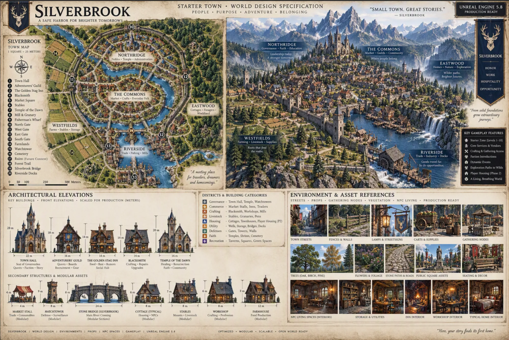

# Legends of the Shattered Frontier — Settlement: Silverbrook
### Version 0.1 — Settlement definition (2026-10-19, design board v1 adopted)

The first settlement definition written to the [Settlement Design Board Standard](../World-Simulation/Legends_Shattered_Frontier_Settlement_Design_Board_Standard_v1.0.md). Silverbrook anchors `zone/greenlands_silverbrook` (Starter) in the [Greenlands region](Legends_Shattered_Frontier_Region_Greenlands_v0.1.md). Zone rules come from the [Zone Definition Standard](../World-Simulation/Legends_Shattered_Frontier_World_Zone_Definition_Standard_v0.1.md). Items marked **proposed** need confirming in a graybox traversal test.

## 1. Role

Silverbrook is the primary starter settlement of the Greenlands and the first major player hub. Players arrive at the edge of the zone, learn the basics on the approach, and reach the town as their first hub.

- **Tagline:** "A safe harbor for brighter tomorrows." The board also uses "Small town. Great stories."
- **Aims:** the town should feel welcoming, memorable, easy to navigate and instantly recognisable. Its layout teaches the core systems through exploration: gathering, crafting, trade, housing and first fights.
- **Values on its banner:** Honor, Work, Hospitality and Opportunity.

## 2. Design board

| Item | Value |
| --- | --- |
| Adopted board | [`concept-art/Silverbrook-Design-Board-v1.webp`](../concept-art/Silverbrook-Design-Board-v1.webp), adopted 2026-10-19 |
| Source | gpt-image generation from the §13 brief; stored at 2000 × 1337 |
| Wins on | Layout intent, district placement, architecture, materials and mood |
| This document wins on | Names, numbers, level range and requirements (§13 lists where the board differs) |

**Standard check:**
- **Present:** sections 1–3 (map, isometric view, elevations). Sections 4 and 5 share the environment and asset reference panel. Development notes appear as the categories panel, the key gameplay features and the callouts.
- **Missing from the board:**
  - Elevation markers.
  - Road names.
  - Board-level metrics: population, NPC density and building count. §5 records them instead.

## 3. Architectural style

- **Style:** high-fantasy medieval realism, grounded and believable.
- **Visual references:** World of Warcraft, New World, The Elder Scrolls Online and The Lord of the Rings, for mood and readability. Do not copy any of them.
- **Materials:** timber, stone foundations, plaster walls and slate roofs. Civic buildings are in dressed stone.
- **Heraldry:** a white stag on navy blue, with gold trim.
- **Banners:** blue and gold, used on gates, the square and building fronts.

This is the Greenlands half-timbered settlement style at town scale.

## 4. Geography

- **River:** the Silverbrook River runs through the town and gives it its name. Waterfalls drop into the valley upstream, to the east and north-east. The river loops through the walled town and leaves past the Riverside docks and mill in the south.
- **Bridges:** the Silverbrook Bridge (key 19) is the main crossing. Smaller bridges link the districts.
- **Surroundings:** rolling hills, pine, oak and birch forests, farmland to the west, woodland to the east, and wildflower meadows. Snow-capped mountains rise to the north.
- **Climate:** temperate, fertile and prosperous.
- **Region position:** the region map places Silverbrook in the north-west of the mainland, with Silvermere to the north, Everwood to the south-west and Valemere to the south-east.
- **Not yet settled:** whether the Silverbrook River is the region's main river or a tributary that joins it below the town (§13, decision 1).

## 5. Scale

The board map is drawn at 1 square = 25 m, with a 500 m scale bar. Measured from that bar, the walled town is about 0.8 km east–west by 1 km north–south (**estimate**).

| Ring | Radius | Meaning |
| --- | --- | --- |
| Walled town | About 400–500 m from the Market Square | Northridge, The Commons and Riverside, inside the wall and four gates |
| Playable radius | 750 m | The town plus Westfields, Eastwood, the farmlands and the first gathering and fighting areas |
| Settlement radius | 1,250 m | The zone's countryside out to its borders. It sets the zone extent at about 2.5 × 2.5 km (**proposed**). |
| Influence radius | 5,000 m | How far Silverbrook's routes, quests and trade reach into neighbouring zones. It places no geometry outside this zone. |

- **Population:** 350–500 residents. This is the in-world population, used for building count and density. The number of NPCs actually spawned is decided when NPCs are placed.
- **Player capacity:** the zone's, 200 soft and 250 hard.
- **Zone extent:** the standard's starting point is about 2 km. The larger 2.5 km extent needs the graybox traversal test to confirm it.

## 6. Districts

Districts are **areas** inside the zone (checklist Z5). The board's five districts replace the seven functional districts in the original brief. Those functions now live inside the districts below.

| District | Where | Board focus | Contains |
| --- | --- | --- | --- |
| **Northridge** | North, inside the wall, on the high ground | Governance, faith, education ("nobles, temple, administration") | Town Hall (1), Temple of the Dawn (7), elite housing, North Gate (10) |
| **The Commons** | Centre, inside the wall, within the river loop | Market, guilds, community ("market, crafts, everyday folk") | Market Square (5), Adventurers' Guild (2), The Golden Stag Inn (3), Blacksmith (4), workshops, townhouses |
| **Riverside** | South, along the river | Trade, industry, docks ("trade, fishing, mills") | Silverbrook Bridge (19), Fisherman's Wharf (9), Riverside Docks (20), Mill & Granary (8), South Gate (13) |
| **Westfields** | West, outside the wall | Farming, livestock, supplies ("farms, stables, storage") | Stables (6), Farmlands (14), granaries, pens, West Gate (11) |
| **Eastwood** | East, outside the wall, toward the woods | Homes, nature, exploration ("cottages, foragers, woodland") | Cottages, foragers, East Gate (12), Forest Trail (18), Ruins (17) |

**Where the original brief's functions now sit:**
- **Town square:** Market Square.
- **Market district:** The Commons.
- **Adventurer district:** the Adventurers' Guild.
- **Crafting district:** the Blacksmith and the Commons workshops.
- **Residential district:** Eastwood and the Commons townhouses.
- **Stable district:** Westfields.
- **Inn district:** The Golden Stag Inn.

**Safety:** the walled town is a protected, no-edit area.

**Player housing:** the board puts it in Phase 2, outside Wave 0. Wave 0's slice build plots are construction plots, placed in Eastwood outside the wall (**proposed**).

## 7. Points of interest

The board's numbered key. Each entry is a `poi` (Z6) or a building in its district.

| # | Name | District | Notes |
| --- | --- | --- | --- |
| 1 | Town Hall | Northridge | Seat of governance; quests, faction introductions and story |
| 2 | Adventurers' Guild | The Commons | Quest boards, recruitment and gear |
| 3 | The Golden Stag Inn | The Commons | Food, rest, rumours and social hub |
| 4 | Blacksmith | The Commons | Crafting, repairs and upgrades |
| 5 | Market Square | The Commons | Central square: statue, banners, stalls and event space |
| 6 | Stables | Westfields | Mounts and livestock |
| 7 | Temple of the Dawn | Northridge | Healing, resurrection, faith and community |
| 8 | Mill & Granary | Riverside | Waterwheel mill |
| 9 | Fisherman's Wharf | Riverside | Fishing |
| 10–13 | North, West, East and South Gates | Wall | Each gate meets a road out of town |
| 14 | Farmlands | Westfields | Several fields |
| 15 | Watchtower | Wall and outskirts | Defence and surveillance. A tower on high ground serves as the slice's return overlook. |
| 16 | Cemetery | Outskirts, south-west | Faith |
| 17 | Ruins (future content) | Eastwood outskirts | Reserved |
| 18 | Forest Trail | Eastwood, north-east | Leads to the wilds |
| 19 | Silverbrook Bridge | Riverside | Main river crossing |
| 20 | Riverside Docks | Riverside | Trade |

**Landmarks:** Town Hall, Temple of the Dawn, Adventurers' Guild, Market Square, Silverbrook Bridge, the Watchtower and the waterfalls. Each must be visible from at least one major road, and at least one must be visible from the arrival point.

## 8. Building reference

Approximate sizes from the board elevations, given as height × width or length in metres.

| Building | Size (m) | Use | Kind |
| --- | --- | --- | --- |
| Town Hall | 28 × 22 | Governance, quests, faction, story | Unique |
| Adventurers' Guild | 18 × 16 | Quests, boards, recruitment, gear | Unique |
| The Golden Stag Inn | 14 × 14 | Food, rest, rumours, social | Unique |
| Blacksmith | 14 × 14 | Crafting, repairs, upgrades | Unique |
| Temple of the Dawn | 20 × 14 | Healing, resurrection, faith | Unique |
| Market stall | 4 × 4 | Trade and consumables | Modular |
| Watchtower | 9 × 8 | Defence and surveillance | Modular |
| Stone bridge | 6 × 24 | Main river crossing | Modular sections |
| Cottage | 6 × 8 | NPC housing | Modular |
| Stables | 7 × 8 | Mounts and livestock | Modular |
| Workshop | 6 × 8 | Crafting and professions | Modular |
| Farmhouse | 7 × 12 | Food production | Modular |

**Building categories:**
- **Governance:** the town hall, temple and watchtowers.
- **Commerce:** market stalls, inns and traders.
- **Crafting:** the blacksmith, workshops and mills.
- **Livestock:** stables, granaries and pens.
- **Housing:** cottages, townhouses and, in phase 2, player housing.
- **Utility:** wells, storage, bridges and docks.
- **Defences:** gates, towers and walls.
- **Faith:** temples, shrines and the cemetery.
- **Recreation:** taverns, squares and green spaces.

**Reuse of current art:** the existing cottage and workshop are measured at 8 × 6 m, which matches the board's typical cottage and workshop. They go into the biome library as the starting modular set.

## 9. Gameplay design rules

- **No minimap needed:** players can find their way using landmarks, roads and signposts alone.
- **One-minute rule:** every important building is within one minute's walk of the Market Square. At the current run speed of 7 m/s (`RunSpeedMetresPerSecond`), that is about 420 m of path. Key buildings in the board layout fit. The gates sit at about 400–500 m, which is about the limit; confirm in graybox. If the run speed changes, recheck this.
- **Supported systems:** core services and vendors, crafting and gathering access, faction introductions, dynamic events, exploration paths to the wilds, guilds, seasonal events and future expansion. Player housing comes in phase 2.

## 10. Roads and walls

| Tier | Surface | Use |
| --- | --- | --- |
| Primary | Paved stone | Market Square to the four gates, and from the gates out to Silvermere (north), Everwood (south-west) and Valemere (south-east) |
| Secondary | Packed earth | Between districts, and out to the farms and docks |
| Rural trails | Natural dirt | The Forest Trail, gathering areas, camps, ruins and the cave |

- **Walls:** a stone wall with towers encloses Northridge, The Commons and Riverside, with four gates. Westfields and Eastwood lie outside it.
- **Roads:** lead players toward gameplay. Every road that reaches the zone border meets a `border_entry` anchor (Z3, Z7).

## 11. Exterior

All of this sits within the 1,250 m settlement radius.

| Content | Placement |
| --- | --- |
| Farms | Westfields Farmlands (14) |
| Gathering areas | Timber, stone, herbs and fibre within the playable radius. The board shows wells and stone-ringed gathering nodes. This is the slice's resource route. |
| Fishing | Fisherman's Wharf and the river banks |
| Boar territories | Forest and farm edges. This is the slice's enemy clearing and the starter combat area. |
| Wolf dens | Beyond the playable radius, in packs, away from the arrival area |
| Bandit camps | Beyond the playable radius, on rural trails |
| Ruins | Ruins (17), reserved for future content |
| Hidden cave and future dungeon entrance | A `dungeon_entrance` point of interest linking to an instance (Z13), reserved |

## 12. Required outputs

Each output feeds a zone checklist row or a board section.

| Output | Zone checklist | Board section |
| --- | --- | --- |
| Settlement and district layout | Z5 | 1, 2 |
| Terrain plan and elevation markers | Z2 | 1 |
| Road network and travel routes | Z3, Z7 | 1, 4 |
| River network | Z7, Z12 | 1 |
| Landmark placement | Z6 | 1, 2 |
| Building footprints | Z5 | 1, 3 |
| Housing and construction plots | Z10 | 1 |
| Future expansion areas | Z10 | 1, 6 |
| NPC activity areas | Z9, Z14 | 6 |
| Resource node placement | Z8 | 1 |

All outputs must be ready to implement in Unreal Engine 5.8.

## 13. Where the board differs, and open decisions

**Where the board differs:**
- **Level range:** the board says levels 1–10, but the region definition sets Silverbrook at 1–8. The region value stands until the level bands are tuned.
- **Great Oak Tree and Central Fountain:** both are required by the original brief but not shown on the board, whose square has a statue. Decide at the next board pass whether the square keeps them.
- **Watchtower:** at 9 m, the tower is barely taller than the houses. A readable overlook needs more height or high ground; confirm in graybox.
- **Eastwood and Everwood:** the district Eastwood and the neighbouring settlement Everwood sound alike. Keep both names only if players are not confused by them.

**Decided (2026-10-19):**
- **North** is Unreal −Y, the top of the board map, and east is +X. This follows the project-wide axis rule in the zone standard.

**Open decisions:**
1. **The river:** whether the Silverbrook River is the main river or a tributary, and where the waterfalls sit relative to the zone border.
2. **Zone extent:** confirm about 2.5 × 2.5 km, or shrink the settlement radius to fit 2 km.
3. **Construction plots:** Eastwood, outside the wall, is the proposed site for Wave 0 plots.
4. **NPC count:** how many NPCs actually spawn, compared with the 350–500 residents.

## 14. Design board brief

This is the brief that produced board v1. Keep it in step with §3–§11 for the next board.

> Create a professional AAA game development design board for Silverbrook, the starter settlement of the Greenlands in Legends of the Shattered Frontier. It must read as a production-ready environment design package for Unreal Engine 5.8 world builders, level designers, environment artists, Blender artists and Pixel3D asset creators.
>
> **Style:** fantasy medieval realism, presented as AAA development documentation: highly readable, technical but beautiful, a source-of-truth production board.
>
> **Canvas:** 3:2 landscape, at the largest size the tool produces.
>
> **Colours:** Greenlands colours, blue, gold, forest green and natural parchment accents.
>
> Divide the board into clearly labelled sections:
>
> 1. **Top-down town map.** The Silverbrook River and its bridges, the wall and four gates, roads, forests, farms, hills and expansion areas. Label the districts Northridge, The Commons, Riverside, Westfields and Eastwood, the numbered points of interest and the road names, and add elevation markers. It should look like a modern MMORPG zone map.
> 2. **Isometric settlement view.** A realistic overview matching the map: districts, the Market Square, the Town Hall, the Temple of the Dawn, the Adventurers' Guild, the stables and the crafting quarter, with the waterfalls and the northern mountains. It should feel alive and believable, at realistic scale.
> 3. **Building reference library.** Front elevations with sizes in metres for the Town Hall, Adventurers' Guild, Golden Stag Inn, Blacksmith, Temple of the Dawn, market stall, watchtower, stone bridge, cottage, stables, workshop and farmhouse. Each is a clean reference for Blender modelling, showing materials and structural details.
> 4. **Gameplay infrastructure.** Roads, bridges, signposts, lamps, wells, fences, barrels, crates, market props and crafting stations, as reusable environment art references.
> 5. **Biome references.** Pine, oak and birch forests, meadows, riverbanks, farmland, wildflowers and local rock formations, with seasonal visual guidance.
> 6. **Development notes.** Callouts for the district functions, population (350–500 residents), level range 1–8, expansion areas, navigation routes, architectural rules and environmental rules.
>
> **Visual references:** World of Warcraft, New World, The Elder Scrolls Online and The Lord of the Rings.
