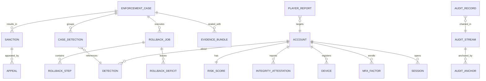

# Legends of the Shattered Frontier — Security Part 3: Audit, Staff Permissions, Operations and Interfaces

Version 1.0 — Expanded Technical Design Authority edition (2026-10-17)

Status: Design target; not implemented. Names per Shared Registry v1.0.

Entry file: [Security and Anti-Cheat Architecture](../Legends_Shattered_Frontier_Security_and_Anti_Cheat_Architecture_v1.0.md) · Registry: [Shared Registry v1.0](../Legends_Shattered_Frontier_Shared_Registry_v1.0.md)

---

## 1. Purpose of this part

Audit trail design, the `admin-portal` staff permission model, incident response runbooks, monitoring and alerts, durable schemas (PostgreSQL DDL), gRPC APIs, event payloads for every Security-owned event, and analytics hooks.

---

## 2. Audit trail

### 2.1 What is audited

`audit-service` records **privileged and economic actions** (Registry, audit-service). Producers call `Append` synchronously **before** performing the action (audit-before-act); if `Append` fails, the action fails closed.

| Stream category | Producers | Examples |
| --- | --- | --- |
| `staff_action` | `admin-portal` via every service's `*Admin` API | GM teleport, item grant (`gm_grant`), character rename, chat log reveal, PII reveal |
| `enforcement` | enforcement-service | case transitions, sanctions, appeal decisions, rollback plans and steps |
| `economy_privileged` | economy-service, inventory-service, reward-service | any `gm_grant`, `liveops_compensation`, `enforcement_rollback`, `enforcement_restore`; single transfers ≥ 10,000,000 copper (`tune.security.audit_value_threshold_copper`) |
| `auth_security` | auth-service | MFA enrol/remove, email/password change, recovery, session revocation by staff, staff logins |
| `config_change` | config-service, liveops-service | flag and tuning changes, kill switches, detector activations |
| `release` | release pipeline, signing service | manifest signing, promotion to `prod`, key rotation |
| `data_access` | DB proxies, warehouse | break-glass DB sessions, warehouse queries on p2/p3 tables |

### 2.2 Record structure and hash chain

Records are partitioned into **streams** `stream_id = <category>:<dc_region>` (e.g. `enforcement:na`) so that each stream is a single strictly ordered chain without global contention.

```text
canonical(r)  = RFC 8785 JSON canonicalization of the record body
                (all fields except seq, prev_hash, record_hash; sensitive fields included as ciphertext)
record_hash_n = SHA-256( prev_hash_n || uint64_be(seq_n) || canonical(r_n) )
prev_hash_n   = record_hash_{n−1};   prev_hash_1 = SHA-256("lsf-audit-genesis:" || stream_id)
```

Because sensitive fields (p2/p3) are hashed **as ciphertext** encrypted with a per-account data key, deleting that key (crypto-shredding for erasure) leaves the chain verifiable.

**Anchoring.** Every 5 minutes (`tune.security.audit_anchor_interval_s` = 300) the anchor job writes, per stream, `{stream_id, seq, record_hash, anchored_at}` to:

1. `audit.anchors` (PostgreSQL), and
2. an object-storage bucket with **object lock in compliance mode**, retention 7 years (WORM), as a file signed with the `audit-service` KMS signing key.

Daily, a Merkle root over all stream heads is signed and stored in a second WORM bucket in a different cloud account (separation of duty: no single operator role can write both).

**Verification.** An hourly job recomputes each stream from the last verified anchor and compares with stored hashes and with the WORM anchor files. Any mismatch fires `ops.alert.fired` (`security_audit_chain_broken`, SEV1) and freezes staff write permissions in `admin-portal` until cleared by two security leads.

### 2.3 Storage rules

* PostgreSQL schema `audit`, table partitioned by month. The service role has `INSERT` and `SELECT` only; a trigger rejects `UPDATE`/`DELETE`/`TRUNCATE` for all roles, including owner (dropping the trigger is itself a DB-audited DDL event shipped off-host).
* Partitions older than 13 months are exported to WORM object storage as signed Parquet with their chain segments and detached.
* Each record emits `audit.record.appended` (metadata only, no sensitive content).

**Worked example.** Stream `enforcement:na`, record 41,207: prev_hash `9f2c…`, body `{"action":"enforcement.sanction.apply","actor":{"type":"staff","ref":"staff:7d…"},"target":{"account_id":"acc_01J…"},"sanction_type":"temporary_suspension","reason_code":"botting","ticket":"CS-88213"}` canonicalized → `record_hash = SHA-256(9f2c… || 0x000000000000A0F7 || canonical)`. If an insider later edits `sanction_type` in the database, record 41,207's recomputed hash differs, and every subsequent `prev_hash` stops matching; the hourly verifier and the WORM anchor for the containing 5-minute window both disagree.

---

## 3. Staff (GM / admin-portal) permission model

### 3.1 Identity

* Staff authenticate to `admin-portal` through corporate SSO with **WebAuthn hardware-backed MFA** only; sessions 8 h max, re-authentication for elevation.
* Staff identities are separate from player accounts. A staff member's own player accounts are registered as **linked accounts**; the policy engine denies any action whose target is linked to the actor (also matched by `device_id_hmac`/`ip_hmac` overlap from the last 90 days).
* `admin-portal` has no database credentials; it calls service `*Admin` APIs with the staff identity propagated in a signed token (actor claims cannot be set by form fields).

### 3.2 Roles and permissions

Permissions are strings `<service>:<resource>:<action>`. Roles (enum `staff_role`: `support_agent`, `game_master`, `senior_game_master`, `enforcement_reviewer`, `enforcement_lead`, `security_analyst`, `economy_analyst`, `liveops_operator`, `liveops_lead`, `store_manager`, `release_manager`, `auditor`, `break_glass_admin`; the LiveOps-facing roles' capabilities are in LiveOps spec, Roles and permissions):

| Permission (examples) | support_agent | game_master | senior_game_master | enforcement_reviewer | enforcement_lead | security_analyst | economy_analyst | liveops_operator | auditor |
| --- | --- | --- | --- | --- | --- | --- | --- | --- | --- |
| `character:profile:read` | ✓ | ✓ | ✓ | ✓ | ✓ | ✓ | ✓ |  |  |
| `character:location:teleport` |  | ✓ | ✓ |  |  |  |  |  |  |
| `inventory:item:grant` (`gm_grant`) |  | JIT ≤ 50,000 c | JIT ≤ 1,000,000 c |  |  |  |  |  |  |
| `inventory:item:restore` |  |  | ✓ |  | ✓ |  |  |  |  |
| `economy:currency:grant` |  |  | JIT ≤ 1,000,000 c |  |  |  | two-person |  |  |
| `chat:log:reveal` |  | ✓ (reason) | ✓ | ✓ | ✓ | ✓ |  |  |  |
| `auth:pii:reveal` | ✓ (ticket) |  |  |  | ✓ | ✓ |  |  |  |
| `enforcement:case:review` |  |  |  | ✓ | ✓ | ✓ |  |  |  |
| `enforcement:sanction:apply` |  | warning, chat_mute | + temporary_suspension ≤ 3 d | ✓ (not permanent_ban) | ✓ |  |  |  |  |
| `enforcement:sanction:approve_ban` |  |  |  |  | ✓ |  |  |  |  |
| `enforcement:rollback:approve` |  |  |  |  | ✓ |  | ✓ (co-sign) |  |  |
| `anticheat:detector:activate` |  |  |  |  | two-person | ✓ (two-person) |  |  |  |
| `world:weather:override` |  | ✓ | ✓ |  |  |  |  | ✓ |  |
| `world:spawn:bounded` |  | ✓ (tier ≤ `elite`) | ✓ (incl. `mini_boss`) |  |  |  |  | ✓ |  |
| `world:terrain:revert` |  |  | ✓ | ✓ (rollback) | ✓ |  |  |  |  |
| `config:flag:change` |  |  |  |  |  |  |  | ✓ |  |
| `audit:record:read` |  |  |  |  | own cases | ✓ |  |  | ✓ |

### 3.3 Policy rules

1. **Least privilege, default deny.** Every RPC on an `*Admin` API declares its permission; the policy engine (embedded library, same rules in every service) evaluates `role ∧ realm_scope ∧ conditions`.
2. **Just-in-time elevation** (`elv_`): grant/rollback/reveal permissions marked JIT require an elevation with reason code + ticket reference, max 4 h, auto-expiring. Elevations are audited.
3. **Two-person rule** for: `permanent_ban`, rollbacks ≥ 10,000,000 copper or ≥ 10 accounts, currency grants ≥ 1,000,000 copper, detector activation with `auto_action`, deny-list changes, staff role grants.
4. **Daily caps** per staff member on `gm_grant` value (role cap × 5 per day); exceeding raises `detector/staff_action_anomaly`.
5. **No self-service:** no staff member can change their own roles, approve their own requests, or act on linked accounts.
6. **Break-glass** (`break_glass_admin`): sealed credentials, two-person retrieval, all actions recorded, SEV2 incident opened automatically.
7. **Quarterly access review**; roles unused for 60 days are revoked automatically.

---

## 4. Incident response

### 4.1 Severity

| SEV | Definition | Response |
| --- | --- | --- |
| SEV1 | Active economy-wide dupe, credential/PII breach, signing key compromise, audit chain broken, multi-realm outage | Page security on-call + incident commander within 5 min; status page; exec notification |
| SEV2 | Single-realm dupe or exploit, credential stuffing wave with confirmed takeovers, staff account compromise, mass false-positive sanctions | Page within 15 min |
| SEV3 | New public cheat with limited spread, bot wave, detector malfunction without sanctions | Business hours, 4 h |
| SEV4 | Single-account issues | Ticket queue |

### 4.2 Runbooks

Each runbook follows **Detect → Contain → Eradicate → Recover → Review**. All containment actions are taken through `admin-portal`/`config-service` (audited), never by direct DB edits.

**RB-IR-1 Live duplication exploit (SEV1/SEV2)**
1. Detect: `detector/item_ledger_mismatch`, `currency_conservation` residual, `reward_rate_outlier` realm alert, player reports.
2. Contain: kill-switch the implicated feature (`ff.<domain>.*`, LiveOps); if the vector is unknown, enable `ff.security.economy_freeze` on the realm (disables trade, market, mail attachments; gameplay continues). Interim restrictions on all holders of tainted items.
3. Eradicate: hotfix with regression test reproducing the race; verify invariants on staging with production-shaped data.
4. Recover: taint trace, rollback saga (Part 2) with two-person approval; restore market; announce.
5. Review: post-incident review within 5 working days; add property test for the race (Part 4).

**RB-IR-2 Credential stuffing wave (SEV2)**
1. Detect: `auth.login.failed` rate per ASN > 5× baseline; `m_login_fail_ratio` > 0.6.
2. Contain: raise edge bot challenge on login; tighten `tune.security.login_rate_subnet`; force step-up for `LR ≥ 30`.
3. Eradicate: block abusive ASNs/IP ranges at edge for 24 h; add leaked credentials to breach check.
4. Recover: identify accounts with successful logins from attacking infrastructure → revoke sessions, force reset, 72 h cooling-off, restore stolen items via restore saga on owner request.
5. Review: MFA adoption campaign if takeover count > 0.01% MAU.

**RB-IR-3 DDoS (SEV1/SEV2)**
1. Detect: edge alerts, zone packet loss > 5%, login queue saturation.
2. Contain: enable edge "under attack" profile for HTTP; rotate relay IPs for affected zones; shed non-critical services.
3. Recover: gradual re-admission via login queue; compensate via LiveOps policy if downtime > 30 min.

**RB-IR-4 Compromised staff account (SEV2, SEV1 if role ≥ enforcement_lead)**
1. Contain: disable SSO identity, revoke elevations and tokens, freeze `admin-portal` writes for that role group.
2. Investigate: pull audit stream by actor; verify chain integrity first.
3. Recover: reverse unauthorized grants (rollback saga), lift unauthorized sanctions, rotate any secrets visible to the role.

**RB-IR-5 Release signing key compromise (SEV1)**
1. Contain: stop release pipeline; revoke key in KMS; publish signed revocation in next manifest using the pinned "next" key (Part 1, Signed manifests).
2. Eradicate: rotate both pinned keys via launcher update signed by the surviving key; audit all releases signed since last known-good time.
3. Recover: force full file validation on next launch (`minimum build` bump).

**RB-IR-6 Mass false-positive sanctions (SEV2)**
1. Detect: appeal rate spike > 3× baseline, overturn rate > 10% for one detector.
2. Contain: set detector to `shadow_mode` (config, two-person); pause pending waves.
3. Recover: bulk relabel detections `false_positive`, lift sanctions, restore saga, compensation, public acknowledgement.

**RB-IR-7 Personal data exposure (SEV1)**
1. Contain: revoke credentials/paths; preserve evidence.
2. Assess: data classes and regions affected (Part 1, Data classification).
3. Notify: legal/regulatory timelines per region (e.g. 72 h where GDPR applies); player notification for p2/p3 exposure.

**RB-IR-8 New public cheat or bot wave (SEV3)**
1. Acquire sample (from public sources only, in an isolated analysis environment); add signature to deny-list (two-person).
2. Run new detector in shadow mode; plan ban wave after ≥ 7 days of evidence to avoid tipping off the vendor.

---

## 5. Monitoring and alerts

Alerts are evaluated by `analytics-pipeline` and published as `ops.alert.fired` on `ops.alerts` (Analytics spec owns alerting implementation).

| Alert | Condition | Severity |
| --- | --- | --- |
| `security_audit_chain_broken` | any verifier mismatch | SEV1 |
| `security_invariant_violation` | any critical invariant detection (INV-1/2/4/8/10) | SEV2 (SEV1 if ≥ 10 accounts or ≥ 100,000,000 copper) |
| `security_reward_outlier_cluster` | ≥ 20 characters with `z ≥ 4` on same content in 1 h | SEV2 |
| `security_login_failure_spike` | failed logins per ASN > 5× 7-day baseline for 10 min | SEV2 |
| `security_ato_spike` | `detector/login_anomaly` detections > 3× baseline in 1 h | SEV2 |
| `security_integrity_fail_spike` | `security.integrity.failed` > 3× baseline in 1 h for one build | SEV3 (possible new cheat or bad build) |
| `security_reject_storm` | `security.action.rejected` rollups per realm > 10× baseline | SEV3 (possible zone desync bug — check before blaming players) |
| `security_detector_silent` | a stream detector produced 0 evaluations in 15 min while its inputs flowed | SEV3 |
| `security_case_backlog` | P1 cases older than 24 h > 0, or P2 older than 72 h > 50 | SEV3 |
| `security_interim_expiring` | interim sanctions within 2 h of auto-lift without review | SEV3 |
| `security_staff_anomaly` | any `detector/staff_action_anomaly` | SEV2 to security lead only |
| `security_mass_sanction_rate` | > 500 sanctions/min or > 3× planned wave size | SEV2; auto-pause sanction API |

---

## 6. Schemas (PostgreSQL)

Schemas per Registry naming: `anticheat`, `enforcement`, `audit`, and the security tables in `auth`. All timestamps `timestamptz`; IDs `text` with prefix check.

### 6.1 Entity relationships



### 6.2 `anticheat`

```sql
CREATE SCHEMA anticheat;

CREATE TABLE anticheat.detections (
  detection_id      text PRIMARY KEY CHECK (detection_id LIKE 'det\_%'),
  detector_id       text NOT NULL CHECK (detector_id LIKE 'detector/%'),
  detector_version  int  NOT NULL,
  category          text NOT NULL,
  account_id        text NOT NULL,
  character_id      text,
  realm_id          text,
  cluster_id        text,
  severity          text NOT NULL CHECK (severity IN ('info','low','medium','high','critical')),
  confidence        numeric(4,3) NOT NULL CHECK (confidence BETWEEN 0 AND 1),
  status            text NOT NULL CHECK (status IN ('shadow','active','confirmed','false_positive','expired')),
  points_initial    numeric(8,2) NOT NULL,          -- c_d at raise time
  features          jsonb NOT NULL,                 -- p1 only
  evidence_ref      text,                           -- object key of sealed raw evidence
  window_start      timestamptz NOT NULL,
  window_end        timestamptz NOT NULL,
  raised_at         timestamptz NOT NULL DEFAULT now(),
  labelled_by       text,
  labelled_at       timestamptz
);
CREATE INDEX ON anticheat.detections (account_id, raised_at DESC);
CREATE INDEX ON anticheat.detections (detector_id, raised_at DESC);

CREATE TABLE anticheat.risk_scores (
  account_id      text PRIMARY KEY,
  score           int NOT NULL CHECK (score BETWEEN 0 AND 1000),
  band            text NOT NULL CHECK (band IN ('normal','watch','elevated','high','severe')),
  floor_value     int NOT NULL DEFAULT 0,
  floor_until     timestamptz,
  computed_at     timestamptz NOT NULL,
  version         bigint NOT NULL DEFAULT 0          -- optimistic concurrency
);

CREATE TABLE anticheat.risk_score_history (
  account_id   text NOT NULL,
  computed_at  timestamptz NOT NULL,
  score        int NOT NULL,
  band         text NOT NULL,
  cause        text NOT NULL,                        -- detection_id or 'decay' or 'relabel'
  PRIMARY KEY (account_id, computed_at)
);

CREATE TABLE anticheat.integrity_attestations (
  attestation_id   text PRIMARY KEY CHECK (attestation_id LIKE 'iat\_%'),
  account_id       text NOT NULL,
  session_id       text NOT NULL,
  client_build     text NOT NULL,
  trigger          text NOT NULL CHECK (trigger IN ('session_start','zone_entry','random')),
  challenge_nonce  bytea NOT NULL,
  outcome          text NOT NULL CHECK (outcome IN ('pass','unknown','fail','missing')),
  failure_kind     text,
  report_digest    bytea,
  received_at      timestamptz NOT NULL
);

CREATE TABLE anticheat.module_denylist (
  signature_id   text PRIMARY KEY,
  match_kind     text NOT NULL CHECK (match_kind IN ('module_hash','code_pattern','signer')),
  match_value    bytea NOT NULL,
  label          text NOT NULL,
  added_by       text NOT NULL,
  approved_by    text NOT NULL CHECK (approved_by <> added_by),
  added_at       timestamptz NOT NULL
);

CREATE TABLE anticheat.reject_rollups (
  rollup_id        bigserial PRIMARY KEY,
  account_id       text NOT NULL,
  character_id     text,
  producer         text NOT NULL,
  server_instance_id text,
  reason           text NOT NULL,
  count            int NOT NULL CHECK (count > 0),
  window_start     timestamptz NOT NULL,
  window_end       timestamptz NOT NULL,
  samples          jsonb NOT NULL
) PARTITION BY RANGE (window_start);
```

### 6.3 `enforcement`

```sql
CREATE SCHEMA enforcement;

CREATE TABLE enforcement.cases (
  case_id          text PRIMARY KEY CHECK (case_id LIKE 'cas\_%'),
  subject_account_id text NOT NULL,
  state            text NOT NULL CHECK (state IN ('open','investigating','actioned','dismissed','appealed','closed')),
  offense_category text,
  trigger          text NOT NULL CHECK (trigger IN ('score_band','critical_detection','report_cluster','manual','batch_wave')),
  priority         text NOT NULL CHECK (priority IN ('p1','p2','p3')),
  assignee_ref     text,
  dismissal_reason text,
  opened_at        timestamptz NOT NULL DEFAULT now(),
  state_changed_at timestamptz NOT NULL DEFAULT now(),
  closed_at        timestamptz,
  version          bigint NOT NULL DEFAULT 0
);
CREATE UNIQUE INDEX one_live_case_per_subject_category
  ON enforcement.cases (subject_account_id, coalesce(offense_category,'_'))
  WHERE state <> 'closed';

CREATE TABLE enforcement.case_detections (
  case_id       text REFERENCES enforcement.cases,
  detection_id  text NOT NULL,
  PRIMARY KEY (case_id, detection_id)
);

CREATE TABLE enforcement.case_transitions (
  case_id     text REFERENCES enforcement.cases,
  seq         int NOT NULL,
  from_state  text NOT NULL,
  to_state    text NOT NULL,
  actor_ref   text NOT NULL,
  reason_code text NOT NULL,
  audit_id    text NOT NULL,
  at          timestamptz NOT NULL,
  PRIMARY KEY (case_id, seq)
);

CREATE TABLE enforcement.sanctions (
  sanction_id     text PRIMARY KEY CHECK (sanction_id LIKE 'snc\_%'),
  case_id         text NOT NULL REFERENCES enforcement.cases,
  account_id      text NOT NULL,
  character_id    text,
  scope           text NOT NULL CHECK (scope IN ('account','character')),
  sanction_type   text NOT NULL CHECK (sanction_type IN ('warning','chat_mute','trade_restriction','market_restriction',
                    'temporary_suspension','permanent_ban','item_rollback','currency_rollback','progression_rollback')),
  interim         boolean NOT NULL DEFAULT false,
  automatic       boolean NOT NULL DEFAULT false,
  offense_number  int,
  starts_at       timestamptz NOT NULL,
  ends_at         timestamptz,                    -- null = indefinite (permanent_ban) or one-shot (warning/rollback)
  lifted_at       timestamptz,
  lift_reason     text,
  applied_by_ref  text NOT NULL,
  approved_by_ref text,
  CHECK (sanction_type <> 'permanent_ban' OR (approved_by_ref IS NOT NULL AND approved_by_ref <> applied_by_ref)),
  CHECK (scope = 'account' OR character_id IS NOT NULL)
);
CREATE INDEX active_restrictions ON enforcement.sanctions (account_id) WHERE lifted_at IS NULL;

CREATE TABLE enforcement.appeals (
  appeal_id      text PRIMARY KEY CHECK (appeal_id LIKE 'apl\_%'),
  case_id        text NOT NULL REFERENCES enforcement.cases,
  sanction_id    text NOT NULL REFERENCES enforcement.sanctions,
  state          text NOT NULL CHECK (state IN ('submitted','in_review','upheld','partially_overturned','overturned')),
  statement_ct   bytea NOT NULL,                  -- p2, encrypted with account data key
  reviewer_ref   text,
  submitted_at   timestamptz NOT NULL,
  decided_at     timestamptz,
  UNIQUE (sanction_id, submitted_at)
);

CREATE TABLE enforcement.evidence_bundles (
  evidence_id     text PRIMARY KEY CHECK (evidence_id LIKE 'evd\_%'),
  case_id         text NOT NULL REFERENCES enforcement.cases,
  object_key      text NOT NULL,
  sha256          bytea NOT NULL,
  data_key_ref    text NOT NULL,
  retention_class text NOT NULL,
  purge_after     timestamptz NOT NULL,
  sealed_at       timestamptz NOT NULL,
  audit_id        text NOT NULL
);

CREATE TABLE enforcement.player_reports (
  report_id         text PRIMARY KEY CHECK (report_id LIKE 'rpt\_%'),
  reporter_account_id text NOT NULL,
  target_account_id text NOT NULL,
  target_character_id text,
  category          text NOT NULL,
  context_ref       text,                         -- chat message ID / location snapshot
  created_at        timestamptz NOT NULL,
  outcome           text CHECK (outcome IN ('pending','used_in_case','dismissed'))
);

CREATE TABLE enforcement.rollback_jobs (
  rollback_id    text PRIMARY KEY CHECK (rollback_id LIKE 'rbk\_%'),
  case_id        text NOT NULL REFERENCES enforcement.cases,
  kind           text NOT NULL CHECK (kind IN ('rollback','restore')),
  state          text NOT NULL CHECK (state IN ('planned','approved','executing','completed','compensating','failed')),
  plan           jsonb NOT NULL,
  plan_hash      bytea NOT NULL,
  planned_by_ref text NOT NULL,
  approved_by_ref text,
  second_approver_ref text,
  created_at     timestamptz NOT NULL,
  completed_at   timestamptz
);

CREATE TABLE enforcement.rollback_steps (
  rollback_id     text REFERENCES enforcement.rollback_jobs,
  step_no         int NOT NULL,
  target_service  text NOT NULL,
  target_id       text NOT NULL,
  operation       text NOT NULL,
  idempotency_key text NOT NULL UNIQUE,           -- rbk_id:step_no:target_id
  state           text NOT NULL CHECK (state IN ('pending','done','failed','compensated')),
  attempts        int NOT NULL DEFAULT 0,
  result          jsonb,
  PRIMARY KEY (rollback_id, step_no, target_id)
);

CREATE TABLE enforcement.rollback_deficits (
  rollback_id   text REFERENCES enforcement.rollback_jobs,
  account_id    text NOT NULL,
  currency_id   text NOT NULL,
  amount        bigint NOT NULL CHECK (amount > 0),
  settled       bigint NOT NULL DEFAULT 0 CHECK (settled >= 0),
  written_off   boolean NOT NULL DEFAULT false,
  PRIMARY KEY (rollback_id, account_id, currency_id)
);
```

### 6.4 `audit`

```sql
CREATE SCHEMA audit;

CREATE TABLE audit.records (
  audit_id        text NOT NULL CHECK (audit_id LIKE 'aud\_%'),
  stream_id       text NOT NULL,
  seq             bigint NOT NULL,
  occurred_at     timestamptz NOT NULL,
  actor_type      text NOT NULL CHECK (actor_type IN ('staff','service','player','system')),
  actor_ref       text NOT NULL,
  action          text NOT NULL,
  target_refs     jsonb NOT NULL,
  reason_code     text,
  ticket_ref      text,
  body            jsonb NOT NULL,                 -- p0/p1 fields
  sensitive_ct    bytea,                          -- p2/p3 fields, encrypted with subject data key
  data_key_ref    text,
  idempotency_key text NOT NULL,
  prev_hash       bytea NOT NULL,
  record_hash     bytea NOT NULL,
  PRIMARY KEY (stream_id, seq, occurred_at),
  UNIQUE (stream_id, idempotency_key, occurred_at)
) PARTITION BY RANGE (occurred_at);

CREATE TABLE audit.stream_heads (
  stream_id   text PRIMARY KEY,
  seq         bigint NOT NULL,
  record_hash bytea NOT NULL
);

CREATE TABLE audit.anchors (
  stream_id     text NOT NULL,
  seq           bigint NOT NULL,
  record_hash   bytea NOT NULL,
  anchored_at   timestamptz NOT NULL,
  worm_object   text NOT NULL,
  signature     bytea NOT NULL,
  PRIMARY KEY (stream_id, seq)
);

CREATE FUNCTION audit.forbid_mutation() RETURNS trigger LANGUAGE plpgsql AS $$
BEGIN RAISE EXCEPTION 'audit records are append-only'; END $$;
CREATE TRIGGER no_update BEFORE UPDATE OR DELETE ON audit.records
  FOR EACH ROW EXECUTE FUNCTION audit.forbid_mutation();
CREATE TRIGGER no_truncate BEFORE TRUNCATE ON audit.records
  FOR EACH STATEMENT EXECUTE FUNCTION audit.forbid_mutation();
```

Append is serialized per stream: `SELECT … FROM audit.stream_heads WHERE stream_id = $1 FOR UPDATE`, compute hash, insert record, update head, commit.

### 6.5 `auth` (security tables only; account core owned by Backend spec)

```sql
CREATE TABLE auth.credentials (
  account_id      text PRIMARY KEY,
  password_hash   text NOT NULL,                 -- argon2id encoded string incl. params
  breached        boolean NOT NULL DEFAULT false,
  changed_at      timestamptz NOT NULL
);

CREATE TABLE auth.mfa_factors (
  factor_id     text PRIMARY KEY,
  account_id    text NOT NULL,
  method        text NOT NULL CHECK (method IN ('webauthn','totp','email_otp','recovery_code')),
  secret_ct     bytea,                           -- KMS envelope encrypted (TOTP)
  public_key    bytea,                           -- WebAuthn credential public key
  created_at    timestamptz NOT NULL,
  last_used_at  timestamptz,
  revoked_at    timestamptz
);

CREATE TABLE auth.devices (
  device_id        text PRIMARY KEY,
  account_id       text NOT NULL,
  device_pubkey    bytea NOT NULL,               -- p3
  fingerprint_hmac bytea NOT NULL,               -- p3
  first_seen_at    timestamptz NOT NULL,
  last_seen_at     timestamptz NOT NULL,
  trusted          boolean NOT NULL DEFAULT false,
  revoked_at       timestamptz
);

CREATE TABLE auth.sessions (
  session_id        text PRIMARY KEY CHECK (session_id LIKE 'ses\_%'),
  account_id        text NOT NULL,
  device_id         text NOT NULL REFERENCES auth.devices,
  refresh_family_id text NOT NULL,
  refresh_hash      bytea NOT NULL,              -- current refresh token hash
  started_at        timestamptz NOT NULL,
  ended_at          timestamptz,
  end_reason        text
);

CREATE TABLE auth.login_attempts (
  attempt_id     bigserial,
  account_id     text,                           -- null when identifier unknown
  ip_hmac        bytea NOT NULL,
  asn            int,
  country_code   char(2),
  login_risk     smallint NOT NULL,
  outcome        text NOT NULL,
  at             timestamptz NOT NULL,
  PRIMARY KEY (attempt_id, at)
) PARTITION BY RANGE (at);

CREATE TABLE auth.cooloffs (
  account_id   text PRIMARY KEY,
  until        timestamptz NOT NULL,
  reason       text NOT NULL
);
```

---

## 7. gRPC APIs

Player-reachable methods: none of the services below are player-reachable except via `gateway` routes listed. `*Admin` services are bound to the admin network only. Every mutating RPC carries `idempotency_key`.

### 7.1 `lsf.anticheat_service.v1`

```protobuf
service AnticheatService {
  // producers: zone-server, instance-server, gateway, economy-service, inventory-service, reward-service
  rpc ReportSignals(ReportSignalsRequest) returns (ReportSignalsResponse);
  // zone-server forwards nonce-bound integrity digests; gateway route for client report upload
  rpc IssueIntegrityChallenge(IssueChallengeRequest) returns (IntegrityChallenge);
  rpc ReportIntegrity(ReportIntegrityRequest) returns (ReportIntegrityResponse);
  // analytics-pipeline only
  rpc SubmitBatchDetections(SubmitBatchDetectionsRequest) returns (SubmitBatchDetectionsResponse);
  // consumers: economy-service (trade holds), enforcement-service
  rpc GetRiskScore(GetRiskScoreRequest) returns (RiskScore);
}
service AnticheatAdmin {
  rpc ListDetections(ListDetectionsRequest) returns (ListDetectionsResponse);
  rpc LabelDetection(LabelDetectionRequest) returns (Detection);   // false_positive / confirmed
  rpc SetDetectorMode(SetDetectorModeRequest) returns (DetectorMode); // shadow/active; two-person
  rpc UpsertDenylistEntry(UpsertDenylistRequest) returns (DenylistEntry); // two-person
}

message ReportSignalsRequest {
  string idempotency_key = 1;
  string producer_service = 2;
  string server_instance_id = 3;           // srvi_
  repeated RejectRollup rollups = 4;
  repeated TimingSummary timing = 5;       // ability timing, t_acq distribution sketch
  repeated PathDigest paths = 6;           // cell sequence per 60 s
  repeated ClockSample clock = 7;          // Σ Δt_client, Σ Δt_server per window
}
message RejectRollup {
  string account_id = 1; string character_id = 2; string reason = 3;
  uint32 count = 4; string window_start = 5; string window_end = 6;
  repeated google.protobuf.Struct samples = 7; // ≤ 3
}
message RiskScore { string account_id = 1; uint32 score = 2; string band = 3; string computed_at = 4; }
```

| RPC | Caller allow-list | Errors |
| --- | --- | --- |
| `ReportSignals` | zone-server, instance-server, gateway, economy-service, inventory-service, reward-service | `INVALID_ARGUMENT` (oversized: > 500 rollups), `PERMISSION_DENIED` |
| `ReportIntegrity` | zone-server; gateway (client upload route `POST /v1/integrity/report`, session-bound) | `FAILED_PRECONDITION` (nonce stale/unknown) |
| `SubmitBatchDetections` | analytics-pipeline | `INVALID_ARGUMENT` (unknown detector/version) |
| `GetRiskScore` | economy-service, enforcement-service, admin-portal (via Admin) | — (unknown account → score 0) |

### 7.2 `lsf.enforcement_service.v1`

```protobuf
service EnforcementService {
  rpc CheckRestrictions(CheckRestrictionsRequest) returns (Restrictions); // auth, gateway, chat, economy
  rpc SubmitReport(SubmitReportRequest) returns (SubmitReportResponse);  // via gateway, player
  rpc SubmitAppeal(SubmitAppealRequest) returns (Appeal);                // via gateway, step-up required
  rpc GetPlayerSanctions(GetPlayerSanctionsRequest) returns (PlayerSanctions); // own account only
  rpc GetLegalHold(GetLegalHoldRequest) returns (LegalHoldSet);           // auth-service privacy workflow, analytics-pipeline
}
// Resolved (2026-10-17): Security ratifies Backend spec, Legal holds — message shapes, LegalHold `hld_`,
// `legal_hold_scope`, `legal_hold_basis` and the `HoldReleased` callback (implemented by auth-service,
// called by enforcement-service when a hold's scopes are released) are defined there, not redefined here.
service EnforcementAdmin {
  rpc OpenCase(OpenCaseRequest) returns (Case);
  rpc TransitionCase(TransitionCaseRequest) returns (Case);         // enforces state machine guards
  rpc ApplySanction(ApplySanctionRequest) returns (Sanction);
  rpc ApproveSanction(ApproveSanctionRequest) returns (Sanction);   // second person for permanent_ban
  rpc LiftSanction(LiftSanctionRequest) returns (Sanction);
  rpc DecideAppeal(DecideAppealRequest) returns (Appeal);
  rpc PlanRollback(PlanRollbackRequest) returns (RollbackJob);      // runs taint trace
  rpc ApproveRollback(ApproveRollbackRequest) returns (RollbackJob);
  rpc ExecuteRollback(ExecuteRollbackRequest) returns (RollbackJob);
  rpc GetRollback(GetRollbackRequest) returns (RollbackJob);
  rpc SealEvidence(SealEvidenceRequest) returns (EvidenceBundle);
}
message CheckRestrictionsRequest { string account_id = 1; string character_id = 2; }
message Restrictions {
  bool login_denied = 1; bool chat_muted = 2; bool trade_restricted = 3; bool market_restricted = 4;
  bool cooloff_active = 5;  // mirrored from auth-service
  string earliest_change_at = 6; // cache hint
}
message ApplySanctionRequest {
  string idempotency_key = 1; string case_id = 2; string sanction_type = 3; string scope = 4;
  string character_id = 5; google.protobuf.Duration duration = 6; bool interim = 7;
  string reason_code = 8; string ticket_ref = 9; string player_message_code = 10;
}
```

| RPC | Guards |
| --- | --- |
| `TransitionCase` | Only transitions in Part 2 state machine; `version` optimistic check; reason code required |
| `ApplySanction` | Case in `investigating` (or interim from `open`); permission per sanction type; `permanent_ban` remains `pending_approval` until `ApproveSanction` by a different actor |
| `DecideAppeal` | Decider ≠ actioning reviewer; appeal state `in_review` |
| `ExecuteRollback` | Job `approved`; plan hash unchanged |
| `GetLegalHold` | Read-only; callers `auth-service`, `analytics-pipeline`; returns one hold per open case (basis `open_case`) plus fraud/legal/payment holds; Security re-reviews each hold by `review_at` (default 90 d) and calls `HoldReleased` with an idempotency key `hld_…:released` |
| `CheckRestrictions` | Read-only; p99 ≤ 5 ms from cache; fail-open for chat, **fail-closed** for login of accounts with known bans (local deny cache) and for trades above `tune.security.trade_hold_value_copper` |

### 7.3 `lsf.audit_service.v1`

```protobuf
service AuditService {
  rpc Append(AppendRequest) returns (AppendResponse);        // all producers listed in §2.1
}
service AuditAdmin {
  rpc Query(AuditQueryRequest) returns (AuditQueryResponse); // auditor, security_analyst
  rpc VerifyStream(VerifyStreamRequest) returns (VerifyStreamResponse);
  rpc ExportCaseTrail(ExportCaseTrailRequest) returns (ExportCaseTrailResponse);
}
message AppendRequest {
  string idempotency_key = 1; string stream_category = 2; string dc_region = 3;
  string actor_type = 4; string actor_ref = 5; string action = 6;
  google.protobuf.Struct target_refs = 7; string reason_code = 8; string ticket_ref = 9;
  google.protobuf.Struct body = 10; bytes sensitive_plain = 11; string subject_account_id = 12;
}
message AppendResponse { string audit_id = 1; uint64 seq = 2; bytes record_hash = 3; }
```

`Append` p99 ≤ 20 ms; on unavailability callers fail closed for privileged actions.

### 7.4 `lsf.auth_service.v1` (security methods)

| RPC | Purpose | Caller |
| --- | --- | --- |
| `BeginLogin` / `CompleteLogin` | Credential check, login risk, step-up challenge selection | gateway |
| `StepUp(StepUpRequest)` | Re-verify MFA for sensitive actions (email change, appeal, high-value trade during cooling-off) | gateway |
| `RegisterDevice` | Register device public key | gateway |
| `ValidateSession(token, proof)` | Verify token + proof-of-possession; returns account, session, restrictions hint | gateway (cached 30 s) |
| `IssueConnectTicket(session, character, srvi)` | Single-use UDP connect ticket | gateway |
| `RevokeSessions(account, reason)` | Revoke all sessions/token families | enforcement-service, AuthAdmin |
| `GetLoginRisk(account)` | Latest login risk and cooling-off | anticheat-service, economy-service |
| `AuthAdmin.ForcePasswordReset`, `AuthAdmin.RemoveMfaFactor` | Support actions; JIT + audited | admin-portal |

---

## 8. Event payloads

Envelope per Registry §10.1 (not redefined). Topic `domain.security`, `domain.enforcement`, `domain.audit`, `domain.auth` keyed by `account_id`; `client.integrity.reported` on `telemetry.client`. Envelope `privacy_class` is the maximum of payload field classes.

### 8.1 `security.detection.raised` (anticheat-service, schema_version 1)

Published for `active` detections only (shadow detections are stored, not published).

| Field | Type | Req | Description | privacy_class |
| --- | --- | --- | --- | --- |
| `detection_id` | string | yes | `det_` ID | p1_pseudonymous |
| `detector_id` | string | yes | `detector/<slug>` | p0_public |
| `detector_version` | int | yes | definition version | p0_public |
| `category` | string | yes | detector category | p0_public |
| `severity` | string | yes | `detection_severity` | p1_pseudonymous |
| `confidence` | number | yes | 0–1 | p1_pseudonymous |
| `points` | number | yes | `c_d` contribution at raise | p1_pseudonymous |
| `subject_type` | string | yes | `account`, `character`, `account_group` | p1_pseudonymous |
| `cluster_id` | string | no | graph cluster for `account_group` | p1_pseudonymous |
| `window_start` / `window_end` | string (RFC 3339) | yes | feature window | p1_pseudonymous |
| `features` | object | yes | numeric features only (no IPs/devices) | p1_pseudonymous |

### 8.2 `security.score.changed`

| Field | Type | Req | Description | privacy_class |
| --- | --- | --- | --- | --- |
| `score_old` / `score_new` | int | yes | 0–1000 | p1_pseudonymous |
| `band_old` / `band_new` | string | yes | risk band | p1_pseudonymous |
| `cause` | string | yes | `detection`, `decay`, `relabel`, `floor` | p1_pseudonymous |
| `cause_detection_id` | string | no | triggering `det_` | p1_pseudonymous |
| `top_contributors` | array<{detector_id, points}> | yes | up to 5 | p1_pseudonymous |

### 8.3 `security.integrity.failed`

| Field | Type | Req | Description | privacy_class |
| --- | --- | --- | --- | --- |
| `attestation_id` | string | yes | `iat_` | p1_pseudonymous |
| `outcome` | string | yes | `fail` or `missing` | p1_pseudonymous |
| `failure_kind` | string | yes | `hash_mismatch`, `denylisted_module`, `signature_invalid`, `nonce_stale`, `missing_repeated`, `debugger_attached` | p1_pseudonymous |
| `client_build` | string | yes | build ID | p0_public |
| `signature_id` | string | no | deny-list entry matched | p1_pseudonymous |
| `detection_id` | string | no | resulting `det_` | p1_pseudonymous |

### 8.4 `security.action.rejected`

| Field | Type | Req | Description | privacy_class |
| --- | --- | --- | --- | --- |
| `producer_service` | string | yes | e.g. `zone-server` | p0_public |
| `server_instance_id` | string | no | `srvi_` | p1_pseudonymous |
| `reason` | string | yes | `reject_reason` | p1_pseudonymous |
| `count` | int | yes | rejects in window | p1_pseudonymous |
| `window_start` / `window_end` | string | yes | rollup window | p1_pseudonymous |
| `rollup` | bool | yes | false for immediate invariant rejects | p0_public |
| `samples` | array<object> | no | ≤ 3 samples (positions, ability_id, values) | p1_pseudonymous |

### 8.5 `security.trade.flagged`

| Field | Type | Req | Description | privacy_class |
| --- | --- | --- | --- | --- |
| `transfer_kind` | string | yes | `trade`, `mail`, `market` | p1_pseudonymous |
| `transfer_ref` | string | yes | `trd_`, `txn_` or `lst_` | p1_pseudonymous |
| `counterparty_account_id` | string | yes | other party | p1_pseudonymous |
| `value_copper` | int64 | yes | value moved (items at index) | p1_pseudonymous |
| `index_value_copper` | int64 | yes | fair value from price index | p1_pseudonymous |
| `ratio` | number | yes | `value_copper / index_value_copper` | p1_pseudonymous |
| `detector_id` | string | yes | flagging detector | p0_public |
| `detection_id` | string | no | linked `det_` | p1_pseudonymous |
| `hold_applied` | bool | yes | whether a hold/escrow delay was applied | p1_pseudonymous |

### 8.6 `enforcement.case.opened`

| Field | Type | Req | Description | privacy_class |
| --- | --- | --- | --- | --- |
| `case_id` | string | yes | `cas_` | p1_pseudonymous |
| `trigger` | string | yes | `score_band`, `critical_detection`, `report_cluster`, `manual`, `batch_wave` | p1_pseudonymous |
| `priority` | string | yes | `p1`–`p3` | p1_pseudonymous |
| `offense_category` | string | no | if known at open | p1_pseudonymous |
| `detection_ids` | array<string> | yes | may be empty for manual | p1_pseudonymous |
| `risk_score` | int | yes | score at open | p1_pseudonymous |

### 8.7 `enforcement.case.resolved`

| Field | Type | Req | Description | privacy_class |
| --- | --- | --- | --- | --- |
| `case_id` | string | yes | `cas_` | p1_pseudonymous |
| `outcome` | string | yes | `actioned`, `dismissed`, `appeal_upheld`, `appeal_partially_overturned`, `appeal_overturned` | p1_pseudonymous |
| `final_state` | string | yes | `enforcement_case_state` (`dismissed` or `closed`) | p1_pseudonymous |
| `offense_category` | string | no | | p1_pseudonymous |
| `sanction_ids` | array<string> | yes | | p1_pseudonymous |
| `dismissal_reason` | string | no | reason code | p1_pseudonymous |
| `reviewer_ref` | string | no | pseudonymous staff reference | p1_pseudonymous |
| `time_to_resolution_s` | int | yes | open → resolution | p1_pseudonymous |

### 8.8 `enforcement.sanction.applied`

| Field | Type | Req | Description | privacy_class |
| --- | --- | --- | --- | --- |
| `sanction_id` | string | yes | `snc_` | p1_pseudonymous |
| `case_id` | string | yes | | p1_pseudonymous |
| `sanction_type` | string | yes | registry `sanction_type` | p1_pseudonymous |
| `scope` | string | yes | `account` / `character` | p1_pseudonymous |
| `interim` | bool | yes | | p1_pseudonymous |
| `automatic` | bool | yes | applied without human action | p1_pseudonymous |
| `offense_category` | string | no | | p1_pseudonymous |
| `offense_number` | int | no | ladder step | p1_pseudonymous |
| `starts_at` / `ends_at` | string | yes / no | | p1_pseudonymous |
| `player_message_code` | string | yes | localized notice template | p0_public |

### 8.9 `enforcement.sanction.lifted`

| Field | Type | Req | Description | privacy_class |
| --- | --- | --- | --- | --- |
| `sanction_id` | string | yes | | p1_pseudonymous |
| `case_id` | string | yes | | p1_pseudonymous |
| `sanction_type` | string | yes | | p1_pseudonymous |
| `reason` | string | yes | `expired`, `appeal_overturned`, `interim_unreviewed`, `review_dismissed`, `manual_correction`, `deficit_settled` | p1_pseudonymous |

### 8.10 `enforcement.appeal.submitted`

| Field | Type | Req | Description | privacy_class |
| --- | --- | --- | --- | --- |
| `appeal_id` | string | yes | `apl_` | p1_pseudonymous |
| `case_id` | string | yes | | p1_pseudonymous |
| `sanction_id` | string | yes | | p1_pseudonymous |
| `is_reappeal` | bool | yes | | p1_pseudonymous |

The appeal statement is p2 and never placed on the bus.

### 8.11 `enforcement.rollback.executed`

| Field | Type | Req | Description | privacy_class |
| --- | --- | --- | --- | --- |
| `rollback_id` | string | yes | `rbk_` | p1_pseudonymous |
| `case_id` | string | yes | | p1_pseudonymous |
| `kind` | string | yes | `rollback` / `restore` | p1_pseudonymous |
| `final_state` | string | yes | `completed` / `failed` | p1_pseudonymous |
| `accounts_affected` | int | yes | | p1_pseudonymous |
| `items_quarantined` / `items_destroyed` / `items_restored` | int | yes | | p1_pseudonymous |
| `grants_revoked` | int | yes | `rwg_` count | p1_pseudonymous |
| `currency_removed` | map<currency_id,int64> | yes | via `enforcement_rollback` | p1_pseudonymous |
| `currency_refunded` | map<currency_id,int64> | yes | via `enforcement_restore` | p1_pseudonymous |
| `deficit` | map<currency_id,int64> | yes | unrecovered | p1_pseudonymous |
| `progression_entries_reversed` | int | yes | `pgl_` count | p1_pseudonymous |
| `plan_hash` | string (hex) | yes | approved plan hash | p1_pseudonymous |

### 8.12 `audit.record.appended`

| Field | Type | Req | Description | privacy_class |
| --- | --- | --- | --- | --- |
| `audit_id` | string | yes | `aud_` | p1_pseudonymous |
| `stream_id` | string | yes | `<category>:<dc_region>` | p0_public |
| `seq` | int64 | yes | position in stream | p0_public |
| `action` | string | yes | e.g. `enforcement.sanction.apply` | p1_pseudonymous |
| `actor_type` | string | yes | | p1_pseudonymous |
| `actor_ref` | string | yes | pseudonymous staff/service ref | p1_pseudonymous |
| `target_refs` | object | yes | IDs only | p1_pseudonymous |
| `record_hash` | string (hex) | yes | chain hash | p0_public |

### 8.13 `auth.*` (auth-service; security-relevant payloads)

| Event | Field | Type | Req | Description | privacy_class |
| --- | --- | --- | --- | --- | --- |
| `auth.account.created` | `creation_channel` | string | yes | `launcher`, `web`, `platform` | p1_pseudonymous |
| | `country_code` | string | yes | ISO 3166-1 alpha-2 from IP | p2_personal |
| | `login_risk` | int | yes | risk at creation | p1_pseudonymous |
| | `ip_hmac` | string | yes | keyed HMAC | p2_personal |
| `auth.login.succeeded` | `method` | string | yes | `password`, `passkey`, `refresh` | p1_pseudonymous |
| | `mfa_method` | string | no | if MFA used | p1_pseudonymous |
| | `login_risk` | int | yes | 0–100 | p1_pseudonymous |
| | `risk_action` | string | yes | `allow`, `step_up`, `cooloff` | p1_pseudonymous |
| | `device_new` | bool | yes | | p1_pseudonymous |
| | `device_id_hmac` | string | yes | | p3_sensitive |
| | `ip_hmac` / `country_code` / `asn` | string/string/int | yes | | p2_personal |
| | `client_build` | string | yes | | p0_public |
| `auth.login.failed` | `reason` | string | yes | `login_failure_reason` (Backend spec, `login_failure_reason` and `m_login_success_rate`; Security classifies each attempt): `bad_credentials`, `mfa_failed`, `challenge_failed`, `account_locked`, `suspended`, `banned`, `rate_limited`, `client_outdated`, `session_binding` (formerly `binding_invalid`), `server_error`, `timeout`. Field renamed from `failure_reason` 2026-10-17. | p1_pseudonymous |
| | `decided_by` | string | yes | `gateway` (checks 1–4) or `auth_service`. Resolved (2026-10-17): confirmed per Backend spec, Login path and Backend hooks | p0_public |
| | `login_risk` | int | yes | | p1_pseudonymous |
| | `ip_hmac` / `asn` | string/int | yes | (envelope `account_id` omitted for unknown identifiers) | p2_personal |
| | `attempts_in_window` | int | yes | per account or per IP | p1_pseudonymous |
| `auth.session.started` | `session_kind` | string | yes | `launcher`, `game` | p1_pseudonymous |
| | `device_id_hmac` | string | yes | | p3_sensitive |
| | `client_build` | string | yes | | p0_public |
| `auth.session.ended` | `reason` | string | yes | `logout`, `timeout`, `superseded`, `revoked_security`, `sanction`, `refresh_reuse` | p1_pseudonymous |
| | `duration_s` | int | yes | | p1_pseudonymous |
| `auth.mfa.enrolled` | `method` | string | yes | `webauthn`, `totp` | p1_pseudonymous |
| | `factor_count` | int | yes | active factors after enrolment | p1_pseudonymous |
| | `incentive_granted` | bool | yes | cosmetic unlock issued | p1_pseudonymous |

### 8.14 `client.integrity.reported` (game client via telemetry-ingest; payload defined by Security)

| Field | Type | Req | Description | privacy_class |
| --- | --- | --- | --- | --- |
| `challenge_id` | string | yes | server challenge reference (nonce-bound) | p1_pseudonymous |
| `trigger` | string | yes | `session_start`, `zone_entry`, `random` | p1_pseudonymous |
| `client_build` | string | yes | | p0_public |
| `file_results` | array<{path_id, sha256}> | yes | for challenged files (path IDs from manifest, not local paths) | p1_pseudonymous |
| `region_results` | array<{region_id, sha256}> | yes | challenged code regions | p1_pseudonymous |
| `modules` | array<{name_hash, signer, prefix_sha256}> | yes | loaded modules in game process; names hashed | p2_personal |
| `debugger_present` | bool | yes | | p1_pseudonymous |
| `hook_indicators` | array<string> | no | indicator codes | p1_pseudonymous |
| `report_signature` | string (base64) | yes | signature with device key | p3_sensitive |

`telemetry-ingest` must not forward `report_signature` to the warehouse; anticheat-service receives the full report.

---

## 9. Analytics hooks

| Metric | Definition | Source events |
| --- | --- | --- |
| `m_detections_per_1k_dau` | active detections per 1,000 DAU by detector | `security.detection.raised` |
| `m_detector_precision` | confirmed / (confirmed + false_positive) per detector, 30 d | detection labels |
| `m_false_positive_overturn_rate` | appeals overturned / sanctions applied, per offense category | `enforcement.case.resolved` |
| `m_case_time_to_action_p50` / `_p95` | open → actioned | `enforcement.case.*` |
| `m_appeal_sla_breach_rate` | appeals decided after SLA | `enforcement.appeal.submitted`, case resolved |
| `m_bot_prevalence_estimate` | share of online characters with active bot detections, corrected by measured precision | detections + `client.session.heartbeat` |
| `m_bot_time_to_detect_hours` | bot account first activity → first bot detection | detections |
| `m_rmt_flagged_value_copper` | value in `security.trade.flagged`, daily | `security.trade.flagged` |
| `m_rollback_value_removed_copper` / `m_rollback_net_created_copper` | rollback totals; net currency created by refunds | `enforcement.rollback.executed` |
| `m_action_reject_rate` | rejects per 1,000 intents by reason and zone (desync canary) | `security.action.rejected` |
| `m_integrity_fail_rate` | integrity fails per 1,000 attestations by build | `security.integrity.failed` |
| `m_ato_rate` | confirmed account takeovers per 100k MAU | `detector/login_anomaly`, support tags |
| `m_mfa_adoption` | accounts with ≥ 1 active MFA factor / MAU | `auth.mfa.enrolled` |
| `m_login_fail_ratio` | failed / total logins per ASN, 10 min | `auth.login.*` |
| `m_risk_band_distribution` | share of active accounts per band | `security.score.changed` |
| `m_audit_chain_verify_failures` | verifier mismatches | ops alerts |

Dashboards (Analytics spec owns implementation): Anti-cheat overview, Enforcement operations, Economy integrity (with Economy), Account security.
