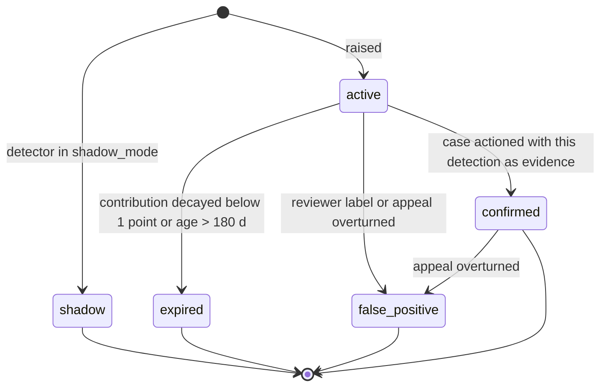
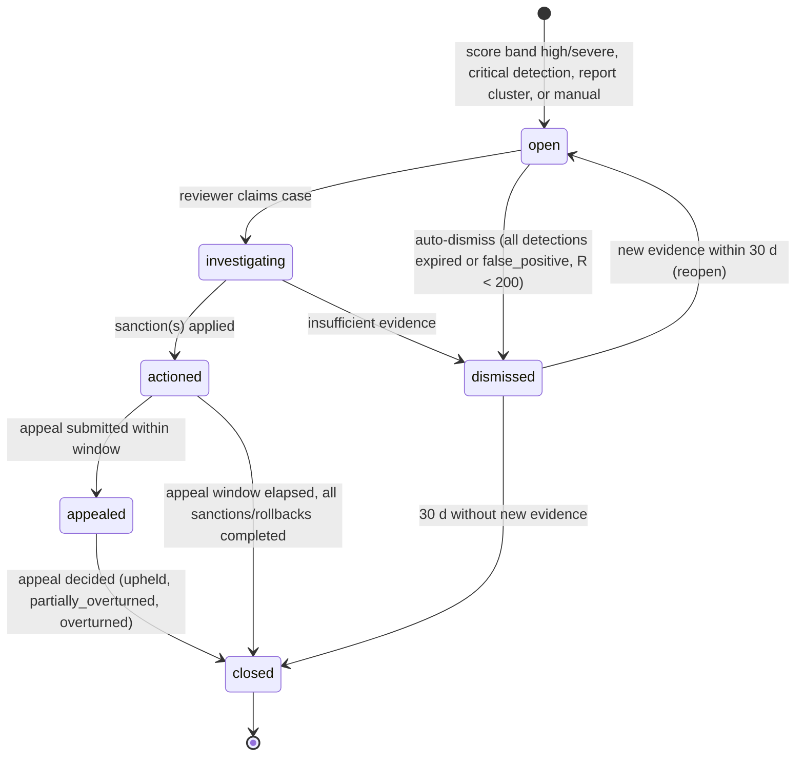
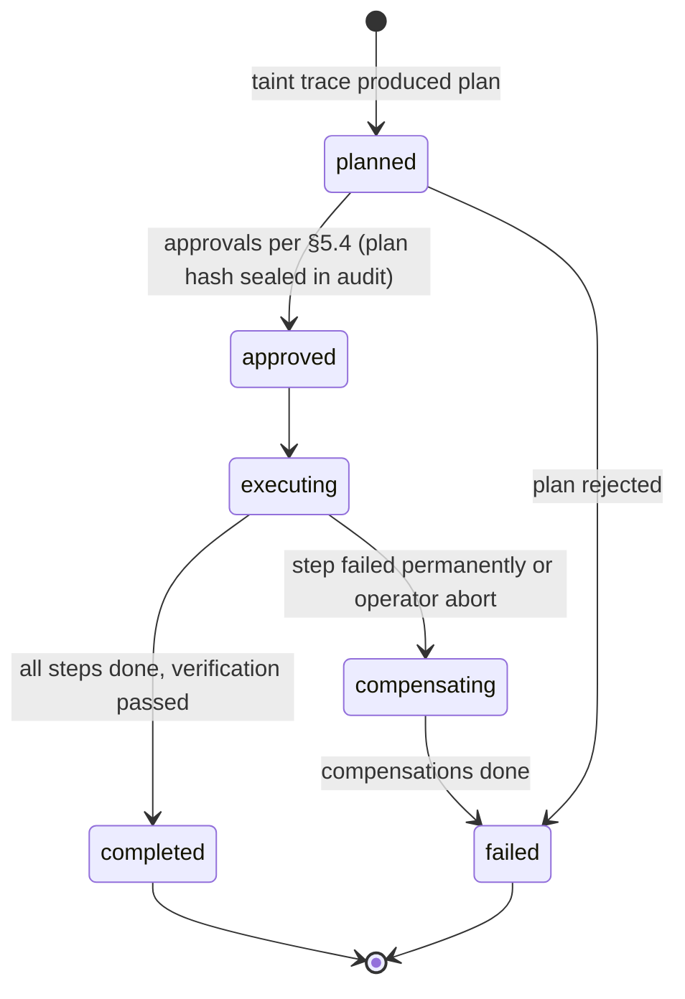
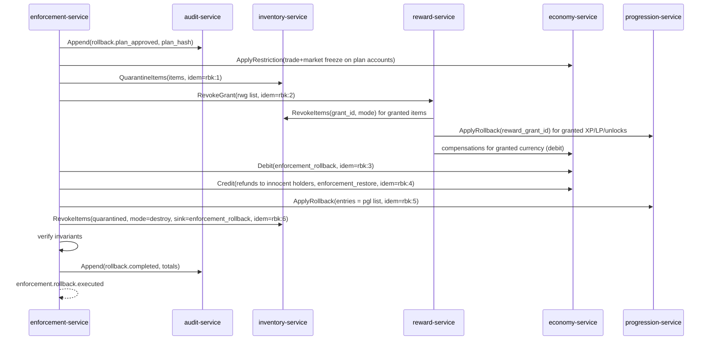

# Legends of the Shattered Frontier — Security Part 2: Detectors, Risk Score, Enforcement and Rollbacks

Version 1.0 — Expanded Technical Design Authority edition (2026-10-17)

Status: Design target; not implemented. Names per Shared Registry v1.0.

Entry file: [Security and Anti-Cheat Architecture](../Legends_Shattered_Frontier_Security_and_Anti_Cheat_Architecture_v1.0.md) · Registry: [Shared Registry v1.0](../Legends_Shattered_Frontier_Shared_Registry_v1.0.md)

---

## 1. Purpose of this part

This part defines how signals become **detections** (`det_`), how detections become a **Risk Score** (0–1000 per account), how the score and human review lead to **Enforcement Cases** (`cas_`), **Sanctions** (`snc_`) and **Appeals** (`apl_`), and how damage is undone with **rollbacks**. Inputs come from the server authority rules in Part 1; storage and APIs are in Part 3.

---

## 2. Detection model

### 2.1 Pipeline

```mermaid
sequenceDiagram
    participant P as Producers (zone/instance-server, gateway, services)
    participant B as event-bus
    participant A as anticheat-service (stream workers)
    participant J as anticheat batch jobs (warehouse)
    participant E as enforcement-service
    P->>A: ReportSignals / ReportIntegrity (gRPC)
    B->>A: domain.economy, domain.market, domain.item, domain.reward, domain.auth
    A->>A: windowed feature extraction per account
    J->>A: graph and long-window features (hourly/daily)
    A->>A: evaluate detector rules (versioned definitions)
    A->>B: security.detection.raised
    A->>A: recompute risk score
    A->>B: security.score.changed (band crossing or Δ ≥ 50)
    B->>E: consume; open/update case per policy
```

Two execution paths:

* **Stream detectors** evaluate within seconds on per-account windows (movement, combat, integrity, invariants).
* **Batch detectors** run in `analytics-pipeline` over the warehouse (trade graph, market, long-term botting) and submit detections through `anticheat-service.SubmitBatchDetections`; `anticheat-service` remains the only writer of `det_`.

### 2.2 Detector definition (content kind `detector`)

Detectors are content definitions (`detector/<slug>`) published in content packs by `content-catalog-service` so that thresholds are versioned, reviewed and rollable-back like any other content. Thresholds may additionally be overridden at runtime by tuning keys `tune.security.detector.<slug>.<param>`.

```json
{
  "id": "detector/speed_envelope",
  "version": 3,
  "category": "movement",
  "mode": "stream",
  "subject": "account",
  "inputs": [
    { "event": "security.action.rejected", "filter": { "reason": ["movement_speed", "movement_teleport"] } },
    { "signal": "movement_budget_summary" }
  ],
  "window_seconds": 300,
  "features": [
    { "name": "reject_count", "expr": "count(rejects)" },
    { "name": "reject_rate_per_min", "expr": "reject_count / (window_seconds / 60)" },
    { "name": "max_excess_ratio", "expr": "max(d_h / (B + s_slack))" }
  ],
  "rule": "reject_count >= 6 && reject_rate_per_min >= 1.2",
  "severity": [
    { "when": "max_excess_ratio >= 2.0", "value": "high" },
    { "when": "max_excess_ratio >= 1.3", "value": "medium" },
    { "else": "low" }
  ],
  "confidence": "clamp(0.4 + 0.1 * (reject_count - 6) + 0.2 * (max_excess_ratio - 1), 0, 0.95)",
  "weight": 1.0,
  "auto_action": "none",
  "shadow_mode": false,
  "cooldown_seconds": 600,
  "evidence": ["reject_samples", "position_trace_60s"]
}
```

| Field | Meaning |
| --- | --- |
| `category` | Registry enum `detector_category`: `movement`, `combat`, `integrity`, `network`, `economy`, `botting`, `rmt`, `market`, `exploit`, `conduct`, `account_security`, `staff` |
| `mode` | `stream` or `batch` |
| `subject` | `account` (default), `character`, `staff`, `account_group` (graph cluster; raised once per member account with shared `cluster_id`) |
| `rule` | Boolean over features; expression language is a safe, side-effect-free subset (comparison, arithmetic, `min/max/clamp/log10/count/sum`) evaluated by a sandboxed evaluator — never `eval` |
| `confidence` | Expression yielding [0, 1]; 1.0 reserved for deterministic invariant detectors |
| `auto_action` | `none`, `interim_restriction`, `interim_suspension` (only allowed for `confidence = 1.0` deterministic detectors; §5.4) |
| `shadow_mode` | Detections recorded with status `shadow`; excluded from risk score; used to validate new detectors |
| `cooldown_seconds` | Minimum gap between detections of this detector for the same subject |

A new or changed detector runs in `shadow_mode` for at least one full weekly reset cycle on `prod` and must show precision ≥ 0.95 on a labelled sample of ≥ 200 cases (≥ 0.99 for any detector with `auto_action ≠ none`) before activation.

### 2.3 Detection lifecycle

Registry enum `detection_status`: `shadow`, `active`, `confirmed`, `false_positive`, `expired`.



---

## 3. Detector catalog

Notation: windows are per subject; `n` = sample count; thresholds are defaults, tunable via `tune.security.detector.<slug>.<param>`. Confidence expressions are clamped to [0, 0.95] unless the detector is deterministic.

### 3.1 Movement and combat

| Detector | Inputs | Features | Threshold (rule) | Severity | Confidence |
| --- | --- | --- | --- | --- | --- |
| `detector/speed_envelope` | `security.action.rejected` (movement_speed), budget summaries | reject count/rate, `max_excess_ratio` | ≥ 6 rejects and ≥ 1.2/min in 300 s | low / medium (≥ 1.3×) / high (≥ 2×) | see §2.2 |
| `detector/clock_skew` | clock ratio ρ samples (Part 1) | mean ρ over 10 windows, fraction of windows with ρ > 1.05 | `mean_ρ ≥ 1.05` and ≥ 70% of windows | medium; high if `mean_ρ ≥ 1.20` | `clamp((mean_ρ − 1) × 8, 0, 0.95)` |
| `detector/teleport_jump` | movement_teleport rejects | count, max `d_h` | ≥ 2 in 600 s or any `d_h` ≥ 50 m | high | `0.6 + 0.1 × count` |
| `detector/fly_hover` | movement_vertical, movement_airtime rejects | count, max airtime excess | ≥ 4 in 300 s | medium; high if airtime excess ≥ 3 s | `0.5 + 0.05 × count` |
| `detector/noclip_sweep` | movement_collision rejects | count, distinct collision volumes crossed | ≥ 3 distinct volumes in 300 s | high | `0.7` |
| `detector/target_snap` | per-cast timing summaries: target acquisition time `t_acq` (target becomes relevant → first ability on it), facing change rate before cast | `p10(t_acq)`, CV of `t_acq`, fraction of casts with yaw rate > 1,440°/s in the 100 ms before cast | `n ≥ 100` casts in 30 min and `p10(t_acq) < 120 ms` and `CV < 0.15` | medium; high if snap fraction ≥ 0.3 | `clamp((120 − p10)/120 + (0.15 − CV) × 2, 0, 0.9)` |
| `detector/action_reject_rate` | all combat_* rejects | rejects per 100 intents | ≥ 15 per 100 over ≥ 200 intents | low; medium ≥ 40 | `rate / 100` |
| `detector/packet_anomaly` | gateway/zone counters: replay drops, malformed, out-of-window sequence | counts per 10 min | replay ≥ 20, or malformed ≥ 50 | medium; high if replay ≥ 200 | `0.5 + min(0.4, count/500)` |
| `detector/damage_envelope` | `combat.damage.summarized` (60 s windows), character level `L` and equipped ilvl from the combat profile | envelope ratio `E = damage_done / (3 × DPS_max(L, ilvl) × 60)`, where `DPS_max` uses all caps (Combat spec, Security considerations) | any window with `E > 1` | high; critical if `E ≥ 2` or ≥ 5 characters on one server in 10 min (also `ops.alert.fired`: likely server bug or stacking exploit) | `clamp(0.5 + 0.2 × (E − 1), 0.5, 0.95)` |

Human reaction to a newly visible target is rarely below 150 ms; the 120 ms p10 bound combined with low variance targets automation, not skilled players. `target_snap` never has `auto_action`.

### 3.2 Integrity

| Detector | Inputs | Threshold | Severity | Confidence |
| --- | --- | --- | --- | --- |
| `detector/integrity_attestation` | `ReportIntegrity` outcomes | any `fail` with deny-listed module or code-region hash mismatch; or 3 consecutive `missing` | high (fail), medium (missing) | 0.95 for deny-list signature match; 0.7 for hash mismatch; 0.4 for missing |

Deny-list matches are evidence for human review. Version 1 sets `auto_action` = `interim_restriction` (trade/market only) for deny-list matches; it never auto-suspends on client evidence alone.

### 3.3 Duplication and invariants (deterministic)

| Detector | Inputs | Rule | Severity | Confidence | auto_action |
| --- | --- | --- | --- | --- | --- |
| `detector/item_ledger_mismatch` | nightly ledger replay (INV-4), hourly location check (INV-1), escrow audit (INV-10) | any `itm_` whose replayed state ≠ current, or with 0 or ≥ 2 locations | critical | 1.0 (subject = current owner(s); `subject_role` = `holder`) | `interim_restriction` |
| `detector/item_id_collision` | create path assertion (INV-2) | duplicate `itm_` insert attempt | critical | 1.0 | `interim_restriction` |
| `detector/currency_conservation` | hourly double-entry check (INV-8) per currency/realm | residual ≠ 0; trace residual to accounts via transaction chain | critical | 1.0 for traced accounts | `interim_restriction` |
| `detector/reward_rate_outlier` | `reward.grant.delivered`, `loot.drop.created`, `economy.currency.credited`, `item.instance.created` | per-character reward value per hour `V_h` vs realm-band distribution: `z = (log V_h − μ_band) / σ_band` | `z ≥ 4` (or any INV-5/INV-12 violation) | medium; high if `z ≥ 6` or invariant violation | `clamp((z − 3)/4, 0, 0.9)` | none |

Being the holder of a duplicated item is not proof of duplication. Invariant detectors raise detections against holders so that **freezes** happen fast; the case reviewer determines who caused the dupe (the item ledger shows the originating transaction).

### 3.4 Botting

| Detector | Inputs | Features | Threshold | Severity | Confidence |
| --- | --- | --- | --- | --- | --- |
| `detector/bot_input_regularity` | per-character action timing summaries (zone-server) | inter-action interval mean μ, std σ, `CV = σ/μ`; input entropy `H` of quantized (50 ms) intervals | `n ≥ 300` actions and `CV < 0.08` and `H < 2.5 bits` | medium | `clamp(0.5 + (0.08 − CV) × 5 + (2.5 − H) × 0.1, 0, 0.9)` |
| `detector/bot_path_loop` | movement path digests: sequence of visited cells (World spec cell IDs) per 60 s | loop similarity `J` = Jaccard similarity of consecutive 10-minute cell-sequence 3-gram sets; loop count | `J ≥ 0.85` for ≥ 6 consecutive loops | medium | `clamp((J − 0.7) × 3, 0, 0.9)` |
| `detector/bot_session_marathon` | `auth.session.started/ended`, `client.session.heartbeat` | active hours in rolling 24 h `h24`; distinct days with `h24 ≥ 16` in 7 days | `h24 ≥ 18` or ≥ 3 days with `h24 ≥ 16` | low | `clamp((h24 − 14) / 10, 0, 0.8)` |
| `detector/bot_gather_yield` | `gathering.node.harvested` | harvests/hour vs band p99; distinct node types; chat/social interactions = 0 | harvest rate ≥ p99.5 for ≥ 4 h and zero social interactions | medium | `0.6` (+0.1 per additional 4 h block, max 0.9) |
| `detector/bot_cluster` (batch) | device fingerprint HMACs, ip_hmac, account creation times, path digests | accounts sharing device/IP clusters with ≥ 3 bot detections among members | cluster size ≥ 5 | high per member with own active bot detection; low for others | `0.5 + 0.05 × flagged_members`, max 0.9 |

**Bot-specific balancing targets**

| Target | Value |
| --- | --- |
| Median time from bot start to first detection | ≤ 6 player-hours |
| Median time to case actioned (bot farms) | ≤ 48 h |
| Bot prevalence estimate (`m_bot_prevalence_estimate`) | < 2% of concurrently online characters |
| False positive rate on human players (appeal overturn, bot category) | < 1% of actioned cases |

### 3.5 Trade, RMT and market

All economy detectors are batch jobs over the warehouse graph built from `economy.trade.completed`, `market.listing.sold`, `economy.currency.credited/debited` (mail transfers), with nodes = accounts and edges = value transfers. Value of items uses the Economy price index (`economy.index.computed`); gold in copper.

**Trade funnel (RMT seller/collector)**

For account `a` over a 7-day window:

```text
U_new(a)   = number of distinct counterparties with account age < 14 d who sent value to a
V_in(a)    = Σ value received (copper) via trade/mail/market at > 3× or < 0.33× index price
V_out(a)   = Σ value sent back to those counterparties
recip(a)   = V_out(a) / max(V_in(a), 1)
funnel(a)  = U_new(a) × (1 − min(recip(a), 1)) × log10(1 + V_in(a) / 10000)
```

| Detector | Rule | Severity | Confidence |
| --- | --- | --- | --- |
| `detector/trade_funnel` | `funnel ≥ 12` (tune `tune.security.detector.trade_funnel.threshold`) | high; critical if `funnel ≥ 40` | `clamp(funnel / 50, 0.3, 0.95)` |
| `detector/trade_value_asymmetry` | single trade/mail with value given ≥ 20× value received, sender account age < 30 d, recipient not in sender's guild/friend list for > 7 d, value ≥ 500,000 copper | medium (raised on both parties; RMT buyers and sellers are both in scope) | `0.5`, +0.1 per repeat in 30 d |
| `detector/market_wash_cycle` | cycles of length 2–4 in market buyer→seller graph for the same `item/` where each hop price ≥ 2× index, completed within 48 h | medium; high if cycle value ≥ 5,000,000 copper | `clamp(0.4 + 0.1 × cycles, 0, 0.9)` |
| `detector/market_corner` | account (or cluster) bought ≥ 60% of listed supply of an item in a regional market in 24 h, then relisted ≥ 50% of it at ≥ 2× pre-buy median | medium | `0.6` |
| `detector/market_spoof` | listings created and cancelled ≥ 30 times in 1 h at prices ≤ 0.5× or ≥ 2× index without sales | low | `0.5` |

**Worked example (trade funnel).** Account `acc_A` receives gold from 9 accounts aged 2–10 days; `V_in` = 4,200,000 copper (420 gold) at non-market ratios; returns nothing (`recip` = 0). `funnel = 9 × 1 × log10(1 + 420) = 9 × 2.624 = 23.6` → high detection, confidence 0.47. A legitimate guild bank deposit from 9 new guild members is excluded upstream: guild-bank transfers are separate edges (`guild` scope) and are only included if the guild is < 7 days old.

A `security.trade.flagged` event is emitted for each flagged trade/transfer so that Economy dashboards and the case console can show it.

### 3.6 Exploit, conduct, account security and staff

| Detector | Inputs | Rule | Severity | Notes |
| --- | --- | --- | --- | --- |
| `detector/reward_rate_outlier` | see §3.3 | — | — | Primary exploit-abuse detector; also sends `ops.alert.fired` if ≥ 20 characters on a realm exceed `z ≥ 4` on the same `causation` content in 1 h (likely a live exploit → runbook) |
| `detector/leash_abuse` | `leash_abuse` signals via `ReportSignals` from zone/instance servers (AI spec, NPC behavior and memory part; Dungeon spec): ≥ 3 evades of the same NPC or pack within 120 s with the same top-threat character | ≥ 3 signals for the same character in 24 h, or any signal whose evade caused a `safe_zone` training kill of another player | low; medium if ≥ 10 signals in 7 d | Resolved (2026-10-17): Security consumes the AI/Dungeon signal; never `auto_action` (evade already clears credit and threat) |
| `detector/craft_salvage_loop` | `crafting.item.crafted` + `item.instance.salvaged` pairs on the same `itm_` within 24 h (Crafting spec, Security considerations; salvage reference values from Crafting spec, Salvage profiles) | per character in 24 h: loop count `n_loop`, realised return `r_loop` = Σ salvage output ref value / Σ input ref value | `r_loop > 0.40` over ≥ 5 loops (above the crafted salvage band, so a salvage bug or exploit); or `n_loop ≥ 200` with craft cadence CV < 0.15 (automation) | `r_loop > 0.40`: high, also `ops.alert.fired`; automation: low (feature for `botting`) | Resolved (2026-10-17): defined at Crafting's request; loops are lossy by construction (≤ 40 % return), so only an over-band return is exploit evidence; never `auto_action` |
| `detector/report_cluster` | player reports (`rpt_`) | ≥ 5 distinct eligible reporters in 24 h (reporter account age ≥ 30 d; reporters sharing a guild count as one) | low; medium ≥ 15 | reporter weights reduced for reporters with ≥ 50% dismissed reports |
| `detector/login_anomaly` | login risk, refresh reuse, password/MFA/email changes | `LR ≥ 60` on success, or refresh reuse, or email change followed by item/gold outflow ≥ 50% of holdings within 24 h | high | category `account_security`: **protective**, excluded from risk score |
| `detector/staff_action_anomaly` | `audit.record.appended` for staff actors | `gm_grant` value per day > p99 of role; actions on linked accounts (shared device/ip_hmac); off-shift elevation; > 3 denied permission checks in 1 h | high | subject = staff identity; routed to security team, never to player enforcement queue |

---

## 4. Risk score

### 4.1 Definition

The Risk Score `R(t)` is a rolling 0–1000 integer per account owned by `anticheat-service` (Registry, RiskScore). It is a **prioritization and interim-control signal**, never a sanction by itself.

```text
R(t) = min( 1000, round( max( F(t),  Σ_{d ∈ D(t)} c_d × 2^(−(t − t_d) / H(sev_d)) ) ) )

c_d  = base(sev_d) × conf_d × w_det(d) × m_rep(d) × m_age(account)
```

| Symbol | Meaning | Default | Tuning key |
| --- | --- | --- | --- |
| `D(t)` | Detections on the account with status `active` or `confirmed`, `t − t_d ≤ 180 d`, category ≠ `account_security`, `staff` | — | `tune.security.risk_max_age_days` (180) |
| `base(sev)` | Severity base points | `info` 0, `low` 25, `medium` 75, `high` 200, `critical` 450 | `tune.security.risk_severity_base` |
| `conf_d` | Detection confidence [0, 1] | from detector | — |
| `w_det` | Detector weight | 1.0 (per definition) | detector `weight` |
| `m_rep(d)` | Repeat damping: k-th detection of the same detector within 24 h gets `0.5^(k−1)` | 0.5 | `tune.security.risk_repeat_decay` |
| `m_age` | New-account multiplier: account age < 7 days | 1.25 | `tune.security.risk_new_account_multiplier` |
| `H(sev)` | Half-life by severity | `low` 7 d, `medium` 14 d, `high` 30 d, `critical` 60 d | `tune.security.risk_half_life_days` |
| `F(t)` | Floor after a confirmed cheating/botting/duplication/RMT sanction: 250 for 90 days after the sanction ends | 250 / 90 d | `tune.security.risk_sanction_floor`, `tune.security.risk_floor_days` |

Detections labelled `false_positive` are removed and the score recomputed immediately (score is a pure function of stored detections, so recomputation is exact). Score is cached in Redis and persisted with a history row on every band change.

### 4.2 Bands and automatic controls

| Band | Range | Automatic controls (all reversible, not sanctions) |
| --- | --- | --- |
| `normal` | 0–199 | none |
| `watch` | 200–399 | attestation interval 120 s; full-rate path digests and timing summaries |
| `elevated` | 400–599 | + outgoing trades/mail/market sales with value ≥ 100,000 copper held 24 h for automatic re-check (`tune.security.trade_hold_value_copper`) |
| `high` | 600–799 | + `enforcement-service` auto-opens a case (state `open`, priority P2) |
| `severe` | 800–1000 | + case priority P1; interim `trade_restriction` and `market_restriction` applied as sanctions with `interim = true`, reviewed within 24 h |

Band names are registry enum `risk_band`. `security.score.changed` is emitted on band crossing or when `|ΔR| ≥ 50`.

### 4.3 Worked examples

**Example 1 — speed hacker.** Day 0: `speed_envelope` high, conf 0.90 → 200 × 0.90 = 180. `clock_skew` medium, conf 0.80 → 60. A second `speed_envelope` within 24 h, conf 0.90, k=2 → 180 × 0.5 = 90. R = 330 (`watch`).
Day 1: decayed old detections: 180 × 2^(−1/30) = 175.9; 90 → 87.9; 60 × 2^(−1/14) = 57.1. New `speed_envelope` (new 24 h window, k=1) conf 0.95 → 190. R = 510.9 → 511 (`elevated`). Same day an `integrity_attestation` fail (high, conf 1.0 capped to 0.95 for non-deterministic → 190): R = 701 (`high`) → case opened.

**Example 2 — new-account gathering bot.** Each day for 5 days (account age < 7 d, m_age 1.25): `bot_input_regularity` medium conf 0.85 (63.75), `bot_path_loop` medium conf 0.90 (67.5), `bot_session_marathon` low conf 0.90 (22.5). Per day: medium 164.06, low 28.13 after m_age.
At day 4: medium Σ = 164.06 × (1 + 0.9517 + 0.9057 + 0.8620 + 0.8203) = 744.8; low Σ = 28.13 × (1 + 0.9057 + 0.8203 + 0.7430 + 0.6730) = 116.5. R = 861 (`severe`) → interim trade/market restriction, P1 case.

**Example 3 — legitimate high-latency player.** One `speed_envelope` low, conf 0.4 → 10. R = 10. After 7 days: 5. Never reaches `watch`.

**Example 4 — false-positive correction.** A player at R = 640 from three `target_snap` detections appeals after a case; reviewer labels them `false_positive` → R recomputed to 0 and `security.score.changed` emitted.

### 4.4 Score targets

| Metric | Target |
| --- | --- |
| Share of active accounts in `watch` or above | 1–3% |
| Share in `severe` | ≤ 0.2% |
| Cases opened from `high`/`severe` that end `actioned` | ≥ 70% (else thresholds too loose) |
| Precision of `severe` interim restrictions (not overturned) | ≥ 95% |

---

## 5. Enforcement

### 5.1 Offense categories

Registry enum `offense_category`: `cheat_software`, `botting`, `duplication`, `exploit_abuse`, `rmt_seller`, `rmt_buyer`, `market_abuse`, `harassment`, `griefing`, `account_sale_or_sharing`. (`account_security` victims and `staff_misconduct` are handled outside the player ladder.)

### 5.2 Enforcement ladder

Offense number = prior **actioned** cases in the same category in the last 365 days (`tune.security.offense_lookback_days`) + 1. Permanent bans ignore lookback. Rollback sanctions (`item_rollback`, `currency_rollback`, `progression_rollback`) are added whenever illegitimate gains are identifiable, independent of the ladder step.

| Category | 1st | 2nd | 3rd+ |
| --- | --- | --- | --- |
| `cheat_software` | `temporary_suspension` 14 d + rollback of gains | `permanent_ban` | — |
| `botting` | `temporary_suspension` 3 d + rollback | `temporary_suspension` 30 d + rollback | `permanent_ban` |
| `duplication` (knowing) | `permanent_ban` + rollback; if value < 1,000,000 copper and self-reported or first-time accidental: `temporary_suspension` 30 d + rollback | `permanent_ban` | — |
| `exploit_abuse` | `warning` + rollback | `temporary_suspension` 7 d + rollback | `temporary_suspension` 30 d; 4th `permanent_ban` |
| `rmt_seller` (farm/collector accounts) | `permanent_ban` + rollback | — | — |
| `rmt_buyer` | `warning` + `currency_rollback` of purchased value + `trade_restriction` 14 d | `temporary_suspension` 30 d + rollback | `permanent_ban` |
| `market_abuse` | `market_restriction` 14 d + `currency_rollback` of profits | `market_restriction` 60 d + rollback | `permanent_ban` |
| `harassment` | `warning` or `chat_mute` 24 h | `chat_mute` 7 d | `temporary_suspension` 7 d; 4th `permanent_ban` |
| `griefing` | `warning` | `temporary_suspension` 3 d | `temporary_suspension` 14 d; 4th `permanent_ban` |
| `account_sale_or_sharing` | `warning` + forced credential reset | `temporary_suspension` 14 d | `permanent_ban` |

Sanction scope (registry enum `sanction_scope`): `account` (default for suspensions/bans) or `character` (rollbacks, chat mutes for a single character). Sanctions are enforced by consumers: `auth-service`/`gateway` (suspension, ban → login denied, sessions revoked), `chat-service` (`chat_mute`), `economy-service` (`trade_restriction`, `market_restriction`), via `enforcement-service.CheckRestrictions` with a 30 s cache and invalidation by `enforcement.sanction.applied/lifted`.

### 5.3 Case state machine

Uses registry `enforcement_case_state` exactly.



| Transition | Guard | Side effects |
| --- | --- | --- |
| → `open` | No other non-`closed` case for same subject and category (else merge detections into existing case) | `enforcement.case.opened`; interim controls per §4.2 |
| `open` → `investigating` | Reviewer has role with `enforcement:case:review` | audit record |
| `investigating` → `actioned` | Human review requirements (§5.4) satisfied; evidence bundle sealed (hash recorded in audit) | `enforcement.sanction.applied` per sanction; rollback saga started if needed; detections → `confirmed`; player notified |
| `investigating`/`open` → `dismissed` | Reason code required | interim sanctions lifted (`enforcement.sanction.lifted`); detections optionally → `false_positive`; `enforcement.case.resolved` (outcome `dismissed`) |
| `actioned` → `appealed` | Appeal within window (§5.5) | `enforcement.appeal.submitted` |
| `appealed` → `closed` | Decision by reviewer ≠ original actioning reviewer | overturned → sanctions lifted, restore saga; `enforcement.case.resolved` |
| `actioned` → `closed` | Window elapsed, saga `completed` | `enforcement.case.resolved` (outcome `actioned`) |

### 5.4 Human review requirements

| Action | Automatic allowed? | Review requirement |
| --- | --- | --- |
| Interim `trade_restriction` / `market_restriction` | Yes (`severe` band or deterministic detector) | Review within 24 h, else auto-lift |
| Interim `temporary_suspension` (≤ 72 h) | Only from deterministic detectors (`confidence = 1.0`, `auto_action = interim_suspension`) with ≥ 1,000,000 copper traced value | Review within 24 h, else auto-lift |
| `warning`, `chat_mute` ≤ 24 h | Yes from `report_cluster` medium with chat-moderation classifier agreement | Sampled QA review 10% |
| `temporary_suspension` | No | One reviewer (`enforcement:sanction:apply`) |
| `permanent_ban` | No | Two-person rule: reviewer + `enforcement_lead` approval; never on integrity evidence alone |
| Any rollback with traced value ≥ 10,000,000 copper or touching ≥ 10 accounts | No | Two-person rule; economy analyst sign-off |
| Mass action (≥ 50 accounts in one wave, e.g. bot ban wave) | No | Wave plan approved by `enforcement_lead`; 1% random sample re-reviewed before execution |
| Sanctions on staff-linked accounts | No | Security team only; reviewer must not be in actor's reporting line |

Reviewer tooling shows only the evidence needed (pseudonymous by default; raw IP or chat revealed via an audited "reveal" action).

### 5.5 Appeals

| Rule | Value |
| --- | --- |
| Who | Account owner, via support web flow authenticated with MFA/step-up |
| Window | 30 days after sanction applied (`tune.security.appeal_window_days`) |
| Count | One appeal per sanction; one re-appeal only with new information, decided by `enforcement_lead` |
| Reviewer | Different from the actioning reviewer; for `permanent_ban`, a senior reviewer |
| SLA | `temporary_suspension`: 72 h; `permanent_ban`: 7 days; restrictions: 5 days |
| Outcomes | Registry enum `appeal_state`: `submitted`, `in_review`, `upheld`, `partially_overturned`, `overturned` |
| Overturn effects | Sanctions lifted; detections → `false_positive`; score recomputed; rollbacks reversed by a **restore saga** (§6.6); compensation per LiveOps policy (`liveops_compensation`) for suspension time |

Appeal decisions publish `enforcement.appeal.resolved` (registry event; resolved 2026-10-17: the interim use of `enforcement.case.resolved` for appeal outcomes is retired, though that event still carries the outcome field).

### 5.6 Evidence and retention

Evidence bundles (`evd_`) are sealed snapshots: detection records, feature values, reject samples, ledger excerpts, trade graph excerpts, chat excerpts, attestation reports, reviewer notes. Each bundle is encrypted with a per-case data key, content-hashed (SHA-256), and its hash is written to the audit chain at sealing.

| Evidence class | Retention | Basis |
| --- | --- | --- |
| Shadow-mode detections | 30 days | detector validation |
| Detections never attached to a case | 180 days (then purged; aggregates kept) | risk score window |
| Evidence for `dismissed` cases | 90 days after `closed` | reopen window plus margin |
| Evidence for `actioned` cases (non-ban) | 2 years after `closed` | repeat offense ladder, disputes |
| Evidence for `permanent_ban` | 5 years after `closed`, or until account deletion + 1 year, whichever is longer | ban evasion, chargebacks, legal |
| Chat excerpts | Same as case class; raw chat outside evidence 30 days | p2 |
| Audit records (hash chain) | 7 years (WORM) | integrity of the trail; p2/p3 fields crypto-shredded on erasure |

---

## 6. Rollbacks

### 6.1 Principles

1. Rollbacks never edit rows in place. They append **compensating** entries through owning services: reward revocation (`reward-service`), item quarantine/destruction (`inventory-service`), currency debits (`economy-service`), progression reversal (`progression-service`).
2. All removals use sink code `enforcement_rollback`. Any restore after an overturned appeal or innocent-holder refund uses source code `enforcement_restore` (registry; the interim `gm_grant` fallback is retired).
3. Each rollback is a **saga** (`rbk_`) with a frozen, approved plan; every step is idempotent and audited.
4. Scope is the taint set computed from evidence, never "everything the account did".

### 6.2 Rollback types

| `sanction_type` | Mechanism |
| --- | --- |
| `item_rollback` | `inventory-service.QuarantineItems` (status `quarantined`, `item.instance.quarantined`); after appeal window or approval, `inventory-service.RevokeItems(mode = destroy)` with sink `enforcement_rollback`; tainted reward grants revoked via `reward-service.RevokeGrant` (`reward_grant_state` → `revoked`, `reward.grant.revoked`) |
| `currency_rollback` | `economy-service` debit with sink `enforcement_rollback`, `causation_id` = rollback step ID; amounts beyond available balance recorded as `rollback_deficit` (§6.5) |
| `progression_rollback` | `progression-service.ApplyRollback` (scope `entries` = `pgl_` list, or `reward_grant_id` via `RevokeGrant`) reversal of `pgl_` entries attributable to the offense (XP, LP, skill gains), producing ordinary progression events; dependent unlocks (mastery nodes bought with reversed LP) refunded/locked per Character spec |

### 6.3 Taint trace

Inputs: origin set `S0` — duplicated `itm_` IDs, duplicated or exploited `txn_` IDs, exploited `rwg_` IDs, RMT transfer `trd_`/`txn_` IDs.

```text
for item origins: follow item ledger (ilg_) forward; the tainted item is wherever it is now (or what it became:
   salvage outputs, crafted outputs consuming it — each derived item tainted in proportion 1 if the input was required)
for currency origins: taint-first accounting per wallet:
   taint_out(transfer) = min(transfer_amount, taint_balance(wallet))
   taint_balance(wallet) decreases by taint_out; recipient taint_balance increases by taint_out
limits: max hops H_max = 3 (tune.security.taint_max_hops); window 14 d (tune.security.taint_window_days)
```

Holders are classified:

| Holder | Definition | Treatment |
| --- | --- | --- |
| Offender | Subject of the actioned case or member of the flagged cluster | Full removal |
| Complicit | Received tainted value via trade/mail at ≤ 0.33× or ≥ 3× index price, or in the same detection cluster | Removal + own case opened |
| Innocent | Paid ≥ 0.5× index via market or trade, no relation to offender | Tainted item quarantined/removed; **refund** the price paid, first from offender's frozen proceeds, shortfall via `enforcement_restore` (requires economy analyst approval if > 1,000,000 copper total) |

**Worked example.** A dupe creates 40 extra `item/iron_longsword` instances (index price 30,000 copper). Offender sold 25 on the market for 750,000 copper total and holds 15. Plan: quarantine and destroy 15 held items; for 25 innocent buyers, destroy the items and refund 30,000 copper each (750,000 total) from the offender's wallet; offender's wallet holds 500,000 → debit 500,000 (`enforcement_rollback`), refund shortfall 250,000 via `enforcement_restore`, and record offender `rollback_deficit` = 250,000 copper. Net currency created by the incident: 250,000 copper, reported in `m_rollback_net_created_copper`.

### 6.4 Saga

Registry enum `rollback_state`: `planned`, `approved`, `executing`, `completed`, `compensating`, `failed`.





Step order is fixed: freeze → quarantine → revoke grants → debit → refund → progression → destroy → verify → unfreeze innocents. Item destruction is last so that a compensating restore before step 6 is a status change, not a re-creation.

### 6.5 Saga invariants

| ID | Invariant |
| --- | --- |
| RB-1 | Every step's idempotency key is `rbk_id:step_no:target_id`; re-executing a completed step has no effect. |
| RB-2 | The executed plan equals the approved plan (hash match); any change requires a new plan and approval. |
| RB-3 | Σ value removed (index-priced items + currency) per account = plan value per account, within 0 copper for currency and 0 items. |
| RB-4 | No step touches an account not listed in the plan. |
| RB-5 | Global invariants INV-1..INV-13 (Part 1) hold after each step (verified by targeted reconciliation on plan accounts). |
| RB-6 | Refunds to innocents never exceed the price they paid. |
| RB-7 | Wallets never go negative; any unrecoverable currency remainder becomes a `rollback_deficit` record (enforcement schema) and the saga calls `PlaceLien` for it (Economy spec, Wallet liens: garnishes 50 % of later faucet credits and 100 % of incoming transfers, sink `enforcement_rollback`, 180-day limit, then `WriteOffLien`). Risk-driven trade/mail/market holds use Economy spec, Transfer holds. Deficit-driven `trade_restriction` / `market_restriction` may be lifted once the lien is active. Garnish debits are audited one record per debit via the async audit path (outbox as durable buffer); Resolved (2026-10-17): Security confirms this batching because each garnish follows an already-audited `PlaceLien`. |
| RB-8 | Every step writes an audit record before calling the target service (audit-before-act). |

### 6.6 Restore saga (appeal overturned)

Mirror of the rollback: quarantined items set back to `active` (inventory-service `ReleaseQuarantine`); destroyed items re-created with source `enforcement_restore` and provenance pointing to the original `itm_` (new `itm_` ID — INV-2 forbids reuse); debited currency credited with `enforcement_restore`; progression entries re-applied; revoked reward grants are **not** un-revoked (`revoked` is terminal) — instead a new grant is issued via `liveops-service` compensation (`liveops_compensation`).

---

## 7. Security considerations for this part

* Detector definitions are code-adjacent content: changes go through two-person review and shadow mode; evaluator is sandboxed and time-bounded (≤ 1 ms per rule evaluation).
* Detector thresholds are confidential; content packs containing `detector/` definitions are **server-only** packs never shipped to clients.
* Batch jobs that submit detections authenticate as `analytics-pipeline` with a dedicated `SubmitBatchDetections` permission; they cannot apply sanctions.
* Enforcement APIs used by `admin-portal` require reason codes and ticket references; mass actions are rate-limited (≤ 500 sanctions per minute) to bound damage from a compromised console.
* Detections against staff-linked accounts are routed to the security team queue.
