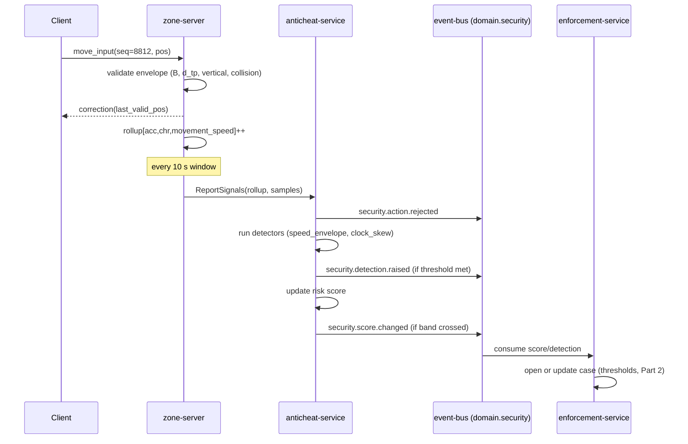

# Legends of the Shattered Frontier — Security Part 1: Threat Model, Server Authority, Client Integrity, Account Security and Privacy

Version 1.0 — Expanded Technical Design Authority edition (2026-10-17)

Status: Design target; not implemented. Names per Shared Registry v1.0.

Entry file: [Security and Anti-Cheat Architecture](../Legends_Shattered_Frontier_Security_and_Anti_Cheat_Architecture_v1.0.md) · Registry: [Shared Registry v1.0](../Legends_Shattered_Frontier_Shared_Registry_v1.0.md)

---

## 1. Purpose of this part

This part answers three questions for every component of the game:

1. **What can go wrong?** — a STRIDE threat model per component plus the MMO-specific threat catalog, each rated for likelihood and impact.
2. **What does the server refuse to believe?** — server authority rules per domain, with computable validation formulas, rate limits, and the `security.action.rejected` flow.
3. **What is the client and the account allowed to be trusted with?** — client integrity attestation, account security (MFA, session binding, anomaly login) and the privacy rules that bound all of the above.

Detectors, risk scoring and enforcement are in Part 2 (Security spec, Detection, Risk and Enforcement). Audit, runbooks, schemas and APIs are in Part 3. Implementation rules for coding agents are in Part 4.

---

## 2. Rating scales

Likelihood (L) and impact (I) use 1–5 scales. Risk = L × I; risks ≥ 15 are **launch-blocking** (mitigation must ship before `prod`), 8–14 are **launch-required with monitoring**, ≤ 7 are **accepted with detection**.

| Score | Likelihood (per season, at Phase 3 population) | Impact |
| --- | --- | --- |
| 1 | Rare; requires nation-state or insider collusion | Cosmetic; single player annoyance |
| 2 | Unlikely; specialist skill and no public tooling | One player's progress or items harmed |
| 3 | Possible; public tooling exists for UE games | Many players harmed, or realm economy measurably distorted (< 1% of gold supply) |
| 4 | Likely; commodity cheat vendors target genre | Realm economy distorted (≥ 1% of gold supply) or mass account compromise (≥ 0.1% of MAU) |
| 5 | Near-certain; happens in every live MMO | Total loss of trust: global dupe, credential database leak, signing key loss, multi-day outage |

---

## 3. Trust boundaries (recap)

The entry file holds the full layer diagram. The five boundaries referenced below:

| ID | Boundary | Crossing rule |
| --- | --- | --- |
| TB1 | Player device ↔ edge (Cloudflare, load balancer) | Everything crossing is hostile. TLS 1.3 for TCP; authenticated encryption for UDP. |
| TB2 | Edge ↔ `gateway` / UDP relay to `zone-server` | Only authenticated sessions pass. Rate limits apply. |
| TB3 | `gateway` / game servers ↔ internal services | mTLS service identity; per-RPC authorization; idempotency keys. |
| TB4 | Services ↔ their own datastores | Per-service DB credentials; no cross-schema grants. |
| TB5 | Staff (`admin-portal`) ↔ service admin APIs | SSO with phishing-resistant MFA, role and elevation checks, audit-before-act. |

---

## 4. STRIDE per component

S = Spoofing, T = Tampering, R = Repudiation, I = Information disclosure, D = Denial of service, E = Elevation of privilege. Each cell lists the primary threat → primary mitigation. L/I is the residual-before-mitigation rating.

### 4.1 Game client and launcher

| STRIDE | Threat | L/I | Mitigation |
| --- | --- | --- | --- |
| S | Unofficial client or headless bot impersonates the official client | 5/3 | Server authority makes client identity non-load-bearing; attestation (§8) adds signal; bot detectors (Part 2). |
| T | Memory editing of health, cooldowns, position | 5/2 | Client holds no authoritative state (§6). Edits only change the local view. |
| T | Patched game files or injected DLLs | 4/3 | Signed manifests, per-session file hash attestation, module list attestation. |
| R | Player denies cheating | 4/2 | Server-side evidence only; client reports are never sole evidence for a sanction. |
| I | Wallhack / ESP reveals hidden entities | 4/3 | Interest management sends only relevant entities; stealthed entities are not replicated to non-detecting clients (Network spec, Interest management). |
| D | Crash exploits via malformed server data | 2/2 | Fuzzed deserializers; length-capped messages. |
| E | Client calls admin or debug commands | 3/4 | Debug commands compiled out of `prod` builds; servers reject any admin opcode from player sessions. |

### 4.2 Edge, gateway and transport

| STRIDE | Threat | L/I | Mitigation |
| --- | --- | --- | --- |
| S | Stolen session tokens replayed from another device | 3/4 | Proof-of-possession session binding (§9.3). |
| T | Packet modification in transit | 2/3 | AEAD (AES-256-GCM or ChaCha20-Poly1305) on UDP with per-connection keys; TLS 1.3 on TCP. |
| T | Packet replay | 4/3 | Monotonic 64-bit sequence per direction plus 1,024-packet sliding replay window; replayed or out-of-window packets dropped and counted. |
| R | Disputed requests | 2/2 | `correlation_id` on every request, logged at gateway. |
| I | Token leakage in logs/URLs | 3/4 | Tokens only in headers; log scrubbing at gateway and `telemetry-ingest`. |
| D | Volumetric and application-layer DDoS | 5/4 | Edge scrubbing, anycast, per-IP/account rate limits, login queue, UDP cookie handshake (§11). |
| E | Path traversal or header smuggling to internal APIs | 2/5 | Gateway allow-lists routes; internal services not reachable from edge; WAF. |

### 4.3 Zone-server and instance-server

| STRIDE | Threat | L/I | Mitigation |
| --- | --- | --- | --- |
| S | Rogue process registers as a zone-server | 1/5 | `world-service` issues server identity certificates via workload identity; services accept durable requests only from registered `srvi_` identities. |
| T | Client input causes illegal state (speed, range, cooldown) | 5/3 | Validation rules (§6). |
| R | Server outcomes disputed | 2/2 | Combat and reject telemetry. |
| I | Server leaks hidden entity data | 3/3 | Relevance filtering per connection. |
| D | Input flooding stalls tick | 4/3 | Per-connection input budget (§6.6); over-budget packets dropped before simulation. |
| E | Compromised server requests unbounded rewards | 1/5 | `reward-service` checks per-source caps per `run_`/encounter; anomaly alert on grant volume per `srvi_`. |

### 4.4 Internal services (stateless + DB)

| STRIDE | Threat | L/I | Mitigation |
| --- | --- | --- | --- |
| S | Service impersonation | 1/5 | mTLS with SPIFFE-style identities; per-RPC caller allow-lists. |
| T | Race conditions produce duplicate items/currency | 4/5 | Idempotency keys, row-level locks, ledger invariants (§6.4), serializable transactions for transfers. |
| R | Unattributed state changes | 2/4 | Every mutation carries `causation_id`; privileged ones also write an `aud_` record. |
| I | Over-broad read APIs | 3/3 | Field-level privacy classes; p2/p3 fields only on admin APIs with role checks. |
| D | Hot-key contention (one popular market item) | 3/3 | Backpressure, bulkheads per RPC. |
| E | Player-facing RPC reaches admin method | 2/5 | Admin methods live in separate `*Admin` gRPC services, bound to a separate port reachable only from `admin-portal` network. |

### 4.5 Datastores

| STRIDE | Threat | L/I | Mitigation |
| --- | --- | --- | --- |
| S | Credential theft for DB access | 2/5 | Short-lived credentials from secret manager; no human standing write access to `prod`. |
| T | Direct edits bypass ledgers | 2/5 | Append-only ledgers (`ilg_`, `txn_`) enforced by triggers; DB audit logging; break-glass only. |
| R | Unlogged DB changes | 2/4 | DB statement audit for non-service roles shipped to `audit-service`. |
| I | Backup or snapshot exfiltration | 2/5 | Encryption at rest with KMS keys; backups in separate account; p3 fields application-encrypted. |
| D | Ransomware/deletion | 1/5 | Immutable backups (object lock), cross-region replication (Database spec, Replication). |
| E | SQL injection | 2/5 | Parameterized queries only (Part 4 rules). |

### 4.6 Security services (anticheat, enforcement, audit) and admin-portal

| STRIDE | Threat | L/I | Mitigation |
| --- | --- | --- | --- |
| S | Attacker forges detections against a rival | 2/4 | Only registered producers can raise detections; player reports are a separate low-weight input. |
| T | Insider edits audit trail to hide abuse | 2/5 | Hash chain plus WORM anchoring (Part 3). |
| R | GM denies an action | 3/3 | Audit-before-act; actor identity from SSO, not from a form field. |
| I | Evidence (chat logs, IPs) leaks | 2/4 | Evidence store encrypted; access logged; least privilege. |
| D | Detector flood overloads case queue | 3/3 | Per-detector diminishing contribution; case dedup per subject. |
| E | GM grants self items or lifts own ban | 3/4 | No self-actions; two-person rule; `gm_grant` daily caps (Part 3, GM permission model). |

### 4.7 Build, patch and release pipeline

| STRIDE | Threat | L/I | Mitigation |
| --- | --- | --- | --- |
| S | Malicious mirror serves fake client | 3/5 | Manifest signature verified by launcher with pinned public key (Client delivery spec, Validation Level 4). |
| T | Compromised dependency or CI runner injects code | 3/5 | Pinned dependencies with lockfile hashes, SBOM, provenance attestations, isolated signing step. |
| R | Unknown who released a build | 2/3 | `rel_` records with approver identities; signed tags. |
| I | Signing key exfiltration | 1/5 | Signing keys in HSM/KMS; signing service accepts only provenance-verified artifacts. |
| D | Release pipeline outage blocks hotfix | 2/3 | Documented manual signing ceremony with two key holders. |
| E | Feature branch deploys to `prod` | 2/4 | Environment promotion order `dev → ptr → staging → prod` enforced; `prod` deploy requires approval. |

---

## 5. MMO-specific threat catalog

| # | Threat | Description | L | I | Risk | Primary mitigations | Detectors (Part 2) |
| --- | --- | --- | --- | --- | --- | --- | --- |
| M1 | Speed hack | Client moves faster than allowed, often by clock acceleration | 5 | 3 | 15 | Movement budget (§6.2); clock ratio check | `detector/speed_envelope`, `detector/clock_skew` |
| M2 | Teleport | Position jumps without server-issued teleport | 4 | 3 | 12 | Teleport token requirement | `detector/teleport_jump` |
| M3 | Fly / no-clip | Airborne beyond jump physics; passing through collision | 4 | 3 | 12 | Air-time and vertical rise limits; collision sweep | `detector/fly_hover`, `detector/noclip_sweep` |
| M4 | Aim / targeting automation | Instant target acquisition, inhuman reaction times, auto-rotation | 4 | 3 | 12 | Server range/LOS/facing checks; statistical detection | `detector/target_snap` |
| M5 | Memory editing | Local health/cooldown edits | 5 | 1 | 5 | No client authority | (rejects only) |
| M6 | Packet tampering/replay | Crafted or replayed packets | 4 | 3 | 12 | AEAD, sequence window, schema validation | `detector/packet_anomaly` |
| M7 | Item duplication | Race in trade/mail/zone handoff/crash recovery creating extra items | 4 | 5 | 20 | Idempotency, escrow, single owner invariant, ledger reconciliation | `detector/item_ledger_mismatch`, `detector/item_id_collision` |
| M8 | Currency duplication | Double-credit via retries or reversal abuse | 3 | 5 | 15 | Ledger conservation; idempotency | `detector/currency_conservation` |
| M9 | Botting / gold farming | Automated play for resources and gold | 5 | 4 | 20 | Behavior detectors; diminishing returns (Character spec, anti-grind) | `detector/bot_input_regularity`, `detector/bot_path_loop`, `detector/bot_session_marathon` |
| M10 | Real-money trading (RMT) | Gold/items sold for real money; funnels via trade/mail/market | 5 | 4 | 20 | Trade graph analysis; trade holds at risk thresholds | `detector/trade_funnel`, `detector/trade_value_asymmetry` |
| M11 | Market manipulation | Wash trading, cornering, price spoofing | 3 | 3 | 9 | Market graph and price analytics | `detector/market_wash_cycle`, `detector/market_corner` |
| M12 | Account takeover / credential stuffing | Reused passwords, phishing, session theft | 5 | 4 | 20 | MFA, breached-password checks, login risk, session binding, cooling-off | `detector/login_anomaly` (protective, §9.5) |
| M13 | Exploit abuse | Using a bug (e.g. reward repeat, geometry) knowingly | 4 | 4 | 16 | Reward caps per source; kill switches (LiveOps); reward anomaly alerts | `detector/reward_rate_outlier` |
| M14 | Griefing | Harassment, spawn camping, train-pulling, chat abuse | 5 | 2 | 10 | Player reports, chat moderation (Backend, chat-service), PvP rules | `detector/report_cluster` |
| M15 | Insider / GM abuse | Staff grants items, leaks data, lifts bans for friends | 2 | 5 | 10 | Least privilege, two-person rule, audit chain, staff anomaly detection | `detector/staff_action_anomaly` |
| M16 | Supply-chain / patch tampering | Malicious build or mirror | 2 | 5 | 10 | Signing, provenance, pinned keys (§4.7) | (release pipeline checks) |
| M17 | DDoS | Edge, login, or zone UDP flooding | 5 | 4 | 20 | Edge scrubbing, rate limits, UDP cookies, login queue | (ops alerts) |

All launch-blocking risks (M1, M7, M8, M9, M10, M12, M13, M17) have mitigations in the first milestone set of Part 4.

---

## 6. Server authority rules per domain

Registry authority rules apply: simulation authority sits with `zone-server`/`instance-server`; durable authority sits with the owning service. This section defines **what is checked** and **how**. Every rejection produces a structured reject (§7).

### 6.1 General rules

1. The client sends **intents** (`move_input`, `use_ability(ability_id, target_ent_id, aim_vector)`, `harvest(node_ent_id)`, `request_trade(…)`), never outcomes.
2. All numeric inputs are range-checked and finite (`NaN`/`Inf` → reject `malformed_input`).
3. Every intent is evaluated against server-side state at server time; client timestamps are advisory and used only for lag compensation within bounded windows.
4. Unknown opcodes, oversized messages (> `tune.security.max_message_bytes`, default 1,200 bytes for UDP payloads), or schema-invalid messages are dropped and counted.
5. The server never sends a client information it is not entitled to see (relevance filtering), even if it would save bandwidth.

### 6.2 Movement envelope validation

The zone-server keeps, per character, a **movement budget** `B` (metres) refilled from authoritative speed, and validates each received position sample.

**Variables**

| Symbol | Meaning | Default | Tuning key |
| --- | --- | --- | --- |
| `v_eff(t)` | Authoritative effective max horizontal speed at server time t (m/s), computed by the server from base speed, mount, buffs/debuffs and haste-independent movement modifiers (Combat spec, Dexterity → movement speed; World spec for mounts) | — | — |
| `Δt_s` | Server-time delta since last accepted sample, clamped to `[0, Δt_max]` | — | — |
| `Δt_max` | Max server delta credited per sample (stops credit hoarding across lag spikes) | 0.5 s | `tune.security.move_dt_max` |
| `ε` | Proportional tolerance for interpolation/jitter | 0.08 | `tune.security.move_tolerance` |
| `T_burst` | Max budget accumulation time | 1.0 s | `tune.security.move_burst_seconds` |
| `s_slack` | Fixed slack per sample (m) | 0.5 m | `tune.security.move_slack_m` |
| `d_h` | Horizontal displacement of the sample (m) | — | — |
| `d_tp` | Hard teleport threshold (m) | `v_eff × 1.0 s + 2.0 m` | `tune.security.teleport_extra_m` (2.0) |

**Budget update per received sample**

```text
B ← min( B + v_eff_max_window × Δt_s × (1 + ε),  v_eff_max_window × T_burst + s_slack )
accept   if d_h ≤ B + s_slack            → B ← B − d_h
reject   otherwise                        → correct client to last accepted position; reason movement_speed
hard_tp  if d_h > d_tp and no valid teleport token → reject; reason movement_teleport
```

`v_eff_max_window` is the maximum `v_eff` over the last `Δt_s` (so a speed buff expiring mid-interval does not cause false positives). Server-initiated displacement (knockback, pull, teleport spell, zone handoff, fast travel) issues a **teleport token** `{token_id, max_displacement_m, expires_at_server_ms}` that the next sample may consume.

**Vertical rules**

| Rule | Formula | Default | Reason code |
| --- | --- | --- | --- |
| Max rise without ground contact | `Δz_rise ≤ h_jump + h_step + s_slack_z` | `h_jump` from character movement data (default 1.2 m), `h_step` 0.45 m, `s_slack_z` 0.25 m | `movement_vertical` |
| Max airborne time | `t_air ≤ 2 × v_jump / g + t_fall(Δz_drop) + t_grace` where `t_fall(Δz) = sqrt(2 × Δz / g)` | `g` 9.81 m/s², `t_grace` 0.3 s | `movement_airtime` |
| Hover | Airborne with `|Δz| < 0.05 m` for > 0.5 s, no flight/swim/glide state | 0.5 s | `movement_airtime` |
| Collision | Swept capsule from last accepted to new position must not intersect blocking collision | — | `movement_collision` |

**Clock skew check (speed-hack by time acceleration)**

```text
ρ = Σ Δt_client / Σ Δt_server   over a sliding 10 s window (≥ 50 samples)
flag if ρ > 1 + ρ_tol           (ρ_tol default 0.05, tune.security.clock_ratio_tolerance)
```

ρ never causes a reject on its own (network jitter); it feeds `detector/clock_skew`.

**Worked example.** A character runs at `v_eff` = 7.0 m/s. Samples arrive every 50 ms. Budget cap = 7.0 × 1.0 + 0.5 = 7.5 m. Per sample credit = 7.0 × 0.05 × 1.08 = 0.378 m. A legitimate sample of 0.35 m is accepted and B stays near the cap. A speed hack at 1.5× sends 0.525 m per sample: B drains by 0.147 m per sample net, so after ≈ 51 samples (2.55 s) B + slack < 0.525 m and rejects begin; the client is rubber-banded. A 3× hack (1.05 m/sample) drains 0.672 m per sample and is rejected after ≈ 11 samples (0.55 s). A 12 m blink with no token exceeds `d_tp` = 9.0 m and is rejected immediately.

**Balancing targets**

| Target | Value |
| --- | --- |
| False reject rate for legitimate players at p99 latency (≤ 250 ms RTT, 2% loss) | < 1 reject per 30 player-minutes |
| Time to first reject for a 1.3× speed hack | ≤ 6 s |
| Time to first reject for a 2× speed hack | ≤ 1.5 s |
| CPU cost per sample | ≤ 2 µs excluding collision sweep |

### 6.3 Combat validation

All combat formulas are owned by the Combat spec. This section validates the **preconditions** of a combat intent; it never recomputes damage differently from Combat.

| Check | Formula / rule | Defaults (tuning key) | Reason code |
| --- | --- | --- | --- |
| Ability known | Ability is unlocked for the character (progression snapshot) and allowed by current equipment | — | `combat_unknown_ability` |
| Range | `dist(p_a, p_t') ≤ R_ability + r_a + r_t + R_tol`, where `p_t'` is target position rewound by `min(rtt/2, rewind_max)` | `R_tol` 0.5 m (`tune.security.range_tolerance_m`); `rewind_max` 200 ms (`tune.security.lag_comp_max_ms`) | `combat_range` |
| Line of sight | Server raycast from attacker eye height to target centre (and to head height if centre blocked) at rewound positions; blocked by `visibility` collision channel | — | `combat_los` |
| Facing (for frontal abilities) | `angle(forward_a, p_t' − p_a) ≤ θ_ability + θ_tol` | `θ_tol` 10° (`tune.security.facing_tolerance_deg`) | `combat_facing` |
| Cooldown | `t_now ≥ t_last_use + cd_eff − cd_tol`; `cd_eff = cd × (1 − h)` only when the ability has `haste_scaled_cooldown`, else `cd_eff = cd`; `h ≤ 0.75` (Combat spec, Haste maximum). Resolved (2026-10-17): Combat spec, Haste | `cd_tol` 50 ms (`tune.security.cooldown_tolerance_ms`) | `combat_cooldown` |
| Global cooldown | `t_now ≥ t_last_gcd + gcd_eff − cd_tol`, `gcd_eff = max(GCD_MIN, GCD_BASE × (1 − h))` (`GCD_BASE` 1.5 s, 1.0 s for `gcd_class: short`; `GCD_MIN` 0.75 s). Resolved (2026-10-17): Combat spec, Haste | per Combat spec | `combat_cooldown` |
| Cast time | Cast completion accepted only at `t_start + cast × (1 − h) − cd_tol` or later; client "cast complete" messages are ignored, server completes the cast | — | `combat_cast_time` |
| Resource | `cost ≤ resource_now` (Mana, Stamina per Combat spec formulas) evaluated server-side; deduct atomically with ability start | — | `combat_resource` |
| State | Not stunned, silenced, dead, mounted (unless allowed), in valid PvP state for player targets | — | `combat_state` |
| Target validity | Target exists in attacker's relevance set, is attackable/healable by faction and PvP rules | — | `combat_target` |

**Worked example (cooldown).** An ability with `cd` = 12.0 s, character haste `h` 0.30, `haste_scaled_cooldown` true (default for `cd ≤ 30 s`, Combat spec, Haste). Allowed reuse at `12.0 × 0.70 − 0.05 = 8.35 s` after last use. A request at 8.30 s is rejected with `combat_cooldown`; at 8.36 s accepted. At the same haste `gcd_eff = max(0.75, 1.5 × 0.70) = 1.05 s`, so the next GCD ability is accepted from `1.05 − 0.05 = 1.00 s`; a 45 s defensive (`haste_scaled_cooldown` false) stays at `45 − 0.05 = 44.95 s`. A modified client that sends reuse at 0.0 s produces a reject per attempt; repeated rejects feed `detector/action_reject_rate`.

### 6.4 Inventory and economy invariants

These invariants are enforced by `inventory-service` and `economy-service` (Itemization and Economy specs own the full schemas). Security defines them as **must-hold** properties that reconciliation jobs verify.

| ID | Invariant | Enforced by | Verified by |
| --- | --- | --- | --- |
| INV-1 | Every `itm_` with status in {`active`, `escrowed`, `broken`, `quarantined`} has exactly one current location (one container slot, one escrow, or one equip slot). | unique constraint on location; single-row ownership update | hourly reconciliation |
| INV-2 | An `itm_` ID is created once and never reused. | primary key; ULID generation in inventory-service only | `detector/item_id_collision` |
| INV-3 | Every item creation has a canonical `source` code and a `causation_id`; every destruction has a `sink` code. | NOT NULL + check constraints | ledger audit |
| INV-4 | Item state = fold of its `ilg_` entries (replay of the item ledger reproduces current state). | append-only ledger written in same transaction | nightly replay, `detector/item_ledger_mismatch` |
| INV-5 | Item ilvl ≤ power ladder ceiling for its source and content (Registry, Power ladder) + upgrade allowances (Itemization). | inventory-service create validation | `detector/reward_rate_outlier` (ilvl outliers) |
| INV-6 | Stack quantity `1 ≤ qty ≤ max_stack(item_def)`. | check constraint | — |
| INV-7 | Wallet balances are never negative. | check constraint | — |
| INV-8 | Per currency, per realm, per hour: `Σ credits − Σ debits = Δ Σ balances`, and `Σ credits by source` matches the source system's own records (reward grants, market sales). | double-entry ledger in one transaction | `detector/currency_conservation` |
| INV-9 | `currency/crowns` never appears as an input to any operation whose output is gold, stat-budget items, XP or skill gain. | store-service and economy-service allow-lists | static check in CI + reconciliation |
| INV-10 | A trade/market/mail transfer moves items into escrow and out in one atomic step per side; no state where both parties own the item. | two-phase escrow under serializable transaction | reconciliation |
| INV-11 | Every mutating RPC with the same `idempotency_key` returns the original result and has no second effect for ≥ 7 days (`IDEMPOTENCY_RETENTION`). | idempotency table | property tests (Part 4) |
| INV-12 | `currency/frontier_marks` credited per character per week ≤ `FRONTIER_MARKS_WEEKLY_CAP`. | economy-service | `detector/reward_rate_outlier` |
| INV-13 | Rewards credited per `run_` / encounter / quest ≤ the authored reward bundle (one `rwg_` per idempotent grant key). | reward-service | reward reconciliation |

A violation of INV-1, -2, -4, -8 or -10 is a **critical** detection (Part 2) and pages on-call (Part 3, Monitoring).

### 6.5 Interaction-level authority (gathering, crafting, looting, NPC interaction)

| Intent | Server checks | Reason code |
| --- | --- | --- |
| Harvest node | Node exists, not depleted, within `interact_range` (default 3.0 m + 0.5 m tolerance), tool requirement, skill requirement, harvest timer elapsed server-side | `interact_range`, `interact_state`, `interact_timing` |
| Loot corpse/chest | Character is eligible (tagging, group, loot mode per Itemization), within range, item not already assigned | `loot_ineligible` |
| Craft | Recipe known, workshop within range, inputs present and not escrowed/quarantined; crafting-service rolls quality | `craft_invalid` |
| NPC vendor/quest giver | Within interact range; vendor stock and price server-side | `interact_range` |
| Zone transfer | `world-service` handoff ticket; old zone-server finalizes state before new zone accepts | `handoff_invalid` |

### 6.6 Rate limits

Rates are token buckets (`capacity`, `refill/s`) unless stated. Exceeding a limit returns `rate_limited` and counts toward `detector/action_reject_rate` only when ≥ 10× the limit (normal over-clicking is not suspicious).

| Scope | Key | Limit (capacity / refill) | Tuning key |
| --- | --- | --- | --- |
| Login attempts | per account | 5 / 1 per 60 s; then exponential backoff to 15 min | `tune.security.login_rate_account` |
| Login attempts | per IP | 20 / 1 per 6 s | `tune.security.login_rate_ip` |
| Login attempts | per /24 (IPv4) or /48 (IPv6) and per ASN | 200 / 2 per s; ASN alert at 10× baseline | `tune.security.login_rate_subnet` |
| Gateway HTTP API | per session | 30 / 10 per s | `tune.security.gateway_rate_session` |
| UDP input | per connection | 64 packets / 64 per s (above 2× → drop; above 5× for 10 s → disconnect) | `tune.security.udp_rate` |
| Ability intents | per character | 20 / 10 per s | `tune.security.ability_rate` |
| Chat messages | per character | 5 / 1 per 2 s; trade channel 1 per 30 s | `tune.security.chat_rate` |
| Trade requests | per character | 10 / 1 per 6 s | `tune.security.trade_request_rate` |
| Market listing create/cancel | per character | 60 / 1 per s; cancel/relist of same item ≤ 10 per hour | `tune.security.market_rate` |
| Mail send | per character | 20 / 1 per 30 s; new accounts (< 72 h) 5 per day with attachments | `tune.security.mail_rate` |
| Player reports | per account | 10 per day | `tune.security.report_rate` |
| Password reset / MFA reset requests | per account | 3 per day | `tune.security.recovery_rate` |

---

## 7. The `security.action.rejected` flow

### 7.1 Reject reason codes

Reason codes (registry enum `reject_reason`): `malformed_input`, `rate_limited`, `movement_speed`, `movement_teleport`, `movement_vertical`, `movement_airtime`, `movement_collision`, `combat_unknown_ability`, `combat_range`, `combat_los`, `combat_facing`, `combat_cooldown`, `combat_cast_time`, `combat_resource`, `combat_state`, `combat_target`, `interact_range`, `interact_state`, `interact_timing`, `loot_ineligible`, `craft_invalid`, `handoff_invalid`, `economy_invariant`, `inventory_invariant`, `sanction_restricted`, `replay_detected`, `session_binding`.

### 7.2 Aggregation

Emitting one domain event per reject would turn a speed hack into a self-inflicted DDoS. Producers therefore **roll up**:

1. Each producer (zone-server, instance-server, gateway, economy-service, inventory-service) keeps an in-memory counter per `(account_id, character_id, reason)` for a 10 s window (`tune.security.reject_rollup_seconds`).
2. At window end, if count > 0, it calls `anticheat-service.ReportSignals` with the rollup and up to 3 sample payloads (first, worst, last).
3. `anticheat-service` publishes **one** `security.action.rejected` per rollup on `domain.security` and feeds the rollup into detectors.
4. Invariant-class rejects (`economy_invariant`, `inventory_invariant`, `replay_detected`, `session_binding`) bypass the rollup and are reported immediately.



### 7.3 Client-visible behavior

The client receives a generic correction (position snap, "ability not ready", "out of range"). It never receives the internal reason code for invariant, replay or binding rejects, and never learns its risk score.

---

## 8. Client integrity

### 8.1 Position

The client is **untrusted by design**. Client integrity checks raise the cost of casual cheating and supply signals; they are never the sole basis of a sanction except for exact matches of known cheat signatures confirmed by human review. Version 1 uses a **user-mode** integrity module shipped in the signed client; no kernel driver. A kernel-level third-party solution may be evaluated later behind `ff.security.kernel_anticheat_enabled` and requires a separate privacy review.

### 8.2 What the client may and may not be trusted with

| May be trusted with (non-authoritative) | Must never be trusted with |
| --- | --- |
| Rendering, audio, UI state | Position outcomes, collision, fall damage |
| Input sampling and client-side prediction | Hit, crit, damage, healing results |
| Local cosmetic settings | Cooldown, cast completion, resource levels |
| Reporting its own build ID and file hashes (as a signal) | Inventory contents, currency, loot outcomes |
| Crash and perf telemetry | Quest/objective completion, gathering yields |
| Proposed UI-only ordering (bag sort) | Timestamps for anything other than bounded lag compensation |
|  | Its own sanctions, risk score, or entitlement flags |

### 8.3 Signed manifests

Extends the Client delivery spec (Manifest System Overview, Validation Level 4):

1. Master and file manifests are signed with Ed25519 keys held in a KMS/HSM; the launcher pins two public keys (current + next) to allow rotation without a launcher update.
2. Each file manifest entry has SHA-256; package (`.pak`) files are additionally signed with UE pak signing so the game process verifies chunks at load.
3. Manifests carry `build`, `channel` (`prod`, `ptr`, `dev` mapping to Release channels), `not_before` and `expires_at` to block downgrade to vulnerable builds; the gateway rejects sessions from builds below `tune.security.min_client_build`.
4. The signing service signs only artifacts whose CI provenance attestation (builder identity, source commit, lockfile hash) verifies.

### 8.4 Attestation reports (`client.integrity.reported`)

At session start, on each zone entry, and at random intervals (mean 10 min, `tune.security.attest_interval_s` = 600) the client integrity module produces a report:

1. Server sends a **challenge**: `{nonce (16 bytes), selected_file_set (random subset of 8 pak/binary paths), selected_regions (3 random code-section ranges)}`.
2. Client computes hashes of the selected files and in-memory code regions, enumerates loaded modules (name, signer, hash of first 64 KiB), detects debugger/hook indicators, and signs the report with the session device key (§9.3).
3. Client submits via `telemetry-ingest` (`client.integrity.reported`, Part 3 payload) **and** the zone-server forwards the nonce-bound result digest to `anticheat-service.ReportIntegrity`.
4. `anticheat-service` verifies: signature, nonce freshness (≤ 30 s), expected hashes for the build, module list against allow-list/deny-list (known cheat modules, overlays allowed list).
5. Outcomes: `pass`, `unknown` (unrecognized module not on deny-list → low-severity signal), `fail` (hash mismatch or deny-listed module → `security.integrity.failed`, detection `detector/integrity_attestation`), `missing` (no response within 30 s → low signal; three consecutive → medium).

Report content is limited to game-process data; it never includes file contents outside the install directory, browser data, document names or screenshots (§10).

---

## 9. Account security (security parts of `auth-service` and `gateway`)

### 9.1 Credentials

| Item | Rule |
| --- | --- |
| Password hashing | Argon2id, memory 64 MiB, iterations 3, parallelism 1; parameters stored per hash for upgrade-on-login |
| Password policy | Length ≥ 12; checked against breached-password corpus via k-anonymity range query; no composition rules |
| Login identifiers | Email (p2) normalized; login responses never reveal whether an account exists |
| Account lockout | No hard lockout (prevents griefing); progressive delay and step-up instead (§6.6) |

### 9.2 Multi-factor authentication

| Factor | Notes |
| --- | --- |
| WebAuthn/passkey | Preferred; phishing-resistant; required for all staff accounts |
| TOTP (RFC 6238) | 30 s step, ±1 step skew; secrets encrypted with KMS envelope key |
| Email one-time code | Fallback only; not accepted for MFA removal or email change |
| Recovery codes | 10 single-use codes, Argon2id-hashed |

MFA enrollment emits `auth.mfa.enrolled`. Incentive: an account-wide cosmetic unlock (Character spec, account unlocks) on first enrollment; the grant flows through `reward-service` like any other reward. Accounts with MFA receive 0.5× weight on `detector/login_anomaly` lock decisions (they can step up instead of being locked).

### 9.3 Session binding

1. On first login on a device, the launcher generates an asymmetric **device key** (P-256, stored in the OS key store; non-exportable where supported) and registers its public key with `auth-service` (device record, p3).
2. Access tokens (15 min) and refresh tokens (30 days, rotating, reuse-detected) are bound to the device key: each gateway request carries a proof (signature over method, path, timestamp, token hash). Missing or invalid proof → reject `session_binding`.
3. Refresh-token reuse (an old refresh token presented after rotation) revokes the whole token family and all sessions of that device and raises `detector/login_anomaly`.
4. UDP game sessions: on zone connect, gateway issues a short-lived **connect ticket** (60 s, single use) bound to `ses_`, `chr_`, device key and target `srvi_`; the client and zone-server derive AEAD keys via ECDH with the server's ephemeral key. Tickets are not transferable to another server or character.
5. One active game session per account. A second login ends the first (`auth.session.ended`, reason `superseded`).

**Login check order.** Resolved (2026-10-17): Security confirms the normative order in Backend spec, Login path and Backend hooks (deadline, rate limits, client build, home-region routing at the gateway; then credentials, session binding, MFA, step-up, sanctions; then Backend's `account_state` gate). The first failing check decides `login_failure_reason`; `auth-service` remains the single producer of `auth.login.failed`, with `decided_by` = `gateway` (checks 1–4) or `auth_service`.

### 9.4 Anomaly login (login risk)

`auth-service` computes a **login risk** `LR` ∈ [0, 100] per attempt (distinct from the anti-cheat Risk Score):

```text
LR = min(100, Σ w_i × f_i)
```

| Feature `f_i` (0 or 1 unless noted) | Weight `w_i` | Notes |
| --- | --- | --- |
| New device (no device key registered) | 25 | |
| New country vs last 30 days | 20 | |
| Impossible travel: `distance_km / hours_since_last_login > 900` | 30 | geo from IP at country/city level only |
| IP on credential-stuffing or anonymizer reputation list | 20 | |
| Failed attempts on this account in last hour ≥ 3 | 15 | |
| Password recently found in breach corpus | 30 | |
| Headless/automation client fingerprint at login | 15 | |
| Account has active MFA | −30 | floor at 0 |

Tuning key: `tune.security.login_risk_weights`. Policy: `LR < 30` allow; `30 ≤ LR < 60` require MFA (or email code if no MFA); `LR ≥ 60` require MFA and, on success, apply a **72 h cooling-off** on high-value actions (trade, market sell of items above `tune.security.cooloff_value_copper` default 50,000 copper, mail with attachments, guild bank withdrawal, character deletion, email change).

**Worked example.** New device (25) + new country (20) + breach-corpus password (30) = 75 → MFA required, cooling-off on success. Same scenario with MFA enrolled: 75 − 30 = 45 → MFA prompt only, no cooling-off.

### 9.5 Account takeover handling

Detections from `detector/login_anomaly` are **protective**: the subject is the victim. They do not increase the cheat Risk Score (Part 2, category `account_security` excluded). Protective actions: revoke sessions, force password reset, freeze trade/market/mail for 72 h, notify the registered email, and allow the owner to request restoration of items lost during the takeover window (rollback saga in Part 2 with `liveops_compensation` or restore source).

### 9.6 Credential stuffing defense

Edge bot management challenge on login endpoints when per-ASN failure rate > 5× baseline; credential-stuffing waves trigger the runbook in Part 3. Login responses are constant-time and uniform for unknown accounts.

---

## 10. Privacy and data protection

### 10.1 Data classification

Uses registry `privacy_class`.

| Data | Class | Retention | Notes |
| --- | --- | --- | --- |
| Character name, public guild, public stats | `p0_public` | life of character | |
| `acc_`, `chr_`, `ses_` IDs, gameplay telemetry | `p1_pseudonymous` | per Analytics (25 months raw) | |
| Email, billing country, IP address, chat messages | `p2_personal` | IP raw 30 days then keyed-HMAC; chat 30 days unless attached to evidence | |
| Device fingerprint, device public key, MFA secrets, payment references, government ID (never collected by game services), evidence bundles | `p3_sensitive` | see evidence retention (Part 2) | application-level encryption |

### 10.2 Rules

1. **Minimization:** detectors operate on pseudonymous IDs and HMAC'd IPs (`ip_hmac = HMAC-SHA256(k_realm_month, ip)`); raw IPs are only joined back for a case under investigation by an authorized role.
2. **Purpose limitation:** security data is used for security, fraud and enforcement only; Analytics receives aggregated or p1 projections.
3. **Data subject rights:** access requests include sanctions, appeals and a summary of evidence categories; enforcement evidence may be withheld where disclosure would reveal detection methods, as permitted by law; erasure requests are honored by **crypto-shredding** per-account keys (audit hash chain stays intact, Part 3) except where retention is required for active cases, fraud prevention or legal obligations.
4. **Transparency:** the Terms and privacy notice describe anti-cheat data collection (process-scope integrity data, gameplay telemetry, device identifiers).
5. **Cross-region:** player personal data stays in the account's home datacenter region; security aggregates crossing regions are p1 only.
6. **Children:** where the account owner is under the regional age of digital consent, chat evidence and device data follow the stricter regional policy (LiveOps/legal owner).

---

## 11. DDoS and availability controls (summary)

| Layer | Control |
| --- | --- |
| Edge | Anycast scrubbing, WAF rules for API, bot management on login |
| Login | Queue with signed position tokens; capacity-based admission |
| UDP | Stateless cookie handshake (HMAC of client address and time) before allocating connection state; per-source packet limits; zone-server IPs not published, reached via relays |
| Services | Per-caller quotas, circuit breakers, load shedding of non-critical RPCs (analytics, social) first |

---

## 12. Security considerations for this part (what to report to anticheat-service)

| Producer | Reports |
| --- | --- |
| zone-server / instance-server | Reject rollups (§7), clock ratio samples, movement path digests (cell sequence per 60 s), ability timing summaries (inter-cast intervals, target acquisition times) |
| gateway | `session_binding`, `replay_detected`, rate-limit rollups, client build ID |
| auth-service | login risk, refresh reuse, MFA changes |
| inventory-service / economy-service | invariant rejects (immediate), trade and transfer facts via domain events |
| reward-service | grants exceeding per-source caps (rejected) |
