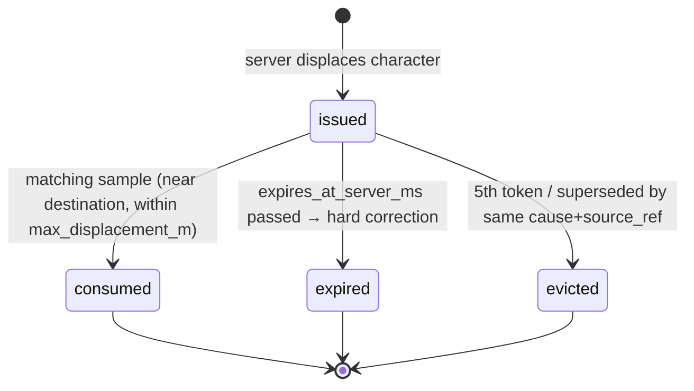
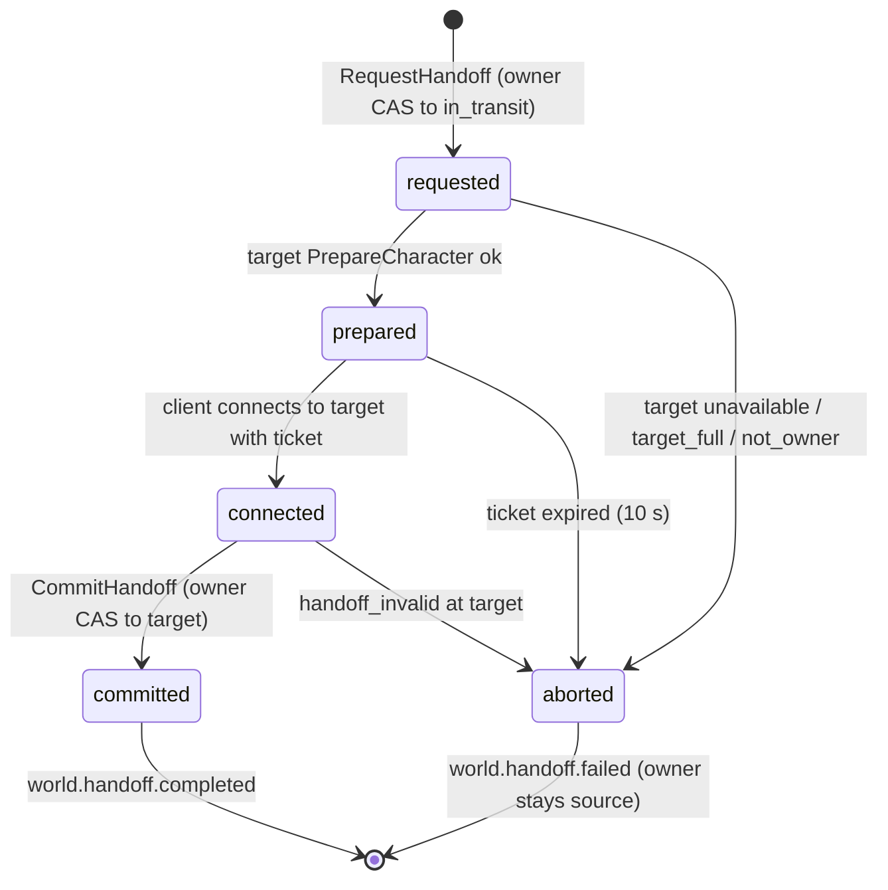

# Legends of the Shattered Frontier — World Simulation: Cells, Movement, Handoffs and World Clock
### Version 1.0 — Expanded Technical Design Authority edition (2026-10-17)

Status: Design target; not implemented. Names per Shared Registry v1.0.

Part 2 of the World Simulation specification. Entry file: [World Simulation Architecture](../Legends_Shattered_Frontier_World_Simulation_Architecture_v1.0.md). Names: [Shared Registry](../Legends_Shattered_Frontier_Shared_Registry_v1.0.md). Server allocation and realms: [Part 1](Legends_Shattered_Frontier_World_Server_Fleet_and_Realms_v1.0.md).

This part owns the cell grid, zone content level, authoritative movement speed `v_eff`, mounts, teleport tokens, zone handoffs and layering, the world clock with day/night, weather, and the `world.handoff.*` and `world.weather.changed` payloads. The world hierarchy (realm → continent → region → zone → cell) and zone content fields are in the entry file, Core model.

---

## Cell ID format

Cells are the smallest simulation partition inside a zone (Registry glossary) and the unit used in Security's movement path digests (Security spec, Threat model, "Security considerations for this part": "movement path digests (cell sequence per 60 s)"). Cells are also the unit of simulation activation (Part 3, Cell activation) and of spatial indexing for structures, spawn points and terrain chunks.

**Map index.** Every simulated map — each `zone` and each instance map (dungeon/raid level asset) — has a stable `zone_index` (uint16) assigned once in the content pack and never reused, even after the map is retired. Index `0` is reserved (invalid). World owns the index table; content tooling rejects a pack that reuses or changes an index.

**Cell coordinates.** In the map's local frame (metres, origin = `zone.origin` for zones, level origin for instance maps):

```text
cx = floor( x_local / CELL_SIZE_M )
cy = floor( y_local / CELL_SIZE_M )
CELL_SIZE_M = 64        (tune.world.cell_size_m; changing it requires a new major path-digest schema)
```

Cells are 2-D (Z is ignored). A 64 m cell is about 9 s of running at 7 m/s, which keeps a 60 s digest to a few dozen entries.

**Binary form** (`cell_key`, uint64, used on the wire and in digests):

```text
bits 63..48  zone_index        (uint16)
bits 47..24  cx                (signed 24-bit two's complement)
bits 23..0   cy                (signed 24-bit two's complement)
```

**Text form** (logs, tools, warehouse): `<zone_id>:<cx>:<cy>`, e.g. `zone/greenlands_01:12:-3`.

Determinism: the same position, map and content version always produce the same key on every server and in offline tools. `cell_key` values from different maps never collide because `zone_index` is part of the key.

**Worked example.** `zone/greenlands_01` has `zone_index` 17 (0x0011). A character at local (812.0, −150.5) gives `cx = floor(812.0 / 64) = 12` and `cy = floor(−150.5 / 64) = floor(−2.35) = −3`. In 24-bit two's complement, −3 = 0xFFFFFD, so `cell_key = 0x0011_00000C_FFFFFD = 0x001100000CFFFFFD` (4,785,074,822,184,957). Text form `zone/greenlands_01:12:-3`.

Reference implementation (normative behaviour; any language must match it bit for bit):

```text
encode(zone_index, cx, cy) = (zone_index << 48) | ((cx & 0xFFFFFF) << 24) | (cy & 0xFFFFFF)
decode(k): zone_index = k >> 48
           cx = sign_extend_24((k >> 24) & 0xFFFFFF);  cy = sign_extend_24(k & 0xFFFFFF)
sign_extend_24(v) = v − 0x1000000 if v ≥ 0x800000 else v
```

**Path digest record** (produced by `zone-server` / `instance-server`, consumed by `anticheat-service`; Security owns detectors and retention):

| Field | Type | Meaning |
| --- | --- | --- |
| `character_id` | string | `chr_` |
| `srvi_id` | string | Producing server. |
| `window_start_server_ms` | int64 | Start of the 60 s window. |
| `cells` | repeated `{cell_key uint64, enter_offset_ms uint32}` | Run-length encoded: one entry per cell change; max 128 entries (`tune.world.path_digest_max_cells`), excess truncated with `truncated = true`. |
| `mode_changes` | repeated `{movement_mode, offset_ms}` | Lets detectors separate mounted from on-foot segments. |
| `tokens_consumed` | repeated `{displacement_cause, offset_ms}` | Server-initiated jumps in the window, so they are not read as teleports. |

Digests are produced only for characters (never NPCs). A window is closed early on handoff, so a digest never spans two servers. Transport is the server's batched stream to `anticheat-service` (Security spec owns the transport and retention); digests are never published on `event-bus` topics read by Analytics.

---

## Zone content level

Several specs use the level of the place where content runs (Dungeon spec, Content scaling and rewards, Open-world dungeons: "`L_run` = zone content level"; Quest generation level bands; NPC spawn levels).

Zone content fields (World-owned, entry file Core model):

| Field | Type | Rule |
| --- | --- | --- |
| `level_range` | `{min, max}` | 1–100 (`LEVEL_CAP`); `min ≤ max`; cap zones `{100, 100}`. |
| `level_areas[]` | `{area_id, polygon, content_level}` | Optional sub-areas. `content_level ∈ level_range`. Polygons may nest; they may not partially overlap. |

```text
content_level(p) = content_level of the innermost level_area containing p
                 = level_range.max                  if no level_area contains p
```

Content tooling requires a `level_area` covering every open-world dungeon arena, world-event area and spawn area. The fallback is therefore a safety value, not a design input. Instances use the run level from instance-service (Dungeon spec), not this function.

Worked example: `zone/greenlands_02` has `level_range {10, 20}`. The ruined mill sits in `level_area mill_ruins` (content_level 14) nested inside `level_area southern_fields` (content_level 12). An open-world boss in the mill arena runs with `L_run = 14`. A player on an unmarked road in the same zone is at content level 20 (fallback).

---

## Authoritative movement speed

The server computes `v_eff(t)`, the maximum legal horizontal speed for a character at server time `t`. Security's movement envelope (Security spec, Threat model, Movement envelope validation) consumes it; the client's own speed is never trusted.

### Movement modes and base speeds

Registry enum `movement_mode`: `walk`, `run`, `sprint`, `crouch`, `swim`, `mounted`.

| Mode | Base speed `v_base` (m/s) | Tuning key | Notes |
| --- | --- | --- | --- |
| `walk` | 2.5 | `tune.world.walk_speed_mps` | |
| `run` | 7.0 | `tune.world.run_speed_mps` | Default mode; matches the Security worked example. |
| `sprint` | 9.0 | `tune.world.sprint_speed_mps` | Drains Stamina (Combat spec); not allowed in combat. |
| `crouch` | 2.0 | `tune.world.crouch_speed_mps` | |
| `swim` | 3.0 | `tune.world.swim_speed_mps` | |
| `mounted` | `mount.move_speed_mps` | mount definition | Launch tiers: 11.0 / 13.0 / 15.0 m/s; content tooling rejects > `V_CAP_MOUNTED`. |
| Backpedal | 0.6 × mode speed | `tune.world.backpedal_factor` | Applies when moving > 120° from facing. |

Vertical constants used by Security's vertical rules: `h_jump` 1.2 m (`tune.world.jump_height_m`), `h_step` 0.45 m (`tune.world.step_height_m`), `g` 9.81 m/s² (`tune.world.gravity_mps2`), so `v_jump = sqrt(2 g h_jump)` ≈ 4.85 m/s. Terminal fall speed 50 m/s (`tune.world.terminal_fall_mps`). Falling does not use `v_eff` for horizontal speed: the horizontal velocity at take-off is kept (no air control above `v_eff` at take-off).

Mode transitions are server-decided from client intent:

| Transition | Server rule |
| --- | --- |
| → `sprint` | Only out of combat and with Stamina > 0 (Combat spec owns Stamina drain). Combat entry forces `run`. |
| → `swim` | Server water volume test: water depth at the character ≥ 1.3 m (`tune.world.swim_depth_m`). The client cannot choose `swim`. |
| → `mounted` | Mount cast 1.5 s (`tune.world.mount_cast_ms`), non-moving (`v_eff = 0` during the cast), out of combat, not in water, not indoors (no roof volume), mount owned (Mounts). |
| `mounted` → on foot | Player dismount; any hostile damage taken (`tune.world.dismount_on_damage`, true); entering water deeper than 1.3 m; entering a `no_mount` volume (dungeon entrances, settlements' interiors). |
| → `crouch`, `walk` | Any time. |

### Formula

```text
on foot (walk, run, sprint, crouch, swim):
  v_raw = v_base(mode) × combat_move_mult × M_buff × M_zone × M_dir
  v_eff = min(v_raw, V_CAP_FOOT)

mounted:
  v_raw = v_mount × M_buff_mount × M_zone × M_dir
  v_eff = min(v_raw, V_CAP_MOUNTED)

always:
  v_eff = min(v_eff, V_CAP_ABSOLUTE);  v_eff = 0 while rooted, stunned or casting a non-moving cast
```

| Variable | Definition | Range / cap | Tuning key |
| --- | --- | --- | --- |
| `v_base(mode)` | Table above. | — | per mode |
| `v_mount` | `move_speed_mps` of the active mount definition. | ≤ `V_CAP_MOUNTED` | content |
| `combat_move_mult` | Owned by Combat spec, Movement speed: `1 + min(MOVE_DEX_CAP, max(0, DEX − 10) / MOVE_DEX_DIVISOR) + min(item movement_speed_bp, 1000) / 10000`. Haste never affects movement. World applies it as given, on foot only. | [1.00, 1.15] (Dex ≤ 0.05, items ≤ 0.10) | `tune.combat.move_dex_cap` (0.05), `tune.combat.move_dex_divisor` (3000), `tune.item.cap.movement_speed_bp` (Itemization) |
| `M_buff` | `(1 + min(Σ u_i, U_CAP)) × (1 − min(max d_j, D_CAP))`. `u_i` = positive speed effects (additive); `d_j` = slows (strongest single slow only, no stacking). | `U_CAP` 0.40, `D_CAP` 0.70 | `tune.world.speed_buff_cap`, `tune.world.slow_cap` |
| `M_buff_mount` | Same as `M_buff` but only effects flagged `applies_mounted`; `U_CAP_MOUNT` 0.30. | — | `tune.world.mount_speed_buff_cap` |
| `M_zone` | Terrain/area volume modifier (road 1.10, deep snow 0.80, tar 0.60), times the weather modifier `M_weather` (Weather). Product of overlapping volumes and weather, clamped. | [0.5, 1.2] | content (`zone` volumes); clamp `tune.world.zone_speed_min/max` |
| `M_dir` | 1.0, or `backpedal_factor` when backpedalling. Security uses `M_dir = 1` (upper bound) so direction never causes false rejects. | — | — |
| `V_CAP_FOOT` | Hard cap on foot. | 12.0 m/s | `tune.world.v_cap_foot` |
| `V_CAP_MOUNTED` | Hard cap mounted. | 20.0 m/s | `tune.world.v_cap_mounted` |
| `V_CAP_ABSOLUTE` | Overall hard cap; any effect or content value is clipped here, with an `ops` warning. | 20.0 m/s | `tune.world.v_cap_absolute` |

Effects that move a character faster than `v_eff` (charge, leap, dash, blink) are not speed buffs: they are server-initiated displacements and issue teleport tokens (Teleport tokens).

Speed effects are Combat-spec effects with a `move_speed` component (Combat owns effect authoring). World reads two fields per effect: `move_speed_delta` (positive = buff `u_i`, negative = slow `d_j` as its absolute value) and `applies_mounted` (bool). Roots and stuns are Combat states that World reads as `v_eff = 0`.

### Publishing `v_eff` to validation

- The zone-server recomputes `v_eff` whenever an input changes (mode, mount, effect applied/expired, volume entered, weather change, combat state) and appends `(server_ms, v_eff)` to a per-character ring buffer covering the last 2 s (`tune.world.v_eff_history_ms`).
- Security's `v_eff_max_window` is the maximum value in that buffer over `[t − Δt_s, t]`. On mode changes (dismount, buff expiry) the higher old value stays in the window, so there are no false rejects at the boundary.
- **Tolerance.** World adds no tolerance of its own. Security's proportional tolerance `ε` (`tune.security.move_tolerance`, default 0.08), slack `s_slack` (0.5 m), `T_burst` (1.0 s) and teleport threshold `d_tp = v_eff × 1.0 s + 2.0 m` apply to `v_eff` exactly as computed here. Per Security, `v_eff` is the authoritative upper bound before tolerance.
- The Security replay test "7.0 m/s at 50 ms samples never rejects" (Security agent guide) therefore corresponds to an unbuffed `run` character with `combat_move_mult = 1.0` (DEX 10, no movement-speed items) on neutral terrain in `clear` weather.
- Weather and volume decreases take effect after a grace of 500 ms (`tune.world.v_eff_decrease_grace_ms`): the buffer keeps the old value for that time. Increases take effect at once. This covers clients that cross a volume edge between samples.

### Worked examples

1. **Agile runner, buffed and slowed.** `run` 7.0; DEX 130 → min(0.05, 120/3000) = 0.04, plus boots with 200 bp → 0.02, so `combat_move_mult` = 1.06. Buffs +0.30; one 0.20 slow → `M_buff` = 1.30 × 0.80 = 1.04. Road volume `M_zone` = 1.10.
   `v_eff` = 7.0 × 1.06 × 1.04 × 1.10 = **8.49 m/s** (< 12.0 cap).
   Security then gets `d_tp` = 8.49 + 2.0 = 10.49 m, budget cap = 8.49 × 1.0 + 0.5 = 8.99 m, per-50 ms credit = 8.49 × 0.05 × 1.08 = 0.458 m.
2. **Stacked buffs hit the cap.** `sprint` 9.0; DEX 200 (Dex term capped at 0.05) + 1,400 bp of items (capped at 1,000 → 0.10) → `combat_move_mult` = 1.15; buffs 0.25 + 0.30 = 0.55 → capped 0.40 → 1.40; `M_zone` 1.0.
   `v_raw` = 9.0 × 1.15 × 1.40 = 14.49 → `v_eff` = **12.0 m/s** (`V_CAP_FOOT`).
3. **Mounted.** Tier-2 mount 13.0; `M_buff_mount` = 1.30 (mount-flagged +0.30); `combat_move_mult` is not applied.
   `v_eff` = 13.0 × 1.30 = **16.9 m/s** (< 20.0).
4. **Dismount mid-sample.** At t = 10.000 s `v_eff` drops from 16.9 to 7.0. A sample at 10.040 with `Δt_s` = 0.05 uses `v_eff_max_window` = 16.9, so no false reject. The next sample uses 7.0.
5. **Blizzard on a road.** `run` 7.0, `combat_move_mult` 1.0, road 1.10, `blizzard` `M_weather` 0.85 → `M_zone` = 1.10 × 0.85 = 0.935. `v_eff` = 7.0 × 0.935 = **6.55 m/s**. The weather change at t applies to validation at t + 0.5 s.

### Mounts

Closes skeleton open issue 3. Mounts are registered content kind `mount` (`mount/<slug>`, Shared Registry §3.2; World owns the kind). World needs only the movement fields. Ownership of a mount is an account unlock of kind `mount` (Character spec, `account_unlock_kind`). An item may teach a mount (Itemization spec owns that item behaviour). The zone-server checks ownership through the character's unlock set loaded at login. Resolved (2026-10-17): content kind and unlock kind are canonical.

| Field | Type | Rule |
| --- | --- | --- |
| `move_speed_mps` | float | 11.0, 13.0 or 15.0 at launch (tiers 1–3); tooling rejects > `V_CAP_MOUNTED` |
| `tier` | int | 1–3 |
| `seats` | int | 1 at launch (multi-seat mounts are vehicles, cause `vehicle`) |
| `swim_allowed` | bool | false at launch |
| `flight` | — | Not a field. Flight and gliding are not in `movement_mode` at launch (closes skeleton open issue 5: adding them needs new caps and Security vertical rules and is a future Registry change). |

---

## Teleport tokens

Every **server-initiated displacement** — any change of position the client did not produce by moving within `v_eff` — issues a teleport token. Without one, Security's hard teleport rule rejects the client's next sample (`movement_teleport`).

### When tokens are issued

Registry enum `displacement_cause`:

| Cause | Issued by | Trigger |
| --- | --- | --- |
| `teleport_spell` | zone-server | Ability with a teleport/blink effect (Combat). |
| `charge` | zone-server | Charge, leap or dash faster than `v_eff`. |
| `knockback` | zone-server | Knockback/knock-up/pull whose planned horizontal displacement ≥ `tune.world.knockback_token_threshold_m` (1.0 m). Below that, the server adds the displacement to the movement budget `B` instead (no token). |
| `pull` | zone-server | Pull, grip or any forced move toward a point (same threshold). |
| `fast_travel` | zone-server, or world-service if cross-zone | Fast-travel node use (sink `fast_travel`). |
| `respawn` | zone-server / instance-server | Release to graveyard or respawn point; login placement. |
| `resurrect` | zone-server / instance-server | Resurrection that moves the body. |
| `unstuck` | zone-server | Player unstuck command (rate limited 1/15 min). |
| `zone_handoff` | world-service (in handoff ticket) | Zone border crossing, migration, layer change (Zone Handoffs). |
| `instance_entry` | instance-server | First placement after a valid join ticket. |
| `instance_exit` | world-service (in handoff ticket) | Return from an instance to the world (Dungeon spec, Instance runtime, Closing). |
| `gm_move` | zone-server, on `AdminMoveCharacter` | Staff teleport; audited by audit-service. |
| `vehicle` | zone-server | Boarding/leaving ships, siege engines, moving platforms (position re-based). |

Rule: if a system moves a character and its cause is not in this list, the system must add a cause (Registry addition) and not bypass the token.

**Unstuck** moves the character to the nearest navigable point at least 2 m away within 30 m. If none exists, it moves the character to the zone's nearest `respawn_point`. It is refused in combat and inside instances (instance-servers use their own respawn points).

### Token fields

Security's fields `{token_id, max_displacement_m, expires_at_server_ms}` are kept unchanged; the rest are added.

| Field | Type | Meaning |
| --- | --- | --- |
| `token_id` | string `tpt_<ULID>` | Unique id. |
| `character_id` | string | `chr_` the token applies to. |
| `srvi_id` | string | The only server that may consume it. |
| `cause` | `displacement_cause` | Table above. |
| `origin` | vec3 (map-local m) | Server-authoritative position at issue. |
| `destination` | vec3 | Server-authoritative landing point (knockback: simulated trajectory end). |
| `dest_tolerance_m` | float | Default 1.5 m (`tune.world.teleport_dest_tolerance_m`); knockback 2.5 m. |
| `max_displacement_m` | float | `‖destination − origin‖_h + dest_tolerance_m`. |
| `issued_at_server_ms` | int64 | |
| `expires_at_server_ms` | int64 | `issued_at + ttl`. |
| `source_ref` | string | Ability id, fast-travel node, `handoff_id`, `run_id`, or audit record id (GM). |
| `consumed` | bool | Set on consumption. |

**Lifetime.** In-zone causes: `tune.world.teleport_token_ttl_ms` (2,000 ms; covers p99 250 ms RTT plus loading of a short blink). Cross-server causes (`zone_handoff`, `instance_entry`, `instance_exit`, cross-zone `fast_travel`): `tune.world.teleport_token_ttl_cross_ms` (10,000 ms), measured from when the destination server accepts the character. These are the Registry constant `TELEPORT_TOKEN_TTL`.

**Limits.** At most 4 outstanding tokens per character (`tune.world.teleport_tokens_max`). A fifth evicts the oldest. A new token with the same `cause` and `source_ref` replaces the previous one (for example a re-applied pull).

### Where tokens live

- **In-zone tokens are server memory only** on the issuing zone-server, keyed by `character_id`. The client never receives the token and never presents it. It gets a `DisplacementNotice{seq, destination, cause}` and must snap or animate to `destination`. A cheat client has nothing to forge or replay.
- **Cross-server tokens** are claims inside a signed `HandoffTicket` (Zone Handoffs) minted by world-service. The destination server verifies the ticket and creates a local in-memory token from its claims. The ticket nonce is single-use (`world:nonce:{nonce}` plus the server's own nonce set).

### Validation and consumption (zone-server, feeding Security's check)

For each received position sample `p` with horizontal displacement `d_h` from the last accepted position:

```text
1. Expire tokens with expires_at_server_ms < now.
2. Candidate = oldest unconsumed token where ‖p − destination‖_h ≤ dest_tolerance_m
                                       and ‖p − origin‖_h ≤ max_displacement_m.
3. If candidate exists:
      consume it (single use; consumed = true; removed from memory)
      last_accepted_position ← p;  B ← budget cap      (Security's B)
      do not run speed/teleport rules for this sample; vertical and collision rules still apply
         relative to destination
      append {cause, offset_ms} to the path digest
4. Else: run Security's normal movement envelope. A sample with d_h > d_tp and no candidate
      → reject movement_teleport (rolled up per Security spec, Reject rollups).
```

While a token is outstanding, the server's authoritative position is already `destination`: other clients see the character there. Samples still near `origin` (packets sent before the client processed the notice) are dropped silently and not counted as rejects while the token is valid. If the token **expires unconsumed**, the server sends a hard correction to `destination` and increments `teleport_token_expired` (Analytics hooks). This is not a reject reason, because players on bad connections hit it legitimately; Security may build a detector on the rate.



**Worked example (knockback).** A character at origin (100.0, 50.0) is knocked back 6.0 m east. The server simulates the arc and lands it at (106.0, 50.0) after 0.6 s. Token: `cause = knockback`, `dest_tolerance_m = 2.5`, `max_displacement_m = 6.0 + 2.5 = 8.5`, expires at issue + 2,000 ms. The client's next sample arrives at (105.1, 50.3). The distance to the destination is √(0.81 + 0.09) = 0.95 m ≤ 2.5, and the distance to the origin is 5.11 m ≤ 8.5, so the token is consumed. Without the token, `d_h` = 5.11 m against `d_tp` = 7.0 + 2.0 = 9.0 m would pass the hard rule. It would pass the budget check only if `B` happened to be full (cap 7.5 m), and it would drain `B`, so the following normal samples (credit ≈ 0.38 m per 50 ms at 7.0 m/s) would be rejected as `movement_speed`. This is why knockbacks of 1.0 m or more need tokens.

---

## Zone Handoffs

Players crossing zone borders are transferred seamlessly. The protocol below gives a single owner at all times (Security threat M7, item duplication during handoff).

### Border model

Each shared border has a **ghost band** of `tune.world.handoff_band_m` (48 m) on both sides. Inside the band, the neighbouring zone-server receives a read-only proxy of the character for replication, so players across the border see each other. Handoff starts when the character's authoritative position is `tune.world.handoff_hysteresis_m` (4 m) past the border line. Hysteresis prevents ping-pong.

Border rules (normative):

- Proxies are read-only. A proxy cannot be damaged, targeted by abilities, traded with, or looted. Combat across a border is resolved by the owning server of the attacker only after handoff (abilities whose target is a proxy fail with `combat_target`). Borders are authored away from combat-dense content: content tooling warns when a spawn area or event area lies within 64 m of a border.
- Projectiles and AoE effects stop at the border line.
- A character may not start a new handoff within 2 s of the previous commit (`tune.world.handoff_cooldown_ms`). During the cooldown, the character can move freely inside the band on the new server, so ping-pong at a corner cannot cause a handoff storm.
- Terrain edits within 8 m of a border line are refused (`tune.world.border_edit_exclusion_m`; Part 3, Terrain edit validation) because two servers would otherwise own adjacent voxels.

### Protocol

```mermaid
sequenceDiagram
    autonumber
    participant C as Client
    participant A as zone-server A (source)
    participant WS as world-service
    participant B as zone-server B (target)
    participant P as Persistence (character/inventory services)
    A->>A: border + hysteresis crossed; freeze transactional actions (trade, loot, craft) for character
    A->>P: checkpoint character state → state_version
    A->>WS: RequestHandoff(idempotency_key, character_id, from_srvi, to_zone_id, position, velocity, state_version)
    WS->>WS: CAS world:chr:{id}:owner (srvi=A, no handoff) → handoff_id, in_transit
    WS-->>A: HandoffTicket(signed: handoff_id, character_id, from_srvi, to_srvi, to_zone_id, entry_position, state_version, token claims cause=zone_handoff, exp, nonce)
    A->>B: PrepareCharacter(ticket) (server-to-server, mTLS)
    B->>B: verify ticket, load state_version, spawn hidden
    A->>C: SwitchServer(B address, ticket)
    C->>B: UDP connect + ticket
    B->>B: validate (signature, to_srvi = self, exp, nonce, state_version) → create in-memory teleport token
    B->>WS: CommitHandoff(handoff_id)
    WS->>WS: CAS owner = B, clear handoff_id
    WS-->>B: committed
    WS->>A: ReleaseCharacter(handoff_id) (heartbeat command)
    A->>A: drop character, unfreeze nothing (no longer owner)
    Note over WS: emits world.handoff.completed; character-service emits character.zone.changed
```

```proto
message RequestHandoffRequest {
  string idempotency_key = 1;          // "hof:{character_id}:{from_srvi}:{state_version}"
  string character_id = 2; string from_srvi_id = 3;
  string to_zone_id = 4; uint32 to_layer = 5;      // to_layer: proposed; default = Layering rule L3
  Vec3 position = 6; Vec3 velocity = 7;            // source-map-local
  uint64 state_version = 8;
  string handoff_kind = 9;                          // registered enum handoff_kind (Shared Registry, Phase-2 enums)
  string to_srvi_id = 10;                           // set only for migration / layer_change
  string displacement_cause = 11;                   // zone_handoff | instance_exit | fast_travel | vehicle | gm_move
  string source_ref = 12;                           // run_, fast-travel node, aud_, migration id
}
message HandoffTicket {
  bytes signed_ticket = 1;             // compact Ed25519 token, claims below
  string handoff_id = 2; string to_srvi_id = 3; string address = 4; uint32 port = 5;
  Vec3 entry_position = 6;             // target-map-local
  int64 expires_at_ms = 7;
}
message CommitHandoffRequest { string idempotency_key = 1; string handoff_id = 2; string to_srvi_id = 3; }
message CommitHandoffResponse { bool committed = 1; uint64 owner_version = 2; }
message AbortHandoffRequest { string idempotency_key = 1; string handoff_id = 2; string reason = 3; }
```

**Ticket.** Ed25519 by the world-service key, lifetime `tune.world.handoff_ticket_ttl_s` (10 s), single use. `handoff_id` uses prefix `hof_`. Claims:

```json
{
  "handoff_id": "hof_01JA6Q4W8E2R5T7Y9U1I3O5P7A",
  "character_id": "chr_01J9ZK3Q8M4V6T2N5X7B1C0D9E",
  "account_id": "acc_01J9ZK0000000000000000000",
  "from_srvi": "srvi_01JA6PZ0000000000000000000",
  "to_srvi": "srvi_01JA6Q00000000000000000000",
  "to_zone_id": "zone/greenlands_01",
  "to_layer": 0,
  "entry_position": [1824.5, -96.0, 42.3],
  "state_version": 88213,
  "handoff_kind": "border",
  "token": { "cause": "zone_handoff", "dest_tolerance_m": 1.5 },
  "exp_ms": 1792249210000,
  "nonce": "b64:9c1f…",
  "kid": "world-2026q4-a"
}
```

**Entry position.** For border crossings, `entry_position` = the source position transformed into the target map frame (`p_target = p_source + zone_A.origin − zone_B.origin`, both in continent space, Z unchanged). It is snapped to the nearest navigable point within 2 m. If none exists (for example a cliff edge), the nearest authored `border_entry` anchor is used. For other kinds, the destination is given by the caller (fast-travel node, dungeon entrance, migration position).

**Failure and rollback.** If `CommitHandoff` has not happened when the ticket expires, or B rejects, world-service runs `AbortHandoff`. The owner stays A, A unfreezes, and the client is told to stay or reconnect to A. Ownership moves only on commit, so there is never a moment with two writers. A crash of A after commit is harmless. A crash of B before commit aborts. A crash of B after commit is handled as `lost` and the character restores from `state_version` on reassignment.

**`handoff_invalid`** (Registry `reject_reason`) is returned by the target server or world-service when any of these fails. Subreasons are kept in the reject rollup detail, not as new enum values:

| Subreason | Check |
| --- | --- |
| `bad_signature` | Ticket signature or key id invalid. |
| `expired` | `exp` passed. |
| `wrong_server` | `to_srvi` ≠ receiving server. |
| `nonce_reused` | Nonce already seen. |
| `state_mismatch` | Loaded `state_version` ≠ ticket. |
| `not_owner` | Owner record not A or a handoff is already in transit. |
| `character_mismatch` | Connection's session character ≠ ticket `character_id`. |

### Handoff kinds

Proposed enum `handoff_kind` (payload field of `world.handoff.*`; the token cause stays `displacement_cause`):

| `handoff_kind` | Source → target | Token cause | Initiator |
| --- | --- | --- | --- |
| `border` | zone → neighbouring zone | `zone_handoff` | source zone-server |
| `instance_entry` | zone → instance-server | `instance_entry` | instance-service join ticket (owner set to `in_transit` by zone, then instance-server) |
| `instance_exit` | instance → entrance zone | `instance_exit` | instance-server |
| `fast_travel` | zone → zone (node to node, portals, ships between continents) | `fast_travel` or `vehicle` | source zone-server after `Debit(fast_travel)` succeeded |
| `migration` | old process → new process, same zone and layer | `zone_handoff` | world-service (`MigrateZone`) |
| `layer_change` | layer i → layer j, same zone | `zone_handoff` | zone-server on party join or world-boss pull (Layering and overflow) |
| `admin_move` | any zone → any zone | `gm_move` | world-service (`AdminMoveCharacter`) |
| `login` | none → zone | `respawn` | `ResolveZone` entry ticket (no source owner) |

**Instance entry/exit.** Entry uses instance-service's join ticket (Dungeon spec). The zone-server releases ownership to world-service as `in_transit` when the client leaves for the instance. The instance-server issues `instance_entry` and sets the owner on accept. Exit (Dungeon spec, Instance runtime, Closing) is a normal `RequestHandoff` from the instance-server to the entrance zone with cause `instance_exit`.

Normative detail for entry: the zone-server calls `RequestHandoff(handoff_kind = instance_entry, to_srvi_id = instance srvi_)`. world-service CASes the owner to `in_transit` with that `handoff_id`. The instance-server, after validating the join ticket, calls `CommitHandoff(handoff_id)`. If the client never arrives (join ticket 60 s), the handoff aborts and the character returns to the zone at its departure position with a `respawn` token.

**Fast travel and inter-continent transit.** Fast travel, portals and paid ships charge the sink `fast_travel` (Economy spec). The charge is taken **after** the move succeeds, so an aborted handoff never needs a refund (the ledger has no refund code for this sink):

1. The source zone-server checks `GetWallet` balance ≥ cost before `RequestHandoff`. If the balance is too low, it refuses with `interact_state`.
2. After `CommitHandoff` (or, in-zone, after the `fast_travel` token is consumed), the server that now owns the character calls `Debit(sink = fast_travel, idempotency_key = "ft:{handoff_id}")`.
3. If the debit fails because the balance dropped in transit (for example a housing-tax debit landed), the trip is not reversed. The server logs `fast_travel_unpaid`, and Analytics counts it. Trades and market actions are frozen during transit, so a player cannot drain the wallet deliberately.

### Target full

A border handoff into a zone at `capacity_hard` (non-layerable) is refused before ticketing with `RESOURCE_EXHAUSTED target_full`. The source server stops the character 2 m inside its own border and shows a "region is crowded" notice. The character can retry after 10 s. This is a `world.handoff.failed` with `failure_reason = target_full`, not a security reject. Layerable zones never refuse while `layers_max` is not reached.

### Handoff state machine



These are internal stages recorded in `world:handoff:{handoff_id}` and in the `stage` field of `world.handoff.failed`. They are not a registry enum.

### Timing budget

| Step | Budget p95 | Notes |
| --- | --- | --- |
| Checkpoint to persistence (`state_version`) | 60 ms | character-service location write; inventory is already durable |
| `RequestHandoff` round trip | 15 ms | Redis CAS + Ed25519 sign |
| `PrepareCharacter` | 50 ms | target loads `state_version`, spawns hidden; ghost proxy already warm |
| Client reconnect (`SwitchServer` → UDP connect) | 150 ms | one RTT plus connection setup |
| Validate + `CommitHandoff` | 25 ms | |
| **Total** | **≤ 300 ms** | `world.handoff.completed.duration_ms`; target success ≥ 99.9 % |

---

## Layering and overflow

Closes skeleton open issue 4. A **layer** is an additional `zone-server` process simulating the same `zone_id` and map with its own players and NPCs. Layers share persisted state (terrain, structures, spawn timers of rare nodes).

| Rule | Normative statement |
| --- | --- |
| L1 Eligibility | Only zones with content field `layerable = true` may have layers. Zones that contain claimable land (Building spec) are never layerable, so terrain and structures always have one live owner. Starting zones and levelling hubs are layerable by default. |
| L2 Placement | `ResolveZone` and `layer_change` choose, in order: the layer holding the character's party; the layer holding most of the listed friends; the fullest layer with `players < capacity_soft` (default 200, `tune.world.zone_capacity_soft`); otherwise open a new layer if `layers < layers_max` (default 4, `tune.world.layers_max`); otherwise queue. |
| L3 Border target | A border handoff into a layerable zone targets the layer with the same index as the source when the source zone is layerable; otherwise rule L2. |
| L4 Merge | A layer `i > 0` with `players < 0.3 × capacity_soft` for 10 min (`tune.world.layer_merge_minutes`) is merged: characters move with `layer_change` into rule-L2 targets at ≤ 25/s, then the process is released with `zone_rebalance`. Layer 0 is never merged away. |
| L5 Hop cooldown | A character may change layer at most once per 300 s (`tune.world.layer_change_cooldown_s`), except to join a party. |
| L6 Scarce content | Gathering nodes of tier `rare` or above, and world bosses, spawn only in layer 0. A world boss pins its zone: no layer merges and no new layers while it is active. Characters in other layers inside the boss's event area are offered a `layer_change` to layer 0, up to `capacity_hard + event_overflow` (default +100, `tune.world.event_overflow_players`). |
| L7 Identity | Layer index is carried in the zone owner key, the alloc token, the handoff ticket and `world.handoff.*` payloads. `cell_key` does not include the layer. Path digests carry `srvi_id`, which identifies the layer. |

---

## World clock

- **Server time.** All hosts sync with chrony to regional NTP. A max offset of 5 ms is enforced by the node agent: a node above it is cordoned. `server_ms` (Unix ms) is the time used for token expiry, movement `Δt_s` and event `occurred_at`. Heartbeats carry `server_time_ms`. world-service flags any process more than 50 ms off its own clock (`ops.alert.fired`).
- **Game time.** Derived, never accumulated, so it cannot drift:

```text
game_seconds = (utc_ms − realm_epoch_ms) / 1000 × (86400 / (DAY_LENGTH_MIN × 60))
DAY_LENGTH_MIN = 240  (one game day = 4 real hours; tune.world.day_length_minutes)
realm_epoch_ms = realm launch midnight UTC (config)
game_day_index = floor(game_seconds / 86400)
time_of_day_s  = game_seconds mod 86400
```

- `GetWorldClock` returns `{realm_epoch_ms, day_length_minutes, world_time_ms, game_day_index, time_of_day_s}`. Zone-servers compute it locally from these values and resync on `config.tuning.published`. Clients get the same values at login; they are cosmetic (lighting) and never used for validation.
- Seasons and resets are owned by LiveOps (Registry, Resets); World does not define them.
- Changing `tune.world.day_length_minutes` is allowed only in a maintenance window. The realm epoch is re-based so that the current `time_of_day_s` is preserved: `realm_epoch_ms' = utc_now − (game_seconds_now / f')`, where `f' = 86400 / (DAY_LENGTH_MIN' × 60)`. Lighting therefore does not jump.

```proto
message GetWorldClockRequest { string realm_id = 1; }
message WorldClock {
  int64 realm_epoch_ms = 1; uint32 day_length_minutes = 2; int64 world_time_ms = 3;
  int64 game_day_index = 4; uint32 time_of_day_s = 5; string day_phase = 6;  // proposed field
  int64 next_phase_at_ms = 7;                                                 // proposed field
}
```

### Day and night

Proposed enum `day_phase`: `dawn`, `day`, `dusk`, `night`. With the default 240-minute day, 1 game hour = 10 real minutes.

| `day_phase` | Game time | Real duration | Gameplay hooks |
| --- | --- | --- | --- |
| `dawn` | 05:00–07:00 | 20 min | Spawn tables may switch; lighting only otherwise |
| `day` | 07:00–19:00 | 120 min | Default spawn tables |
| `dusk` | 19:00–21:00 | 20 min | As dawn |
| `night` | 21:00–05:00 | 80 min | `phase_filter = night` spawns (undead, nocturnal wildlife); NPC visibility multiplier 0.7 for AI perception; world bosses with a night filter |

Phase boundaries come from `tune.world.day_phase_bounds` (default `[18000, 25200, 68400, 75600]` seconds of game time).

**Worked example.** Realm `eu-1` has `realm_epoch_ms` = 2026-11-01T00:00:00.000Z. At 2026-11-01T13:25:00.000Z, 48,300 real seconds have elapsed. The factor is 86400 / (240 × 60) = 6, so `game_seconds` = 289,800, `game_day_index` = 3 and `time_of_day_s` = 289,800 − 259,200 = 30,600 (08:30) → `day`. The next phase (`dusk` at 68,400) is 37,800 game seconds away = 6,300 real seconds, at 15:10:00Z.

---

## Weather

The Game Master concept lets staff change weather. The Construction concept uses weather exposure for structure wear. Movement uses it in `M_zone`. World therefore owns a server-authoritative weather state per `world_region`.

### Model

Proposed enum `weather_kind`: `clear`, `overcast`, `rain`, `storm`, `fog`, `snow`, `blizzard`, `sandstorm`, `heatwave`, `ashfall`.

Weather is a Markov chain per region, stepped once per **weather period** of `W` real minutes (`tune.world.weather_period_min`, 30):

```text
k          = floor((utc_ms − realm_epoch_ms) / (W × 60000))          period index
u_k        = first 8 bytes (big-endian) of SHA-256("wx|" + realm_id + "|" + world_region_id + "|" + k) / 2^64
state_k    = smallest j such that Σ_{i ≤ j} P[biome][state_{k−1}][i] > u_k   (rows in table order)
```

`world-service` steps every region at each period boundary and stores `(k, state_k)` in `world.weather_state` (Part 3). If the stored state is older than `k − 1` (outage), it steps forward from the stored state through the missed periods using the same formula. If no state exists (new region), it samples `state_k` from the biome's stationary distribution `π` with `u_k`. Given the stored state, the result is deterministic and reproducible offline.

### Transition matrices (defaults)

Rows = current state, columns = next state (same order). Key `tune.world.weather_matrix.<biome>`. Content tooling rejects a matrix whose rows do not sum to 1 or whose stationary distribution deviates from the target column by more than 5 percentage points.

These legacy matrix, period, speed, visibility and exposure keys distribute released content; consoles cannot edit their tables or formulas. The bounded controls are `tune.world.weather_frequency_percent` and `tune.world.weather_severity_profile`, declared in [Construction Integration §9](../Legends_Shattered_Frontier_Construction_Integration_Contracts_v0.1.md#9-canonical-construction-configuration-declarations). Standard 100% selects the matrices below. The shipped frequency transform multiplies transition weights to hazardous states (`rain`, `storm`, `snow`, `blizzard`, `sandstorm`, `heatwave`, `ashfall`) by frequency/100 and normalizes the whole row; nonhazard weights remain unchanged. Every row below has a nonhazard exit, including at zero. Frequency is a weight relative to Standard, not a promise of exactly doubled storm count. Release validation enforces biome movement-impairment caps for every selectable setting; combinations exceeding a cap are unavailable with an explanation. Operators preview expected hazard time rather than editing matrix cells. Selection, profile and configuration revisions are persisted per weather interval, so catch-up replays historical profiles instead of today's values.

Severity profiles scale **construction environmental hazard rates only**: Mild 50%, Standard 100%, Severe 150%. The biome's shipped maximum remains enforced; this does not multiply player movement penalties, combat fire, wear-floor protection or siege damage. It composes once with Construction's exposed wear control, and the preview shows the resulting rate. Profiles affect the next interval, never abruptly replace an active storm. GM/event overrides carry the same severity declaration and exact interval history. A normal severe storm, blizzard or sandstorm is deterministically selected at least five real minutes before its onset and broadcasts direction, severity and start time; emergency event weather must advertise its exception policy before participation. Operational pauses never emit retroactive player warnings as if they had been delivered.

**greenlands** — states `clear, overcast, rain, storm, fog`

| from \ to | clear | overcast | rain | storm | fog |
| --- | --- | --- | --- | --- | --- |
| clear | 0.70 | 0.20 | 0.06 | 0.00 | 0.04 |
| overcast | 0.30 | 0.45 | 0.20 | 0.03 | 0.02 |
| rain | 0.10 | 0.35 | 0.40 | 0.15 | 0.00 |
| storm | 0.00 | 0.30 | 0.50 | 0.20 | 0.00 |
| fog | 0.50 | 0.40 | 0.10 | 0.00 | 0.00 |

**frozen_north** — `clear, overcast, snow, blizzard, fog`: rows `[.55 .30 .10 .00 .05]`, `[.20 .40 .35 .03 .02]`, `[.10 .30 .45 .15 .00]`, `[.00 .20 .50 .30 .00]`, `[.40 .40 .20 .00 .00]`.

**desert_wastes** — `clear, overcast, sandstorm, heatwave`: rows `[.70 .10 .08 .12]`, `[.50 .35 .15 .00]`, `[.30 .20 .50 .00]`, `[.45 .05 .10 .40]`.

**corrupted_frontier** — `overcast, ashfall, storm, fog, clear`: rows `[.45 .25 .10 .10 .10]`, `[.35 .45 .15 .05 .00]`, `[.30 .40 .30 .00 .00]`, `[.50 .20 .00 .30 .00]`, `[.60 .20 .00 .10 .10]`.

**Balancing targets** (stationary share of time, computed from the matrices; mean dwell = W / (1 − P_ii)):

| Biome | Share of time | Longest mean dwell |
| --- | --- | --- |
| greenlands | clear 42.0 %, overcast 31.8 %, rain 19.2 %, storm 4.8 %, fog 2.3 % | clear 100 min |
| frozen_north | clear 23.5 %, overcast 32.6 %, snow 33.5 %, blizzard 8.6 %, fog 1.8 % | clear 67 min |
| desert_wastes | clear 57.8 %, overcast 14.7 %, sandstorm 16.0 %, heatwave 11.6 % | clear 100 min |
| corrupted_frontier | overcast 40.9 %, ashfall 32.8 %, storm 12.9 %, fog 8.8 %, clear 4.5 % | overcast, ashfall 55 min |

Design intent: movement-impairing weather (`blizzard`, `sandstorm`) stays at or below 16 % of play time in any biome. No impairing state lasts more than 60 min on average.

### Effects

| `weather_kind` | `M_weather` (movement, folded into `M_zone`) | AI visibility multiplier | Exposure class (Construction wear) |
| --- | --- | --- | --- |
| `clear`, `overcast`, `heatwave` | 1.00 | 1.0 | 0 (none), heatwave 1 |
| `rain` | 1.00 | 0.9 | 1 |
| `fog` | 1.00 | 0.6 | 0 |
| `snow` | 0.95 | 0.8 | 1 |
| `storm` | 0.95 | 0.8 | 2 |
| `ashfall` | 1.00 | 0.7 | 2 |
| `sandstorm` | 0.90 | 0.5 | 2 |
| `blizzard` | 0.85 | 0.5 | 3 |

Keys: `tune.world.weather_speed.<kind>`, `tune.world.weather_visibility.<kind>`, `tune.world.weather_exposure.<kind>`. The AI spec decides how the visibility multiplier enters perception. The Building/Construction specs decide how the exposure class enters wear. World only publishes the values. Night multiplies visibility by a further 0.7. Indoors (roof volume) and inside instances, weather effects are 1.0.

For construction wear, rain→rain hazard; snow→frost; storm→rain plus severe wind; blizzard→frost plus severe wind; sandstorm→severe wind abrasion; ashfall→rain-equivalent abrasive deposit; clear/overcast/fog/heatwave→no direct condition loss. Heatwave still requires Construction's hot-biome ventilation. Material resistances use the mapped hazard channel; this mapping is shipped code/content. Roof volumes suppress rain and roofed ash deposits, not wind, cold or room smoke. Each affected face uses Construction's exposure geometry and real elapsed time.

Automation receives a released wind factor by weather: clear/heatwave0.25, overcast/fog0.5, rain/snow/ashfall0.75, storm/blizzard/sandstorm1.0, clamped0–1. This drives exposed windmill output only; roofed mills generate zero. Authored flowing-water sockets provide flow factor0–1 and availability history; placing a wheel does not create or divert a watercourse. No socket/history means no waterwheel output. Water extraction uses explicit renewable source budgets or finite reservoir volume, serializes pump withdrawals and never subtracts visual river geometry. Powered pumps and waterwheels cannot multiply flow through loops. These are released World data, not editable formulas or a new player fluid-simulation feature.

**Worked example.** `world_region/greenlands_south` was `overcast` at period k − 1. `u_k` = 0.83. The overcast row has cumulative sums `[0.30, 0.75, 0.95, 0.98, 1.00]`. The smallest cumulative value above 0.83 is 0.95 → `rain`. Zone-servers in the region receive the change, `M_weather` stays 1.00, AI visibility becomes 0.9, and `world.weather.changed` is emitted.

### Distribution and overrides

- world-service pushes the new state to zone-servers with the heartbeat command `weather` at the period boundary. Zone-servers may also call `GetWeather(world_region_id)`. Weather changes are blended visually over 60 s on clients. Gameplay values switch at the boundary, subject to the 500 ms `v_eff` decrease grace.
- **GM override.** `ApplyWorldAction(kind = weather_override, world_region_id, weather_kind, duration_min)` with permission `world:weather:override`. `weather_kind` must be in the biome's state list. `duration_min` ≤ 60 (`tune.world.weather_override_max_min`, from the Game Master concept). The chain keeps stepping underneath; at expiry the region shows the chain's current state. Longer changes must be part of an authored world event.
- **World event weather.** ai-director-service may request weather with `DispatchZoneCommand(command = weather_set, world_region_id, weather_kind, until)`, limited to the event's `active` duration. world-service executes it as an internal world action with `actor_kind = event` (Part 3, World actions).
- Precedence: GM override > world-event weather > chain.

```proto
message GetWeatherRequest { string realm_id = 1; string world_region_id = 2; }
message WeatherReport {
  string world_region_id = 1; string weather_kind = 2; int64 period_index = 3;
  string source = 4;                  // chain | gm_override | world_event
  int64 until_ms = 5;                 // end of override/event weather; else next period boundary
  float speed_mult = 6; float visibility_mult = 7; uint32 exposure_class = 8;
}
```

---

## Event payloads (this part)

`world.handoff.*` are published by world-service on `telemetry.server` (Registry catalog: world-service owns them; payloads here). Registered event `world.weather.changed` is published by world-service on `domain.world`, keyed by `world_region_id`.

### `world.handoff.completed`

Envelope `character_id`, `account_id`, `zone_id` (target zone).

| Name | Type | Required | Description | privacy_class |
| --- | --- | --- | --- | --- |
| `handoff_id` | string | yes | `hof_` | p1_pseudonymous |
| `handoff_kind` | string | yes | `handoff_kind` | p0_public |
| `cause` | string | yes | `displacement_cause` of the token | p0_public |
| `from_srvi_id`, `to_srvi_id` | string | yes | Absent `from` for `login` | p0_public |
| `from_zone_id`, `to_zone_id` | string | cond | Zone or instance map | p0_public |
| `from_layer`, `to_layer` | int | no | Layerable zones | p0_public |
| `run_id` | string | cond | `instance_entry`, `instance_exit` | p1_pseudonymous |
| `requested_at` | timestamp | yes | | p0_public |
| `committed_at` | timestamp | yes | | p0_public |
| `duration_ms` | int | yes | `committed_at − requested_at` | p0_public |
| `state_version` | int | yes | Character checkpoint version | p1_pseudonymous |
| `source_ref` | string | no | `run_`, fast-travel node, `aud_`, migration id | p1_pseudonymous |

### `world.handoff.failed`

| Name | Type | Required | Description | privacy_class |
| --- | --- | --- | --- | --- |
| `handoff_id` | string | yes | | p1_pseudonymous |
| `handoff_kind` | string | yes | | p0_public |
| `stage` | string | yes | `requested`, `prepared`, `connected` | p0_public |
| `failure_reason` | string | yes | One of the `handoff_invalid` subreasons, or `target_full`, `target_unavailable`, `world_unavailable`, `ticket_expired_uncommitted`, `owner_conflict_resolved`, `client_timeout` (registered enum `handoff_failure_reason`, Shared Registry, Phase-2 enums) | p0_public |
| `is_security_reject` | bool | yes | True when `handoff_invalid` was returned (also reported as `security.action.rejected` rollup) | p0_public |
| `from_srvi_id`, `to_srvi_id` | string | yes | | p0_public |
| `from_zone_id`, `to_zone_id` | string | yes | | p0_public |
| `duration_ms` | int | yes | Until abort | p0_public |
| `rolled_back` | bool | yes | Owner stayed with source | p0_public |

---

### `world.weather.changed` (registered event; Shared Registry, Phase-2 additions)

Emitted at most once per region per weather period, and on override start and end. Envelope has no `zone_id` (region scope) and no character fields.

| Name | Type | Required | Description | privacy_class |
| --- | --- | --- | --- | --- |
| `world_region_id` | string | yes | | p0_public |
| `biome` | string | yes | `biome` | p0_public |
| `from_kind`, `to_kind` | string | yes | `weather_kind` | p0_public |
| `source` | string | yes | `chain`, `gm_override`, `world_event`, `override_expired` | p0_public |
| `period_index` | int | yes | `k` | p0_public |
| `until` | timestamp | yes | Next boundary or override end | p0_public |
| `world_action_id` | string | no | `wac_` for overrides | p0_public |
| `wev_id` | string | no | Event weather | p0_public |

---

## Analytics hooks (this part)

| Metric | Definition | Grain | Target / alert | Status |
| --- | --- | --- | --- | --- |
| `m_handoff_failure_rate` | Σ `handoffs_failed` / Σ `handoffs_out` | 5 min | < 0.1 % | Analytics, existing |
| `m_handoff_p95_ms` | p95 `world.handoff.completed.duration_ms` by `handoff_kind` | 5 min | ≤ 300 ms (`border`) | Analytics catalog pointer (§6.0) |
| `m_teleport_token_expiry_rate` | expired / issued tokens, by cause (from `ops.server.tick_sampled` counters) | hour | < 0.5 % | Analytics catalog pointer (§6.0) |
| `m_v_eff_cap_clip_rate` | `v_eff` cap clips per 1,000 character-hours, by effect or content source | day | alert on any new source | Analytics catalog pointer (§6.0) |
| `m_layer_count` | open layers per layerable zone | 1 min | dashboard | Analytics catalog pointer (§6.0) |
| `m_weather_share` | share of region-time per `weather_kind` vs stationary target | week | deviation ≤ 5 pp | Analytics catalog pointer (§6.0) |

Teleport token counters (issued, consumed, expired, evicted per cause) are rolled into `ops.server.tick_sampled` as a map field `teleport_tokens` (cross-spec request to Analytics). `character_id` fields are `p1_pseudonymous`. Positions and cells are not personal data in themselves, but they take the same class when joined to a character.

## Security considerations (this part)

| Threat | Mitigation |
| --- | --- |
| Speed hack (Security M1) | `v_eff` computed only on the server from server-held mode, mount, effects, volumes and weather; hard caps clip any content or effect bug; history buffer gives Security an exact `v_eff_max_window`; decreases have a 500 ms grace so honest clients are not rejected. |
| Teleport (M2) | Every server-initiated move issues a token; in-zone tokens never leave server memory; cross-server claims are signed, single use, server-bound and short lived. |
| Duplication during handoff (M7) | Single owner record with CAS; ownership moves only on `CommitHandoff`; transactional actions frozen during transit; `state_version` must match. |
| Ticket replay | Nonces in Redis and on servers for the token lifetime; tickets bound to `to_srvi` and `character_id`. |
| Cross-border combat exploits | Proxies are read-only; projectiles stop at borders; spawn and event areas kept 64 m from borders; 2 s handoff cooldown. |
| Layer hopping to farm | 300 s hop cooldown; rare+ nodes and world bosses only in layer 0. |
| Mode spoofing (claiming `swim`, `sprint` in combat) | The server derives the mode from volumes and combat state; the client only sends intent. |
| Weather abuse by staff | Overrides limited to the biome's states and 60 min, audited, permission `world:weather:override`. |

Report to `anticheat-service`: path digests, `teleport_token_expired` rate per character, handoff rejects with subreason (`security.action.rejected` rollups with `handoff_invalid`), `v_eff` cap clips (content or effect bugs, or an exploit), unstuck use above 4 per hour, and layer changes above 6 per character per hour.
