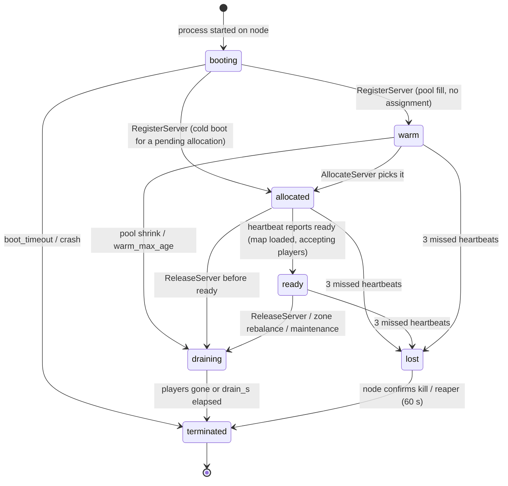

# Legends of the Shattered Frontier — World Simulation: Server Fleet and Realms
### Version 1.0 — Expanded Technical Design Authority edition (2026-10-17)

Status: Design target; not implemented. Names per Shared Registry v1.0.

Part 1 of the World Simulation specification. Entry file: [World Simulation Architecture](../Legends_Shattered_Frontier_World_Simulation_Architecture_v1.0.md). Names: [Shared Registry](../Legends_Shattered_Frontier_Shared_Registry_v1.0.md).

This part owns the `world-service` gRPC surface, server allocation and release, warm pools, the `ServerInstance` lifecycle, heartbeats, the Redis working set, realm operations (drain, realm roles, rolling restarts), server identity, login placement and world-service high availability, and the payloads of `world.server.*`. Zone handoffs and layering are in [Part 2](Legends_Shattered_Frontier_World_Cells_Movement_and_Handoffs_v1.0.md). Names and ownership follow the Shared Registry; remaining proposals are called out explicitly in the entry file.

---

## world-service API and server allocation

### Service surface (`lsf.world_service.v1`)

All RPCs use mTLS service identity. Every mutating RPC takes an `idempotency_key` (string ≤ 128 chars, kept ≥ 7 days, original result returned on replay; Registry, Service registry). RPCs in this part are registered in the Shared Registry (change log, phase-2 row); the Registry is authoritative. They close requirements from LiveOps (realm operations), Quest and AI (resource state), Construction (terrain persistence) and the Game Master concept (bounded world actions).

```proto
syntax = "proto3";
package lsf.world_service.v1;

service WorldService {
  // ---- Registry-canonical ----
  // Allocation (callers: instance-service; world-service itself for zones)
  rpc AllocateServer(AllocateServerRequest) returns (Allocation);
  rpc ReleaseServer(ReleaseServerRequest) returns (ReleaseServerResponse);
  rpc GetServer(GetServerRequest) returns (ServerInstance);

  // Server-facing (caller identity = srvi_ certificate + alloc_token where noted)
  rpc RegisterServer(RegisterServerRequest) returns (RegisterServerResponse);
  rpc Heartbeat(ServerHeartbeat) returns (HeartbeatAck);

  // Zone handoff (callers: zone-server, instance-server)
  rpc RequestHandoff(RequestHandoffRequest) returns (HandoffTicket);
  rpc CommitHandoff(CommitHandoffRequest) returns (CommitHandoffResponse);
  rpc AbortHandoff(AbortHandoffRequest) returns (Ack);

  // Routing and clock
  rpc ResolveZone(ResolveZoneRequest) returns (ZoneRoute);   // gateway: where does character X log in
  rpc GetWorldClock(GetWorldClockRequest) returns (WorldClock);

  // Staff (via admin-portal; audited; permission character:location:teleport)
  rpc AdminMoveCharacter(AdminMoveCharacterRequest) returns (AdminMoveCharacterResponse);

  // ---- Proposed (this expansion) ----
  // Realm operations (callers: liveops-service; admin-portal read)
  rpc DrainRealms(DrainRealmsRequest) returns (DrainRealmsResponse);
  rpc GetRealms(GetRealmsRequest) returns (GetRealmsResponse);
  rpc SetRealmRole(SetRealmRoleRequest) returns (Realm);
  rpc MigrateZone(MigrateZoneRequest) returns (MigrateZoneResponse);  // rolling restart, rebalance

  // Zone state persistence (callers: zone-server only; Part 3)
  rpc LoadZoneState(LoadZoneStateRequest) returns (stream ZoneStateChunk);
  rpc CommitTerrainEdits(CommitTerrainEditsRequest) returns (CommitTerrainEditsResponse);
  rpc ReportZoneState(ReportZoneStateRequest) returns (Ack);           // spawn timers, harvest counters
  rpc RecordDiscovery(RecordDiscoveryRequest) returns (RecordDiscoveryResponse);

  // World state queries (callers: ai-director-service, quest-service, faction-service, admin-portal)
  rpc GetRegionResourceState(GetRegionResourceStateRequest) returns (RegionResourceState);
  rpc GetWeather(GetWeatherRequest) returns (WeatherReport);
  rpc GetWorldBossSchedule(GetWorldBossScheduleRequest) returns (WorldBossSchedule);

  // Directed commands to zone-servers (caller: ai-director-service)
  rpc DispatchZoneCommand(DispatchZoneCommandRequest) returns (DispatchZoneCommandResponse);

  // Bounded staff world actions (caller: admin-portal; Game Master capability model; audited)
  rpc ApplyWorldAction(ApplyWorldActionRequest) returns (WorldAction);
  rpc CancelWorldAction(CancelWorldActionRequest) returns (WorldAction);
  rpc RevertTerrainEdits(RevertTerrainEditsRequest) returns (RevertTerrainEditsResponse);

  // Privacy (Backend spec, Account deletion and privacy request workflow)
  // implemented through the shared PrivacyParticipant service: ExportSubject, EraseSubject
}
```

### Caller matrix

| RPC | Allowed callers (mTLS identity) | Rate limit (per caller) | Audit |
| --- | --- | --- | --- |
| `AllocateServer` | `instance-service` (`kind = instance`); world-service zone scheduler (`kind = zone`) | 20/s (`tune.world.alloc_rate_per_caller`) | no |
| `ReleaseServer` | the allocating caller; world-service | 20/s | no |
| `GetServer` | any registered service | 500/s, cached 30 s by callers | no |
| `RegisterServer`, `Heartbeat` | node-launched server processes (workload identity, see Server identity) | 1 per 5 s per `srvi_` (+1 burst) | no |
| `RequestHandoff`, `CommitHandoff`, `AbortHandoff` | `zone-server`, `instance-server` with state `ready` or `draining` | 50/s per server | no |
| `ResolveZone` | `gateway` | 200/s | no |
| `GetWorldClock`, `GetWeather` | any service; servers at boot | 100/s | no |
| `AdminMoveCharacter`, `ApplyWorldAction`, `CancelWorldAction`, `RevertTerrainEdits` | `admin-portal` with staff permission (below) | 2/s per staff session | yes, `staff_action` record in audit-service before execution |
| `DrainRealms`, `SetRealmRole` | `liveops-service` | 1/s | yes |
| `GetRealms` | `liveops-service`, `gateway`, `admin-portal` | 20/s | no |
| `MigrateZone` | `liveops-service` (rolling release), world-service rebalancer | 1/s | yes |
| `LoadZoneState`, `CommitTerrainEdits`, `ReportZoneState`, `RecordDiscovery` | `zone-server` whose `srvi_` owns the zone named in the request | 50/s per server | no (edits carry their own lineage) |
| `GetRegionResourceState` | `ai-director-service`, `quest-service`, `faction-service`, `admin-portal` | 50/s | no |
| `GetWorldBossSchedule` | `ai-director-service`, `liveops-service`, `admin-portal` | 10/s | no |
| `DispatchZoneCommand` | `ai-director-service` | 100/s | no (director logs `wev_` lineage) |

Staff permissions (Security spec, Audit, permission matrix): `character:location:teleport` for `AdminMoveCharacter`; `world:weather:override`, `world:spawn:bounded`, `world:terrain:revert` for world actions. `staff_role` values that hold them are set by the Security spec. World checks only the permission string carried in the admin-portal's signed staff assertion.

### AllocateServer

The field names `kind`, `map_id`, `dc_region`, `capacity`, `run_id`, `srvi_id`, `address`, `port` and `alloc_token` come from the contract drafted in the Dungeon spec, Instance runtime ("Server allocation (via world-service)"). This section adopts that contract as canonical and only adds fields.

```proto
enum ServerKind {                       // registry enum server_kind
  SERVER_KIND_UNSPECIFIED = 0;
  SERVER_KIND_ZONE = 1;                 // "zone"
  SERVER_KIND_INSTANCE = 2;             // "instance"
}

message AllocateServerRequest {
  string idempotency_key = 1;           // instance-service uses "alloc:{run_id}:{attempt}"
  ServerKind kind = 2;                  // Dungeon draft: kind=instance
  string map_id = 3;                    // level asset (instance) or zone map
  string dc_region = 4;                 // na | eu | apac | sa
  uint32 capacity = 5;                  // max players: 5/10 dungeon, up to 25 raid; zone = capacity_hard
  string run_id = 6;                    // run_ (instance kind; required)  — Dungeon draft
  string zone_id = 7;                   // zone/... (zone kind; required)
  int64 content_version = 8;            // server must run a build that has this pack deployed
  string build_channel = 9;             // optional; default = realm's live build
  uint32 priority = 10;                 // 0 = default; see placement order
  uint32 deadline_ms = 11;              // default 45000 (cold boot budget from Dungeon targets)
  string realm_id = 12;
  map<string,string> labels = 13;       // e.g. "content_id":"dungeon/vault_of_ash"; copied to srvi record
  uint32 layer_index = 14;              // proposed; zone kind only; 0 = primary layer (Part 2, Layering and overflow)
  string replaces_srvi_id = 15;         // proposed; set by MigrateZone and lost-zone recovery
}

message Allocation {
  string srvi_id = 1;                   // Dungeon draft
  string address = 2;                   // Dungeon draft (public UDP endpoint)
  uint32 port = 3;                      // Dungeon draft
  string alloc_token = 4;               // Dungeon draft; Ed25519-signed, see Alloc token
  int64 alloc_token_expires_at_ms = 5;
  bool warm_hit = 6;
  ServerInstanceState state = 7;        // ALLOCATED on success
  string build_id = 8;
  string node_id = 9;                   // host, for ops only; never sent to clients
}
```

`capacity` must satisfy: instance kind 1–25 (`RAID_GROUP_MAX`); zone kind = the zone's `capacity_hard` (default 250, `tune.world.zone_capacity_hard`). Otherwise `capacity_out_of_range`.

**Idempotency.** Same `idempotency_key` + same payload → the same `Allocation` (same `srvi_id`; a fresh `alloc_token` is minted if the old one expired). Same key + different payload → `INVALID_ARGUMENT` with detail `idempotency_payload_mismatch`. A `run_id` may have at most one non-terminal allocation; a second key for the same `run_id` while one is `allocated`/`ready` returns `FAILED_PRECONDITION` `run_already_allocated` (instance-service must release first, as in its crash-recovery path). For zones, a `(zone_id, layer_index)` pair may have at most one `allocated`/`ready` owner, except during `MigrateZone`, where `replaces_srvi_id` names the outgoing owner.

**Errors** (gRPC status + `world_error` detail string):

| Status | `world_error` | When | Caller action |
| --- | --- | --- | --- |
| `INVALID_ARGUMENT` | `missing_field`, `capacity_out_of_range`, `idempotency_payload_mismatch` | Bad request. | Fix request. |
| `NOT_FOUND` | `unknown_map`, `unknown_zone` | `map_id`/`zone_id` not in the deployed pack. | Fail run. |
| `FAILED_PRECONDITION` | `content_version_not_deployed`, `run_already_allocated`, `region_draining` | Build/pack mismatch, duplicate, region in maintenance. | Retry later or fail run. |
| `RESOURCE_EXHAUSTED` | `no_capacity` | No warm process and no node slot within `deadline_ms`. | Back off (2 s, 4 s, 8 s); after 3 attempts fail the run. |
| `PERMISSION_DENIED` | `kind_not_allowed` | Caller may not allocate this kind (only world-service allocates `zone`). | — |
| `DEADLINE_EXCEEDED` | `boot_timeout` | Cold boot did not reach `allocated` in time; the process is killed. | Retry with `attempt + 1`. |
| `UNAVAILABLE` | — | world-service leader failover. | Retry same key. |

`region_draining` is returned when the realm named by `realm_id` is in `realm_state` `draining`, `drained` or `offline` (Realm operations), except for allocations carrying label `"maintenance_smoke":"true"` from liveops-service smoke tests.

### Alloc token

Ed25519 signature by the world-service key (public key distributed to services and server builds via `config-service`, rotated quarterly with a 2-key overlap). Claims:

```json
{ "srvi_id": "srvi_01J…", "kind": "instance", "map_id": "…", "run_id": "run_01J…",
  "zone_id": null, "dc_region": "na", "iat_ms": 0, "exp_ms": 0, "nonce": "…" }
```

Lifetime `tune.world.alloc_token_ttl_s` (default 120 s). The server presents it to its consumer (`FetchRunBootstrap` to instance-service; `RegisterServer` claim step for zones). The consumer verifies offline and checks that `srvi_id` matches the caller's mTLS identity and `run_id`/`zone_id` matches the requested resource. Each consumer accepts a nonce once. The token proves assignment only; it is not a player credential. Zone tokens additionally carry `layer_index` (default 0) and, during migration, `replaces_srvi_id`.

### Capacity, placement and warm pools

**Placement rules** (evaluated in order; first match wins):

1. **Hard filters:** same `dc_region`; node runs a build with `content_version` deployed; node not cordoned/draining; node has a free slot of the right class (`zone` slots: 1 per 8 vCPU; `instance` slots: by capacity class, `tune.world.instance_slots_per_node`, default 12 for 5-player, 6 for 10-player, 3 for 25-player maps).
2. **Warm hit:** take a `warm` process for the same `kind` + `map_id` + `build_id` (oldest first, so long-idle processes are recycled).
3. **Spread:** prefer the node with the lowest projected CPU after placement; never exceed `tune.world.node_cpu_target` (0.80) projected. Zones of the same continent prefer different nodes (anti-affinity) so one node loss does not drop neighbouring zones together.
4. **Cold boot:** start a new process on the chosen node; it registers, loads the map and becomes `allocated`.

**Priority** when slots are scarce: zone allocations (priority 100) > raid instances (50) > dungeon instances (10) > warm-pool refill (0). Refill never takes the last 10 % of slots in a region (`tune.world.reserved_slot_fraction`).

**Projected CPU.** For a candidate node `n` and a placement of class `c`:

```text
cpu_proj(n) = (Σ_{p ∈ processes(n)} cpu_p + cpu_est(c)) / vcpu(n)
cpu_est(zone)       = 0.85 × 8 vCPU            (tune.world.cpu_est_zone_vcpu, 6.8)
cpu_est(instance,k) = 0.30 × k / 5 vCPU        (k = capacity; tune.world.cpu_est_instance_vcpu_per_5, 0.30)
cpu_p               = EWMA of heartbeat cpu × allocated cores, half-life 60 s
choose argmin cpu_proj(n) subject to cpu_proj(n) ≤ node_cpu_target
```

Worked example: a 32-vCPU node runs one zone (cpu 0.62 × 8 = 4.96 vCPU) and six 5-player instances (0.25 × 1 vCPU average each = 1.50 vCPU). Placing a 25-player raid adds 0.30 × 25 / 5 = 1.50 vCPU, so `cpu_proj` = (4.96 + 1.50 + 1.50) / 32 = 0.249. A second node at 0.71 projected is skipped in favour of this one.

**Warm pools.** For instance maps, world-service keeps the size defined by the Dungeon spec: `tune.dungeon.warm_pool_size` (default 2 per map per region, plus 10 % of the trailing-hour peak concurrent runs for that map). For zones, it keeps `tune.world.zone_warm_spares` (default 1 generic zone process per region per build) for fast failover; a generic spare loads the zone map on assignment. Warm processes have the map loaded, no players, and tick at 1 Hz (`tune.world.warm_tick_hz`). A warm process older than `tune.world.warm_max_age_min` (240) is drained and replaced. Pools are refilled by a reconcile loop every 5 s.

```text
pool_target(map, region) = warm_pool_base + ceil(0.10 × peak_runs_1h(map, region))
  warm_pool_base = 2                         (tune.dungeon.warm_pool_size)
  peak_runs_1h   = max concurrent runs of map in region over the trailing 60 min
refill(map, region) = max(0, pool_target − warm_count − booting_count)   per reconcile tick
```

Worked example: `dungeon/sunken_vault` peaked at 37 concurrent runs in `eu` in the last hour, so `pool_target` = 2 + ceil(3.7) = 6. With 3 warm and 1 booting, the reconcile starts 2 processes, subject to the reserved-slot fraction.

Targets (from Dungeon): `provisioning` → `ready` p95 ≤ 10 s on warm hit, ≤ 45 s cold. World target: warm-hit rate ≥ 90 % at peak (`m_warm_hit_rate`, proposed).

### ServerInstance lifecycle

Registry enum `server_instance_state`: `booting`, `warm`, `allocated`, `ready`, `draining`, `terminated`, `lost`.



Notes:
- `ready` is the world-service view (process accepting players). The instance run's own `ready` (`instance_run_state`) is set by instance-service on `ReportServerReady`; the server reports both.
- A process is never reused after `allocated`. Released processes terminate; new warm processes replace them (avoids state leaking between runs).
- `lost` triggers `world.server.lost` and, for zones, immediate reassignment of the zone to a spare (characters reconnect via `ResolveZone`; positions restore from last persisted checkpoint). For instances, instance-service runs its own recovery (Dungeon spec, Instance runtime, Crash recovery) and calls `ReleaseServer` + `AllocateServer` with `attempt + 1`.
- **Heartbeat ownership (closes skeleton open issue 1).** The instance-server heartbeats both instance-service (Dungeon spec, run state, 5 s) and world-service (process liveness, 5 s). They stay separate because they are owned by different services and the cost is two small RPCs every 5 s. world-service does not forward liveness. instance-service may subscribe to `world.server.lost` on `domain.world` to start recovery before its own heartbeat timeout, and must deduplicate by `srvi_id`.

**Lost-zone recovery** (normative):

1. `world:srvi:{srvi_id}:hb` expires (15 s) → state `lost`, `world.server.lost` emitted with `characters_affected` from the last full heartbeat.
2. The zone scheduler calls `AllocateServer(kind = zone, zone_id, layer_index, replaces_srvi_id = lost id, priority = 100)`; a zone warm spare is used when one exists.
3. The new process calls `LoadZoneState` (terrain, spawn timers, resource counters; Part 3), reaches `ready`, and owns `world:zone:{zone_id}:{layer}:owner`.
4. Every `world:chr:{character_id}:owner` that pointed at the lost process is cleared. Clients reconnect through `ResolveZone` and resume at their last character-service location checkpoint (taken every 60 s and on every handoff; Backend spec owns the location snapshot).
5. Target: zone back to `ready` p95 ≤ 20 s with a spare, ≤ 60 s cold (`m_zone_recovery_p95_s`, proposed).

### ReleaseServer

```proto
enum ServerReleaseReason {              // registry enum server_release_reason
  SERVER_RELEASE_REASON_UNSPECIFIED = 0;
  RUN_CLOSED = 1; RUN_FAILED = 2; LOST_REPLACED = 3; ZONE_REBALANCE = 4;
  MAINTENANCE = 5; ALLOCATION_CANCELLED = 6;
}

message ReleaseServerRequest {
  string idempotency_key = 1;           // instance-service: "release:{run_id}:{srvi_id}"
  string srvi_id = 2;
  ServerReleaseReason reason = 3;
  uint32 drain_s = 4;                   // default 30; 0 = immediate kill (lost/cancelled)
  string run_id = 5;                    // must match the allocation (instance kind)
}

message ReleaseServerResponse {
  ServerInstanceState state = 1;        // DRAINING or TERMINATED
  int64 terminate_by_ms = 2;
}
```

Rules: only the allocating caller (or world-service itself) may release; `run_id` mismatch → `PERMISSION_DENIED` `not_owner`. Releasing an already `draining`/`terminated`/`lost` server is a success (idempotent). Unknown `srvi_id` older than 7 days → `NOT_FOUND`. During drain the server refuses new joins, moves remaining characters via handoff (instances: to the dungeon entrance, Dungeon spec, Instance runtime, Closing), flushes state, then exits. Zone servers additionally call `ReportZoneState` with a final spawn and resource snapshot and flush pending terrain edits before exit (Part 3).

### Heartbeats and the Redis record

Servers call `Heartbeat` every `tune.world.server_heartbeat_s` (5 s); `tune.world.server_lost_s` (15 s, 3 missed) marks `lost`.

```proto
message ServerHeartbeat {
  string srvi_id = 1;
  ServerInstanceState reported_state = 2;
  uint32 player_count = 3;
  float tick_ms_p95 = 4;
  float cpu = 5;                        // 0..1 of allocated cores
  uint64 mem_bytes = 6;
  int64 server_time_ms = 7;             // clock sanity, see Part 2, World clock
  repeated string character_ids = 8;    // full set every 6th beat, deltas otherwise
  uint32 seq = 9;                       // proposed; monotonic per srvi_, gaps logged
  bool full_set = 10;                   // proposed; true when character_ids is the full set
  repeated string removed_character_ids = 11; // proposed; delta beats only
  uint32 cells_active = 12;             // proposed; zone kind (Part 3, Cell activation)
  uint32 npcs_active = 13;              // proposed
  string handoff_proto_version = 14;    // proposed; e.g. "1.2"; checked by MigrateZone
}
message HeartbeatAck { repeated string commands = 1; int64 world_time_ms = 2; }  // e.g. "drain"
```

**Heartbeat commands** (strings in `HeartbeatAck.commands`; the payload of commands with arguments is fetched with `GetServer` on the `pending_commands` field to keep the ack small):

| Command | Meaning |
| --- | --- |
| `drain` | Stop accepting joins; begin drain per `ReleaseServer`. |
| `assign_run:{run_id}` | Warm instance process assigned (alloc token in `pending_commands`). |
| `assign_zone:{zone_id}:{layer}` | Generic zone spare assigned. |
| `release_character:{handoff_id}` | Handoff committed elsewhere; drop the character. |
| `migrate_out:{migration_id}` | Begin moving characters to the replacement process. |
| `zone_command` | One or more `DispatchZoneCommand` items are queued (Part 3, World events). |
| `resync_clock` | Re-read `GetWorldClock` (tuning changed). |
| `rebuild_state` | world-service is rebuilding after Redis loss; send a full heartbeat now. |

**Redis keys** (ServerInstance store per Registry):

| Key | Type | TTL | Content |
| --- | --- | --- | --- |
| `world:srvi:{srvi_id}` | hash | 7 d after `terminated` | `kind`, `state`, `map_id`, `zone_id`, `run_id`, `dc_region`, `realm_id`, `node_id`, `build_id`, `content_version`, `address`, `port`, `capacity`, `player_count`, `allocated_at_ms`, `ready_at_ms`, `released_at_ms`, `release_reason`, `alloc_idempotency_key`, `version`; proposed additions `layer_index`, `peak_players`, `handoff_proto_version`, `pending_commands` |
| `world:srvi:{srvi_id}:hb` | string | 15 s | Last heartbeat ms; expiry = lost. |
| `world:pool:{dc_region}:{kind}:{map_id}:{build_id}` | sorted set (score = boot ms) | — | Warm `srvi_id`s. |
| `world:zone:{zone_id}:owner` | string | — | Owning `srvi_id` of layer 0 (CAS on `version`). Kept for compatibility. |
| `world:zone:{zone_id}:{layer}:owner` | string | — | Proposed. Owner per layer; layer 0 mirrors the key above. |
| `world:zone:{zone_id}:layers` | sorted set (score = player count) | — | Proposed. Open layers of a layerable zone. |
| `world:chr:{character_id}:owner` | hash | 24 h idle | `srvi_id`, `handoff_id` if in transit, `version`. Single-owner record. |
| `world:idem:{idempotency_key}` | string (serialized response) | 7 d | Idempotency replay. |
| `world:handoff:{handoff_id}` | hash | 60 s | Pending handoff (Part 2, Zone Handoffs). |
| `world:nonce:{nonce}` | string | token lifetime | Replay guard for tickets minted here. |
| `world:realm:{realm_id}` | hash | — | Proposed. Cache of `world.realms` row (Realm operations). |
| `world:leader` | string | 10 s | Proposed. Leader lease (world-service high availability). |

All state changes go through Lua scripts with a `version` check and the leader `epoch` fencing token. Redis runs with AOF (`everysec`) and a replica. If records are lost in a failover, the next full heartbeat from each server rebuilds `world:srvi:*`, zone owners and character owners (heartbeats carry enough state); during rebuild (≤ 30 s) world-service rejects new handoffs with `UNAVAILABLE`.

**Rebuild rule.** On rebuild, a character listed by two servers (possible only if a commit was lost) is assigned to the server whose last handoff commit is newest by `CommitHandoff` response time in its own log. The other server receives `release_character`. Both cases emit `world.handoff.failed` with `failure_reason = owner_conflict_resolved`, and the character is flagged for an inventory reconciliation check (Itemization spec, INV-1 location check).

### Instance allocation sequence

```mermaid
sequenceDiagram
    autonumber
    participant IS as instance-service
    participant WS as world-service
    participant R as Redis (world:*)
    participant N as Node agent
    participant SRV as instance-server (srvi_)
    IS->>WS: AllocateServer(idempotency_key=alloc:{run_id}:{attempt}, kind=instance, map_id, dc_region, capacity, run_id, content_version)
    WS->>R: GET world:idem:{key}
    alt replay
        R-->>WS: stored Allocation
        WS-->>IS: Allocation (same srvi_id)
    else new
        WS->>R: ZPOPMIN world:pool:{region}:instance:{map}:{build}
        alt warm hit
            R-->>WS: srvi_id (state warm)
        else cold
            WS->>N: StartProcess(map_id, build_id)
            N->>SRV: launch
            SRV->>WS: RegisterServer(node_id, build_id, address, port)
            WS-->>SRV: srvi_id
        end
        WS->>R: HSET world:srvi:{srvi_id} state=allocated run_id=… (CAS)
        WS->>WS: sign alloc_token
        WS->>R: SET world:idem:{key} = Allocation (7 d)
        WS->>SRV: AssignRun(run_id, alloc_token) (heartbeat command channel)
        WS-->>IS: Allocation(srvi_id, address, port, alloc_token, warm_hit)
    end
    SRV->>IS: FetchRunBootstrap(run_id, alloc_token)
    IS->>IS: verify alloc_token offline (srvi_id = mTLS identity, run_id match, nonce unused)
    IS-->>SRV: RunBootstrap
    SRV->>IS: ReportServerReady(run_id, srvi_id, layout_hash)
    SRV->>WS: Heartbeat(reported_state=ready)
    WS->>R: state=ready
    Note over WS: emits world.server.allocated; pool reconcile refills the map's warm pool
    IS->>WS: ReleaseServer(release:{run_id}:{srvi_id}, reason=RUN_CLOSED) on run closed
    WS->>SRV: drain → terminated; world.server.released
```

Zone allocation uses the same RPC, called by world-service's own zone scheduler at realm start and on `lost`/rebalance, with `kind = zone`, `zone_id` set, and the claim step done in `RegisterServer`.

### Zone scheduler

The zone scheduler is a loop inside the world-service leader (period 5 s, same reconcile tick as pools). Desired state: for every realm in `realm_state` `open` or `locked`, every `zone` in the active content pack has a `ready` layer-0 owner. Layerable zones may also have layers 1..`layers_max − 1` (Part 2, Layering and overflow).

| Trigger | Action |
| --- | --- |
| Realm start (`offline` → `locked`) | Allocate all zones at priority 100, continents interleaved for anti-affinity. Realm becomes eligible for `open` when every zone is `ready`. |
| `world.server.lost` for a zone | Lost-zone recovery (above). |
| Content activation adds a zone | Allocate it; the zone is unreachable (no border handoffs into it) until `ready`. |
| Content activation removes a zone | Not allowed while characters are inside. Content tooling requires a `zone.retired_redirect` target, and the scheduler migrates characters there before release. |
| Node cordon (DevOps) | `MigrateZone` each zone process on the node, one at a time. |
| Hot zone (`tick_ms_p95` > 28 ms for 5 min, or players > `capacity_soft`) | Layerable zone: open a layer. Non-layerable: raise an `ops` alert. Splitting a zone is a content change, not a runtime action. |

### Server identity and registration

Rogue processes must not register as zone-servers (Security spec, Threat model, spoofing row).

- The node agent launches a process with a one-time **launch credential** (`launch_nonce`, 60 s TTL) written to the process environment. The node agent itself holds a workload identity from the platform (DevOps spec).
- `RegisterServer(node_id, build_id, address, port, launch_nonce, csr)` is accepted only from a node-agent-attested workload. world-service checks the nonce against the node agent's launch record, mints `srvi_<ULID>`, and asks the platform CA for a short-lived certificate (24 h) with SPIFFE ID `spiffe://lsf/{realm_id}/srvi/{srvi_id}`. It returns the certificate in `RegisterServerResponse`.
- Every service that accepts durable requests from servers (reward-service, progression-service `SubmitPracticeBatch`, crafting-service `CraftItem`/`ResolveHarvest`, faction-service, instance-service) checks the SPIFFE ID and treats a server as registered iff `GetServer(srvi_id).state ∈ {allocated, ready, draining}`. Callers cache the result for 30 s; on `lost` or `terminated` the cache entry is invalid at the next refresh. This is the meaning of "registered in world-service" in the Character and Crafting specs.
- Certificates are not renewed after `terminated`. A process cannot obtain a second `srvi_`.

```proto
message RegisterServerRequest {
  string node_id = 1; string build_id = 2; string address = 3; uint32 port = 4;
  string launch_nonce = 5; bytes csr = 6; string handoff_proto_version = 7;
  ServerKind kind = 8; string map_id = 9;      // map preloaded by the node agent, if any
  string alloc_token = 10;                     // zone claim step: token for a pending zone allocation
}
message RegisterServerResponse {
  string srvi_id = 1; bytes certificate_chain = 2; ServerInstanceState state = 3;  // warm or allocated
  int64 world_time_ms = 4; WorldClock clock = 5;
}
```

### ResolveZone and login placement

```proto
message ResolveZoneRequest {
  string character_id = 1; string account_id = 2; string realm_id = 3;
  string last_zone_id = 4;           // from character-service location snapshot
  Vec3 last_position = 5;            // map-local metres
  string party_id = 6;               // optional, for layer affinity
  repeated string friend_character_ids = 7;  // optional, max 20, for layer affinity
}
message ZoneRoute {
  string srvi_id = 1; string address = 2; uint32 port = 3;
  string zone_id = 4; uint32 layer_index = 5;
  bytes entry_ticket = 6;            // HandoffTicket-format claims, handoff_kind = login, cause respawn
  Vec3 entry_position = 7;
  string queue_ticket = 8;           // set when the zone is full and not layerable
}
```

Rules:

1. If `world:chr:{id}:owner` names a live server (character reconnecting within 24 h), return that server. This keeps a linkdead character attached to its zone.
2. If the realm is not `open`, return `FAILED_PRECONDITION realm_not_open` (the gateway shows the maintenance or lock message; LiveOps login gate is checked first).
3. If `last_zone_id` is retired, use its `retired_redirect` zone and its `default_spawn`.
4. If the zone is layerable, choose a layer with Part 2, Layering and overflow, rule L2.
5. If the zone is full (`player_count ≥ capacity_hard`) and not layerable, return a `queue_ticket` (gateway queue, Backend spec). The entry position is kept.
6. The entry ticket is a signed handoff-format ticket. Its lifetime is 30 s (`tune.world.login_ticket_ttl_s`). The zone-server converts it into a `respawn` teleport token at the entry position (Part 2, Teleport tokens).

### AdminMoveCharacter

```proto
message AdminMoveCharacterRequest {
  string idempotency_key = 1; string character_id = 2;
  string target_zone_id = 3; Vec3 target_position = 4; uint32 target_layer = 5;
  string audit_record_id = 6;        // aud_ written by admin-portal before the call
  string reason_code = 7;            // e.g. "stuck", "investigation", "event_staging"
}
message AdminMoveCharacterResponse { string handoff_id = 1; string teleport_token_id = 2; }
```

In-zone moves issue a `gm_move` token on the owning zone-server. Cross-zone moves run a normal handoff with `handoff_kind = admin_move` and cause `gm_move`. The token's `source_ref` is the `audit_record_id`. Moving a character into an instance map is refused (`kind_not_allowed`); staff use instance-service tools. Moves into a protected volume or under terrain are refused (`invalid_destination`) unless the request carries permission `world:spawn:bounded` (event staging).

---

## Realm operations

### Realm registry and `realm_state`

A realm (`realm_id`, e.g. `na-1`) is one world-service deployment. world-service is the owner of the realm's runtime state. The realm list itself comes from `config-service` (Registry, Realm). liveops-service owns `realm_role` (`canary`, `standard`; LiveOps spec, Canary realms) and mirrors it here with `SetRealmRole`.

Proposed enum `realm_state`: `offline`, `locked`, `open`, `draining`, `drained`.

```mermaid
stateDiagram-v2
    [*] --> offline
    offline --> locked : world-service leader starts; zone scheduler allocating
    locked --> open : all zones ready; DrainRealms(mode=UNLOCK)
    open --> locked : DrainRealms(mode=LOCK)
    open --> draining : DrainRealms(mode=drain)
    locked --> draining : DrainRealms(mode=drain)
    draining --> drained : all servers terminated or drain_timeout_s
    drained --> locked : deploy complete; zones reallocated on new build
    drained --> offline : realm shutdown
    locked --> offline : realm shutdown
```



`realm_state` is distinct from LiveOps `service_status`. `GetRealms` returns both, and LiveOps derives the status page from them. The mapping `open → operational`, `locked/draining/drained → maintenance`, `offline → major_outage` (when not planned) is a LiveOps rule. World only reports facts.

### DrainRealms, GetRealms, SetRealmRole

These close the LiveOps requirement (LiveOps spec, APIs, events and implementation part, Calls made by LiveOps services to other services: `world-service` `DrainRealms`, `GetRealms`, `SetRealmRole`).

```proto
enum DrainMode { DRAIN_MODE_UNSPECIFIED = 0; DRAIN = 1; LOCK = 2; UNLOCK = 3; }

message DrainRealmsRequest {
  string idempotency_key = 1;          // "drain:{mnt_id}:{realm_id or region}"
  repeated string realm_ids = 2;       // or dc_region scope
  string dc_region = 3;
  DrainMode mode = 4;
  uint32 drain_timeout_s = 5;          // default 600 (tune.world.realm_drain_timeout_s)
  string maintenance_window_id = 6;    // mnt_ (LiveOps)
  string release_id = 7;               // rel_ (LiveOps)
}
message RealmDrainStatus {
  string realm_id = 1; string realm_state = 2;
  uint32 servers_remaining = 3; uint32 characters_remaining = 4;
  uint32 characters_saved = 5; uint32 instances_closed = 6;
  int64 drained_at_ms = 7;
}
message DrainRealmsResponse { repeated RealmDrainStatus realms = 1; bool complete = 2; }

message GetRealmsRequest { string dc_region = 1; }
message Realm {
  string realm_id = 1; string dc_region = 2; string realm_state = 3; string realm_role = 4;
  uint32 population = 5; string population_band = 6;   // low | medium | high | full
  string build_id = 7; int64 content_version = 8;
  uint32 zones_ready = 9; uint32 zones_total = 10;
  int64 realm_epoch_ms = 11; int64 updated_at_ms = 12;
}
message GetRealmsResponse { repeated Realm realms = 1; }

message SetRealmRoleRequest { string idempotency_key = 1; string realm_id = 2; string realm_role = 3; }
```

**DrainRealms semantics** (mode `DRAIN`):

1. Set `realm_state = draining` (CAS). `ResolveZone` rejects with `realm_not_open`; `AllocateServer` for the realm returns `region_draining`, except maintenance smoke labels.
2. Send the `drain` command to every server of the realm. Each zone-server notifies its players (15 s countdown; LiveOps announcements already ran), checkpoints every character's location through character-service, flushes terrain edits and spawn state, then disconnects players with reason `maintenance`. Instance-servers follow the Dungeon spec drain: instance-service closes runs as `abandoned` with infrastructure protection (no deserter penalty, mythic timers paused).
3. Each server releases itself with `ReleaseServer(reason = MAINTENANCE)`.
4. The call is long-running but idempotent. It returns progress at once (`complete = false`), and liveops-service polls with the same key every 5 s until `complete = true`. After `drain_timeout_s`, remaining processes are killed (`drain_s = 0`), `characters_remaining` are restored from their last checkpoint (≤ 60 s of position loss; no item or currency loss because those are written synchronously by their owning services), and an `ops` warning is raised.
5. `realm_state = drained` and registered event `world.realm.state_changed` is emitted.

Target: drain of a realm at 5,000 CCU completes p95 ≤ 120 s (`m_drain_duration_s`, proposed).

`LOCK` sets `open → locked` without disconnecting anyone. Only staff and QA can log in, through the LiveOps login gate. `UNLOCK` sets `locked → open` if all zones are `ready`.

`SetRealmRole` stores `realm_role` on the realm and returns the realm. world-service uses it only for placement: canary realms get the new build first in `MigrateZone` ordering. LiveOps keeps the constraint of one canary per region.

### Rolling restart and zone migration

Releases without `requires_maintenance` use rolling restarts with session handoff (LiveOps spec, Config and releases, Maintenance windows). The world mechanism is `MigrateZone`. The same mechanism is used for node cordons and zone rebalance (closes skeleton open issue 6).

```proto
message MigrateZoneRequest {
  string idempotency_key = 1;          // "migrate:{rel_id}:{zone_id}:{layer}"
  string realm_id = 2; string zone_id = 3; uint32 layer_index = 4;
  string target_build_id = 5;          // empty = same build (rebalance / cordon)
  ServerReleaseReason reason = 6;      // MAINTENANCE (release) or ZONE_REBALANCE
  uint32 max_rate_per_s = 7;           // default 25 (tune.world.migration_rate_per_s)
}
message MigrateZoneResponse { string migration_id = 1; string new_srvi_id = 2; string state = 3; }
```

Protocol:

1. **Compatibility gate.** The new build's `handoff_proto_version` must have the same major version as the old build's, and the zone's `content_version` must already be active for the realm. Otherwise → `FAILED_PRECONDITION incompatible_build` (the release needs a maintenance window).
2. **Shadow allocation.** `AllocateServer(kind = zone, zone_id, layer_index, replaces_srvi_id = old, build = target)`. The new process loads zone state (`LoadZoneState`). The old process first calls `ReportZoneState` with a migration snapshot (spawn timers, charges, resource counters, active world-event stage markers).
3. **Owner flip.** When the new process is `ready`, world-service CASes `world:zone:{zone_id}:{layer}:owner` to the new `srvi_`. From this point border handoffs and logins go to the new process.
4. **Bulk move.** The old process receives `migrate_out`. It runs one handoff per character with `handoff_kind = migration`, cause `zone_handoff`, and `entry_position` = current authoritative position. It does this at ≤ `max_rate_per_s`, oldest-in-zone first, never splitting a party in the same second (party members are moved in consecutive slots). Characters in combat are moved after leaving combat, or after 60 s (`tune.world.migration_combat_wait_s`), whichever comes first.
5. **NPCs and events.** NPCs are not transferred. The new process spawns from spawn state (positions reset to spawn points; NPCs engaged at the flip are reset with full health, which is the normal leash behaviour). ai-director-service re-sends the current stage of every active world event in the zone via `DispatchZoneCommand(replay = true)` when it sees `world.server.allocated` with `replaces_srvi_id` set.
6. **Release.** When the old process has 0 characters, it flushes terrain edits and calls `ReleaseServer(reason)`. The migration is complete.

Worked example: a zone with 240 players at the default 25/s moves everyone in about 9.6 s plus up to 60 s for characters in combat. The dominant cost is the client reconnect (handoff p95 ≤ 300 ms). Each player sees one short "realigning" hitch, the same as a border crossing.

---

## world-service high availability

Closes skeleton open issue 7.

- One **leader** per realm holds the Redis lease `world:leader` (value = `{instance_id, epoch}`, TTL 10 s, renewed every 3 s). Two standbys watch the key. On expiry a standby acquires the lease with `SET NX` and increments `epoch`.
- Every Lua script receives the caller's `epoch` and fails with `stale_leader` if it is lower than the stored epoch (fencing). A partitioned old leader cannot write.
- Failover target ≤ 15 s. During failover, new allocations and handoffs return `UNAVAILABLE`. Servers keep simulating, and heartbeats are retried with jitter. Handoffs already ticketed may still be committed by the new leader because tickets are verified with the public key, and `world:handoff:{id}` is in Redis.
- Read RPCs (`GetServer`, `GetWorldClock`, `GetWeather`, `GetRealms`) are served by standbys from Redis replicas (staleness ≤ 1 s).
- PostgreSQL schema `world` (Part 3) is used only for durable world state (terrain edits, spawn timers, resource state, discoveries, world actions, realms). A PostgreSQL outage does not stop allocation or handoffs. Terrain commits queue on zone-servers for up to 5 min (`tune.world.terrain_commit_buffer_s`), after which new edits are refused with `interact_state`.

---

## Event payloads (world-service)

All use the Registry envelope. `producer.service = "world-service"`. Topic: `world.server.lost` goes to `domain.world` (keyed by `srvi_id`) and is also forwarded to `ops.alerts` by analytics-pipeline. All other events on this page go to `telemetry.server` per the Registry's original assignment. The `domain.world` topic carries `world.server.lost`, `world.realm.state_changed` (below), `world.poi.discovered`, `world.terrain.modified` and `world.weather.changed` (Parts 2 and 3). `world.handoff.*` payloads are in Part 2. Envelope `zone_id` is set when the server is a zone; `character_id` is set for handoff events. Fields with `privacy_class` `p0_public` carry no player data.

### `world.server.allocated`

Emitted once per allocation when the server first reaches `ready`. Failed allocations emit only `world.server.released` with `release_reason = allocation_cancelled`.

| Name | Type | Required | Description | privacy_class |
| --- | --- | --- | --- | --- |
| `srvi_id` | string | yes | `srvi_` | p0_public |
| `server_kind` | string | yes | `server_kind` (`zone`, `instance`) | p0_public |
| `map_id` | string | yes | Map / level asset | p0_public |
| `zone_id` | string | cond | Zone kind | p0_public |
| `layer_index` | int | cond | Zone kind; 0 = primary | p0_public |
| `run_id` | string | cond | Instance kind | p1_pseudonymous |
| `build_id` | string | yes | Server build | p0_public |
| `capacity` | int | yes | Requested capacity | p0_public |
| `priority` | int | yes | Placement priority | p0_public |
| `warm_hit` | bool | yes | Taken from the warm pool | p0_public |
| `attempt` | int | yes | Parsed from instance-service key (`alloc:{run_id}:{attempt}`); 1 for zones | p0_public |
| `requested_at` | timestamp | yes | `AllocateServer` received | p0_public |
| `allocated_at` | timestamp | yes | State `allocated` | p0_public |
| `ready_at` | timestamp | yes | State `ready` | p0_public |
| `ready_latency_ms` | int | yes | `ready_at − requested_at` | p0_public |
| `replaces_srvi_id` | string | no | Migration or lost-zone replacement | p0_public |
| `node_id` | string | yes | Host (ops only; never shown to players) | p0_public |

### `world.server.released`

| Name | Type | Required | Description | privacy_class |
| --- | --- | --- | --- | --- |
| `srvi_id` | string | yes | | p0_public |
| `server_kind` | string | yes | | p0_public |
| `map_id` | string | yes | | p0_public |
| `zone_id` | string | cond | | p0_public |
| `layer_index` | int | cond | | p0_public |
| `run_id` | string | cond | | p1_pseudonymous |
| `release_reason` | string | yes | `server_release_reason` | p0_public |
| `from_state` | string | yes | `server_instance_state` at release | p0_public |
| `drain_s` | int | yes | Requested drain | p0_public |
| `allocated_at` | timestamp | no | Absent for `allocation_cancelled` before allocation | p0_public |
| `released_at` | timestamp | yes | | p0_public |
| `terminated_at` | timestamp | yes | Emitted after termination | p0_public |
| `lifetime_s` | int | yes | `terminated_at − allocated_at` (0 if never allocated) | p0_public |
| `peak_players` | int | yes | Max `player_count` seen | p0_public |
| `players_at_release` | int | yes | | p0_public |
| `characters_force_restored` | int | yes | Characters not handed off before kill | p0_public |

### `world.server.lost`

| Name | Type | Required | Description | privacy_class |
| --- | --- | --- | --- | --- |
| `srvi_id` | string | yes | | p0_public |
| `server_kind` | string | yes | | p0_public |
| `map_id` | string | yes | | p0_public |
| `zone_id` | string | cond | | p0_public |
| `layer_index` | int | cond | | p0_public |
| `run_id` | string | cond | Instance-service starts recovery on this | p1_pseudonymous |
| `last_state` | string | yes | `server_instance_state` before `lost` | p0_public |
| `last_heartbeat_at` | timestamp | yes | | p0_public |
| `missed_heartbeats` | int | yes | ≥ 3 | p0_public |
| `players_last` | int | yes | From last heartbeat | p0_public |
| `characters_affected` | int | yes | From last full set + deltas | p0_public |
| `build_id` | string | yes | Crash rate per build | p0_public |
| `node_id` | string | yes | | p0_public |
| `replacement_srvi_id` | string | no | Zone kind, when already allocated | p0_public |

### `world.realm.state_changed` (registered event; Shared Registry, Phase-2 additions)

Domain event on `domain.world`, keyed by `realm_id`. Envelope `realm_id`, `dc_region`.

| Name | Type | Required | Description | privacy_class |
| --- | --- | --- | --- | --- |
| `from_state`, `to_state` | string | yes | `realm_state` | p0_public |
| `realm_role` | string | yes | `canary` or `standard` (LiveOps) | p0_public |
| `trigger` | string | yes | `startup`, `drain`, `lock`, `unlock`, `drain_complete`, `drain_timeout`, `shutdown` | p0_public |
| `maintenance_window_id` | string | no | `mnt_` | p0_public |
| `release_id` | string | no | `rel_` | p0_public |
| `population_at_change` | int | yes | Characters in world | p0_public |
| `servers_killed_on_timeout` | int | no | Only for `drain_timeout` | p0_public |

## Analytics hooks (this part)

| Metric | Definition | Grain | Target / alert | Status |
| --- | --- | --- | --- | --- |
| `m_warm_hit_rate` | `world.server.allocated` with `warm_hit` / all, instance kind | 15 min, per region and map | ≥ 0.90 at peak; alert < 0.75 for 30 min | Analytics catalog pointer (§6.0) |
| `m_alloc_ready_p95_s` | p95 `ready_latency_ms` / 1000, split by `warm_hit` | 15 min | ≤ 10 s warm, ≤ 45 s cold | Analytics catalog pointer (§6.0) |
| `m_server_lost_rate` | `world.server.lost` per 1,000 server-process-hours by `build_id` | day | alert > 2 for a new build | Analytics catalog pointer (§6.0) |
| `m_zone_recovery_p95_s` | `world.server.allocated.ready_at` − matching `world.server.lost.last_heartbeat_at`, zone kind | day | ≤ 20 s spare, ≤ 60 s cold | Analytics catalog pointer (§6.0) |
| `m_drain_duration_s` | p95 time `draining` → `drained` from `world.realm.state_changed` | per maintenance | ≤ 120 s at 5,000 CCU | Analytics catalog pointer (§6.0) |

## Security considerations (this part)

| Threat | Mitigation |
| --- | --- |
| Registry loss duplicating owners | Rebuild rule assigns each character to the newest committed owner and flags an inventory reconciliation check. |
| Forged server / hijacked allocation | Node-attested registration, one `srvi_` per process, SPIFFE certificate bound to `srvi_`; `alloc_token` binds `srvi_id` ↔ `run_id`/`zone_id`; consumers check nonce and identity; only the allocating caller may release. |
| Allocation flood | Per-caller rate limit (20/s); reserved slot fraction; priorities keep zones alive. |
| Drain abuse / forced disconnects | `DrainRealms` and `MigrateZone` only from liveops-service with audit; `LOCK` never disconnects. |
| Key compromise | world-service signing key in KMS; quarterly rotation with 2-key overlap (`kid` claim); emergency rotation invalidates outstanding tickets (players reconnect). |

Report to `anticheat-service`: `RegisterServer` attempts with an unknown or reused `launch_nonce`, `GetServer` lookups for unknown `srvi_` identities by any service (possible forged server), and `owner_conflict_resolved` occurrences after a Redis rebuild.
