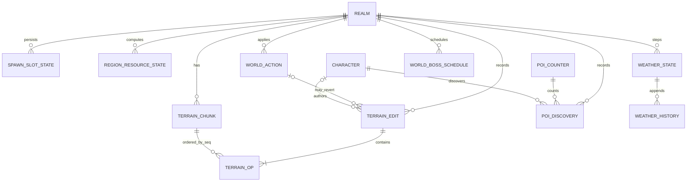
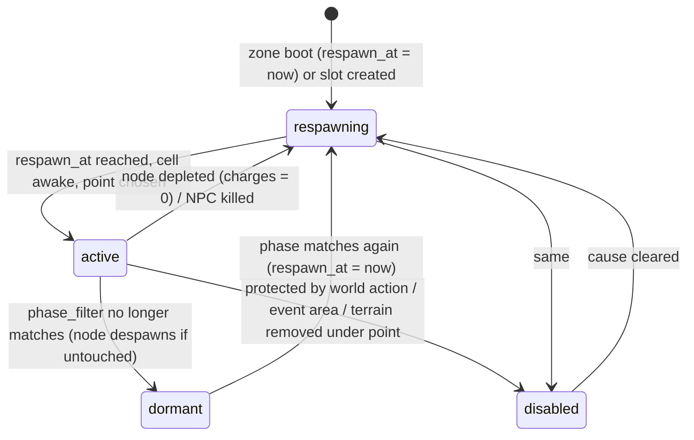
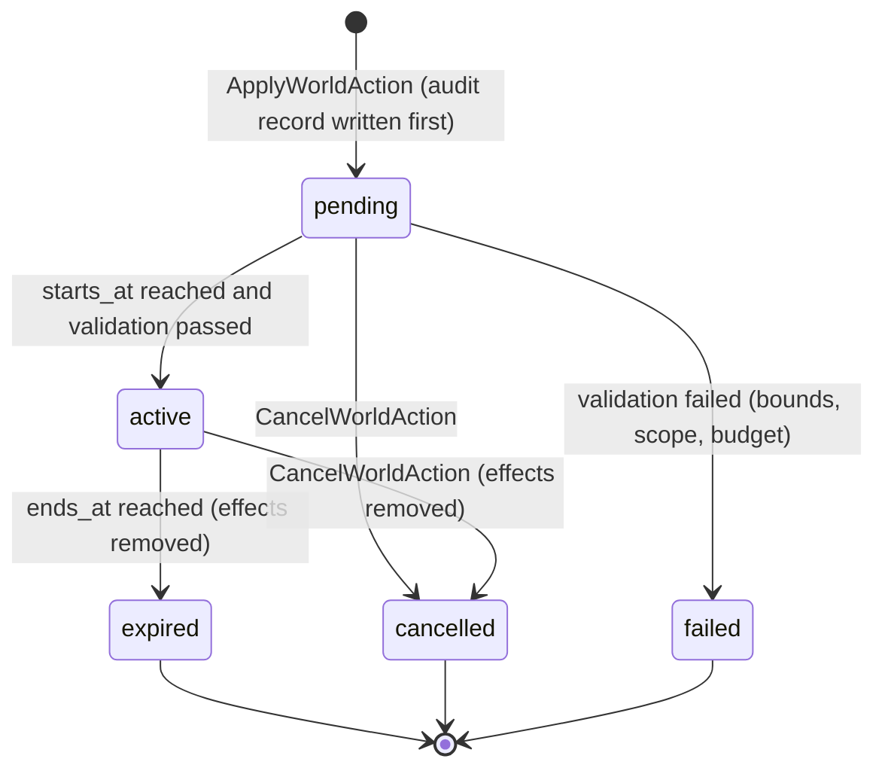

# Legends of the Shattered Frontier — World Simulation: Terrain, Resources, Population and World Events
### Version 1.0 — Expanded Technical Design Authority edition (2026-10-17)

Status: Design target; not implemented. Names per Shared Registry v1.0.

Part 3 of the World Simulation specification. Entry file: [World Simulation Architecture](../Legends_Shattered_Frontier_World_Simulation_Architecture_v1.0.md). Names: [Shared Registry](../Legends_Shattered_Frontier_Shared_Registry_v1.0.md). RPC surface: [Part 1](Legends_Shattered_Frontier_World_Server_Fleet_and_Realms_v1.0.md). Cells and clock: [Part 2](Legends_Shattered_Frontier_World_Cells_Movement_and_Handoffs_v1.0.md).

This part owns the durable `world` schema, terrain and voxel modification and its persistence, structure persistence hooks, cell activation, resource node regeneration and regional scarcity, NPC spawn and population simulation, world-event hosting and world-boss scheduling, points of interest, regional modifiers, bounded staff world actions, and the payloads of `world.poi.discovered` and `world.terrain.modified`. NPC behaviour (decision models, perception, leash behaviour) belongs to the AI spec. Gathering yield and lot quality belong to the Crafting spec. Claims, structures and upkeep belong to the Building spec.

---

## Durable world state (schema `world`)

world-service owns the registered PostgreSQL schema `world`. Only world-service writes it. Zone-servers reach it only through world-service RPCs.



```sql
CREATE SCHEMA world;

CREATE TABLE world.realms (
  realm_id        text PRIMARY KEY,                       -- e.g. 'na-1'
  dc_region       text NOT NULL CHECK (dc_region IN ('na','eu','apac','sa')),
  realm_state     text NOT NULL CHECK (realm_state IN ('offline','locked','open','draining','drained')),
  realm_role      text NOT NULL DEFAULT 'standard' CHECK (realm_role IN ('canary','standard')),
  realm_epoch_ms  bigint NOT NULL,
  build_id        text NULL,
  content_version bigint NULL,
  updated_at      timestamptz NOT NULL DEFAULT now(),
  version         integer NOT NULL DEFAULT 0
);

CREATE TABLE world.terrain_edits (
  edit_id            text PRIMARY KEY CHECK (edit_id LIKE 'ted\_%'),
  realm_id           text NOT NULL REFERENCES world.realms,
  zone_id            text NOT NULL,
  srvi_id            text NOT NULL,
  actor_kind         text NOT NULL CHECK (actor_kind IN ('character','staff','event','system')),
  actor_character_id text NULL,                            -- chr_; set NULL on erasure
  claim_ref          text NULL,                            -- Building claim id, NULL = unclaimed land
  world_action_id    text NULL,                            -- wac_
  edit_kind          text NOT NULL CHECK (edit_kind IN ('dig','raise','flatten','smooth','paint','restore')),
  op_count           smallint NOT NULL CHECK (op_count BETWEEN 1 AND 32),
  volume_changed_m3  numeric(8,3) NOT NULL CHECK (volume_changed_m3 >= 0),
  state              text NOT NULL DEFAULT 'committed'
                     CHECK (state IN ('committed','reverted','healed','rebase_dropped')),
  idempotency_key    text NOT NULL UNIQUE,
  committed_at       timestamptz NOT NULL DEFAULT now(),
  closed_at          timestamptz NULL,
  close_ref          text NULL                             -- wac_, aud_, content_version
);
CREATE INDEX terrain_edits_actor ON world.terrain_edits (realm_id, actor_character_id, committed_at);
CREATE INDEX terrain_edits_heal  ON world.terrain_edits (realm_id, committed_at)
  WHERE claim_ref IS NULL AND state = 'committed';

CREATE TABLE world.terrain_ops (
  realm_id  text   NOT NULL,
  chunk_key bigint NOT NULL,                               -- Terrain chunk key
  seq       bigint NOT NULL,                               -- per-chunk, gap-free
  edit_id   text   NOT NULL REFERENCES world.terrain_edits,
  op        bytea  NOT NULL CHECK (octet_length(op) <= 64),
  PRIMARY KEY (realm_id, chunk_key, seq)
);

CREATE TABLE world.terrain_chunks (
  realm_id             text   NOT NULL,
  chunk_key            bigint NOT NULL,
  zone_id              text   NOT NULL,
  head_seq             bigint NOT NULL DEFAULT 0,
  snapshot_seq         bigint NOT NULL DEFAULT 0,
  snapshot_uri         text   NULL,                        -- object storage, sparse diff vs base
  base_content_version bigint NOT NULL,
  base_hash            bytea  NOT NULL,
  ops_since_snapshot   integer NOT NULL DEFAULT 0,
  updated_at           timestamptz NOT NULL DEFAULT now(),
  PRIMARY KEY (realm_id, chunk_key)
);

CREATE TABLE world.spawn_slot_state (
  realm_id          text     NOT NULL,
  zone_id           text     NOT NULL,
  layer_index       smallint NOT NULL DEFAULT 0,
  group_id          text     NOT NULL,                     -- authored spawn group
  slot_index        smallint NOT NULL,
  spawn_kind        text     NOT NULL CHECK (spawn_kind IN ('gathering_node','npc')),
  state             text     NOT NULL CHECK (state IN ('active','respawning','dormant','disabled')),
  point_id          text     NULL,
  definition_id     text     NULL,                         -- gathering_node/… or npc/…
  charges_remaining smallint NULL,
  node_quality      smallint NULL CHECK (node_quality BETWEEN 0 AND 100),
  cycle             bigint   NOT NULL DEFAULT 0,
  spawned_at        timestamptz NULL,
  respawn_at        timestamptz NULL,
  updated_by_srvi   text     NOT NULL,
  version           integer  NOT NULL DEFAULT 0,
  PRIMARY KEY (realm_id, zone_id, layer_index, group_id, slot_index)
);

CREATE TABLE world.region_resource_state (
  realm_id          text NOT NULL,
  world_region_id   text NOT NULL,
  resource_id       text NOT NULL,
  capacity_per_hour numeric(10,2) NOT NULL,                -- C_r
  harvest_rate_ewma numeric(10,2) NOT NULL,                -- H_r
  scarcity_index    numeric(4,3)  NOT NULL CHECK (scarcity_index BETWEEN 0 AND 2),
  yield_per_hour    numeric(12,2) NOT NULL,
  active_slots      integer NOT NULL,
  total_slots       integer NOT NULL,
  computed_at       timestamptz NOT NULL,
  PRIMARY KEY (realm_id, world_region_id, resource_id)
);

CREATE TABLE world.poi_discoveries (
  realm_id      text NOT NULL,
  character_id  text NOT NULL,
  poi_id        text NOT NULL,
  zone_id       text NOT NULL,
  srvi_id       text NOT NULL,
  discovery_seq integer NOT NULL,                          -- nth discoverer on the realm
  discovered_at timestamptz NOT NULL DEFAULT now(),
  PRIMARY KEY (character_id, poi_id)
);
CREATE TABLE world.poi_counters (
  realm_id           text NOT NULL,
  poi_id             text NOT NULL,
  discoverers        integer NOT NULL DEFAULT 0,
  first_character_id text NULL,                            -- set NULL on erasure
  first_at           timestamptz NULL,
  PRIMARY KEY (realm_id, poi_id)
);

CREATE TABLE world.weather_state (
  realm_id        text NOT NULL,
  world_region_id text NOT NULL,
  period_index    bigint NOT NULL,
  weather_kind    text NOT NULL CHECK (weather_kind IN ('clear','overcast','rain','storm','fog',
                                        'snow','blizzard','sandstorm','heatwave','ashfall')),
  updated_at      timestamptz NOT NULL DEFAULT now(),
  PRIMARY KEY (realm_id, world_region_id)
);
CREATE TABLE world.weather_history (                       -- 30-day retention (Building wear input)
  realm_id text NOT NULL, world_region_id text NOT NULL, period_index bigint NOT NULL,
  weather_kind text NOT NULL, source text NOT NULL CHECK (source IN ('chain','gm_override','world_event')),
  PRIMARY KEY (realm_id, world_region_id, period_index)
);

CREATE TABLE world.world_actions (
  world_action_id text PRIMARY KEY CHECK (world_action_id LIKE 'wac\_%'),
  realm_id        text NOT NULL REFERENCES world.realms,
  action_kind     text NOT NULL CHECK (action_kind IN ('weather_override','spawn_entities',
                                       'despawn_entities','terrain_revert','edit_window')),
  actor_kind      text NOT NULL CHECK (actor_kind IN ('staff','event')),
  scope           jsonb NOT NULL,                          -- zone_id / world_region_id / volume
  params          jsonb NOT NULL,
  state           text NOT NULL CHECK (state IN ('pending','active','expired','cancelled','failed')),
  staff_account_id text NULL, audit_record_id text NULL,   -- aud_ (staff actions)
  wev_id          text NULL,                               -- event actions
  idempotency_key text NOT NULL UNIQUE,
  starts_at       timestamptz NOT NULL,
  ends_at         timestamptz NOT NULL,
  created_at      timestamptz NOT NULL DEFAULT now(),
  CHECK (ends_at > starts_at)
);

CREATE TABLE world.world_boss_schedule (
  realm_id          text NOT NULL,
  world_event_id    text NOT NULL,                         -- world_event/<slug> content id
  next_window_index bigint NOT NULL,
  next_window_open  timestamptz NOT NULL,
  window_state      text NOT NULL CHECK (window_state IN ('waiting','requested','active','closed')),
  last_wev_id       text NULL,
  last_defeated_at  timestamptz NULL,
  version           integer NOT NULL DEFAULT 0,
  PRIMARY KEY (realm_id, world_event_id)
);

CREATE TABLE world.outbox (                                -- transactional outbox to event-bus
  event_id     text PRIMARY KEY,                           -- evt_
  topic        text NOT NULL,
  key          text NOT NULL,
  envelope     jsonb NOT NULL,
  created_at   timestamptz NOT NULL DEFAULT now(),
  published_at timestamptz NULL
);
```

Retention: `terrain_ops` rows at or below `snapshot_seq` are deleted 30 days after compaction (rollback window). `weather_history` 30 days. `world_actions` 400 days (audit lineage stays in audit-service). Everything else is current state.

---

## Terrain and voxel modification

Construction (Construction spec, Placement and shaping) defines the player experience: 0.5 m editable terrain cells, brushes from 0.5 m to 5 m radius, at most 100 m³ per committed action, protected landmarks, nodes, watercourses and routes. World owns validation geometry, persistence and replay: **original terrain + deltas = live world**.

### Chunks and chunk keys

Terrain is a signed-density voxel field with a 0.5 m voxel. It is stored in **chunks** of 16 m × 16 m × 16 m (32³ = 32,768 voxels; `tune.world.terrain_chunk_m`, fixed per major schema). A 64 m cell column holds 4 × 4 chunk columns.

```text
ccx = floor(x_local / 16), ccy = floor(y_local / 16), ccz = floor(z_local / 16)
chunk_key (uint64) = zone_index << 48 | (ccx & 0xFFFF) << 32 | (ccy & 0xFFFF) << 16 | (ccz & 0xFFFF)
```

`ccx`, `ccy` and `ccz` are signed 16-bit (±524 km), with the same sign-extension rule as `cell_key`. Instance maps are immutable: tooling never creates chunks for them, and edits there are rejected.

### Edit operations

Proposed enum `terrain_edit_kind`: `dig`, `raise`, `flatten`, `smooth`, `paint`, `restore`. An **op** is a pure, deterministic function of the chunk's density field:

| Field | Encoding | Notes |
| --- | --- | --- |
| `kind` | uint8 | `terrain_edit_kind` |
| `shape` | uint8 | `sphere`, `cuboid` |
| `center` | 3 × int32, millimetres, map-local | |
| `extent` | sphere: radius mm; cuboid: 3 × half-extents mm | radius 500–5,000 mm |
| `strength` | uint8 | 0–255; fraction of full density change |
| `material_id` | uint16 | `raise`, `paint`; index into the zone's terrain material palette |
| `target_z` | int32 mm | `flatten` only |

Density is an `int16` per voxel. All arithmetic is fixed-point (Q15) with round-half-away-from-zero, so every server, tool and replay produces bit-identical fields. An op touching several chunks is stored once per touched chunk with the same `edit_id`.

**Changed volume** (the 100 m³ limit is on what actually changes, not on the brush):

```text
ΔV = Σ_i |ρ'_i − ρ_i| / ρ_max × v_voxel        ρ_max = 32767, v_voxel = 0.125 m³
sphere nominal volume V_s = 4/3 π r³ ;  cuboid V_c = 8 h_x h_y h_z
```

Two checks apply: a nominal pre-check `V_nominal ≤ 100 m³` for `dig`, `raise` and `flatten`, then `ΔV ≤ 100 m³` for every kind (`smooth` and `paint` skip the pre-check because they change little volume).

Worked example: a full-strength `dig` sphere of r = 2.5 m into solid ground has V_s = 65.45 m³ and ΔV ≈ 65.4 m³ (voxels fully inside change by ρ_max, edge voxels partially) → accepted. The same dig with r = 3.0 m has V_s = 113.1 m³ → rejected by the pre-check. At the edge of a cliff where only 60 % of that sphere is solid, ΔV would be ≈ 67.9 m³. It is still rejected, because the pre-check runs first, so players get the same answer regardless of hidden geometry.

### Terrain edit validation (zone-server)

Checked in order; the first failure returns the `reject_reason` shown.

| # | Rule | Default / key | Reject |
| --- | --- | --- | --- |
| T1 | Actor not sanctioned for construction (trade/market restrictions do not block). | — | `sanction_restricted` |
| T2 | Brush centre within reach of the actor's authoritative position. | 8.0 m (`tune.world.terrain_reach_m`) | `interact_range` |
| T3 | Brush radius 0.5–5.0 m; nominal and changed volume ≤ 100 m³. | `tune.world.terrain_max_volume_m3` | `interact_state` |
| T4 | Permission: inside a Building claim parcel and vertical band where the actor holds the terrain right; or inside an active `edit_window` world action; or the zone policy allows edits on unclaimed land. | Building spec | `interact_state` |
| T5 | Not inside a protected volume: authored landmarks, POI radius, watercourses, critical traversal links (navmesh `critical` flag), gathering spawn points (3 m), respawn points (5 m), active world-event areas, `no_edit` zone volumes, or structures for which the actor lacks the effective terrain/support-edit right (1 m clearance). A claim's explicit terrain right can authorize its own supports; ownership of one placed piece alone cannot authorize undermining another parcel. | content / Building permission evaluation | `interact_state` |
| T6 | Not within 8 m of a zone border. | `tune.world.border_edit_exclusion_m` | `interact_state` |
| T7 | Depth and height bounds: final surface within 8 m below and 12 m above the base surface at that column, and above `zone.min_dig_z`. | `tune.world.terrain_max_depth_m`, `tune.world.terrain_max_raise_m` | `interact_state` |
| T8 | A `raise` must not intersect any character or NPC capsule. | — | `interact_state` |
| T9 | Rate: 1 commit per 1.5 s per character; 2,000 m³ per character per hour; 200 ops/s per zone. | `tune.world.terrain_commit_interval_ms`, `tune.world.terrain_volume_per_hour_m3`, `tune.world.terrain_zone_ops_per_s` | `rate_limited` |
| T10 | Durable construction coordinator and all affected persistence participants available; touched chunks and stock can be prepared under the zone ownership epoch. | Construction Integration | `interact_state` |

After acceptance, if the edit removed density beneath a structure anchor, the zone-server calls the Building runtime's support re-evaluation for the affected structures (Structure persistence hooks).

### Commit and persistence

```mermaid
sequenceDiagram
    autonumber
    participant C as Client
    participant ZS as zone-server
    participant WS as world-service
    participant PG as PostgreSQL world
    participant OS as Object storage
    C->>ZS: TerrainEditIntent(kind, shape, centre, extent, material)
    ZS->>ZS: validate T1–T10, compute ops per chunk, ΔV
    ZS->>ZS: prepare action via building-service (inventory reservations if cost/yield)
    ZS->>WS: CommitTerrainEdits(batch ≤ 32 ops or every 2 s; idempotency_key = ted_id)
    WS->>PG: persist prepared deltas and expected chunk versions; invisible until coordinator commit
    ZS->>ZS: building-service records durable commit decision; participants finalize idempotently
    WS->>PG: finalize terrain ops, chunk heads and outbox once
    WS-->>ZS: committed(head_seq per chunk)
    ZS->>ZS: after all participants finalize, apply live chunks and acknowledge receipt
    Note over WS,OS: compactor: ops_since_snapshot > 256 or > 32 KiB → write snapshot to OS, advance snapshot_seq
```

```proto
message TerrainOp { bytes op = 1; repeated uint64 chunk_keys = 2; }
message TerrainEditRecord {
  string edit_id = 1;  string edit_kind = 2;  string actor_kind = 3;  string actor_character_id = 4;
  string claim_ref = 5; string world_action_id = 6; repeated TerrainOp ops = 7; float volume_changed_m3 = 8;
  int64 applied_at_server_ms = 9;
}
message CommitTerrainEditsRequest {
  string idempotency_key = 1; string zone_id = 2; string srvi_id = 3;
  repeated TerrainEditRecord edits = 4;
  map<uint64, uint64> expected_head_seq = 5;    // per chunk, from the server's live state
  string construction_action_id = 6;  // cba_; durable prepared decision in building-service
  uint64 zone_owner_epoch = 7;        // reject stale zone owners
  string construction_phase = 8;    // prepare | apply | activate | abort; Integration participant protocol
  string decision_digest = 9;       // immutable decision / completion certificate reference
}
message CommitTerrainEditsResponse { map<uint64, uint64> head_seq = 1; repeated string rejected_edit_ids = 2; }
```

Rules:

- **Single writer per chunk.** Only the zone owner (layer 0; claimable zones are never layered) commits. `expected_head_seq` mismatch → `FAILED_PRECONDITION seq_conflict`; the zone-server reloads the chunk (it can only happen after a lost-zone recovery that raced with a commit).
- **Durability and material conservation.** All player terrain edits, including zero-cost edits and resource-yielding excavation, follow [Construction Integration](../Legends_Shattered_Frontier_Construction_Integration_Contracts_v0.1.md). Geometry, costs and yields are prepared under one `cba_` decision; acknowledgments and usable terrain wait for every participant to finalize. The 32-op/2-second transport batch is only a flush ceiling, never permission to acknowledge volatile edits. The UI may show a pending ghost. Prepared edits are invisible and block conflicting chunk/claim actions; an unavailable coordinator fails closed. Claims and structures cannot be placed on pending geometry. Resource eligibility and fractional yield provenance persist through excavation, fill, revert, healing and replay: healing cannot refresh an already harvested baseline cell. Staff restoration does not automatically refund items; it invokes audited compensation if warranted.
- **Boot.** `LoadZoneState` streams every chunk with deltas: snapshot URI (the server downloads it from object storage with a short-lived signed URL) plus the op tail after `snapshot_seq`. Boot target for a zone with 20,000 edited chunks: ≤ 8 s added to boot.
- **Compaction.** When `ops_since_snapshot > 256` or op bytes > 32 KiB, the compactor materializes the chunk as a sparse diff against the base (`{voxel_index uint16, density int16, material uint16}`, zstd) and advances `snapshot_seq`.
- **Rebase on content change.** If a new `content_version` changes a chunk's base (different `base_hash`), world-service replays the chunk's committed ops onto the new base. Ops that now intersect a protected volume are marked `rebase_dropped` and reported. This runs during release validation (LiveOps `ActivateContentVersion` waits for it). It must finish before activation.
- **Revert.** `RevertTerrainEdits(filter)` (staff, permission `world:terrain:revert`; or enforcement rollback) marks matching edits `reverted` and rebuilds affected chunks by replaying the remaining ops from the last snapshot that precedes the earliest reverted op. The owning zone-server receives a heartbeat command `reload_chunks`. Filters: `edit_ids[]`, `actor_character_id + time range`, `claim_ref + time range`.
- **Healing of unclaimed land.** Construction confirms seven elapsed real days from a public edit's commit, processed by the nightly job; unrelated edits do not renew its deadline. Healing replays terrain without expired ops, rather than resetting an entire chunk. Before changing density, recheck present claims, occupants, support, protected routes, later paid fill and yield provenance. Acquiring a legal claim atomically adopts its existing committed terrain history for lifecycle protection, without resetting extraction yield; adopted edits stop public healing. Unsafe healing waits, records its reason and retries. Claim release uses the archive-and-safe-restoration workflow. Authored event edits carry an explicit expiry/restoration policy and receive no implicit permanent exemption. Depth/raise limits are confirmed at 8 m below/12 m above the shipped baseline, further bounded by the parcel and `min_dig_z`; smoothing or repeat edits never reset that baseline. These bounds and healing algorithm are release-controlled under Tuning and Configuration despite legacy `tune.world.*` distribution names.

**Storage budget (worked example).** At 10,000 CCU with 5 % of players shaping terrain at an average 2 commits per minute and 1.5 chunk-ops per commit of ~48 bytes, the op log grows by 500 × 2 × 60 × 1.5 × 48 B ≈ 4.3 MB/h (≈ 104 MB/day). Compaction at 256 ops per chunk produces at most ≈ 8,400 snapshots/day of ~8 KiB ≈ 69 MB/day. With 7-day healing of unclaimed land, steady-state storage per realm stays below 20 GB (`m_terrain_storage_bytes`, alert at 50 GB).

---

## Structure persistence hooks

The Building spec owns structures, claims, permissions, upkeep, structural integrity and sieges. Registry-registered `building-service` is their durable owner; the zone-server runs live support/collision and replication. `building-service` publishes `world.structure.placed` / `world.structure.destroyed` through its durable outbox after the construction decision finalizes, using [Construction Integration](../Legends_Shattered_Frontier_Construction_Integration_Contracts_v0.1.md) payloads. World provides these hooks inside the zone-server:

| Hook | Contract |
| --- | --- |
| Spatial index | Every structure record carries `cell_key` and the set of `chunk_key`s its footprint touches. The zone-server loads structures per zone at boot from the structure owner and indexes them by cell. |
| Terrain support | `IsSupported(anchor_points[])` answers from live terrain density (solid if ρ ≥ 0.5 ρ_max at the anchor voxel). Building calls it before a structural batch is accepted. |
| Support changed | After an accepted terrain edit removes density under a structure anchor, the zone-server calls Building's integrity re-evaluation with the affected structure ids, in the same tick. |
| Protection | Structures are protected volumes for terrain edits by non-owners (rule T5), and claim parcels gate rule T4. |
| Exposure | `world.weather_history` gives, per region and 30-minute period, weather and its exposure class (Part 2, Weather). Preserve exact transition timestamps within periods. Building computes wear from this history plus committed geometry, insulation and heat/fuel intervals; roof coverage blocks rain, not every hazard. Active and offline computation use the same intervals and clock conversion. |
| Events | building-service publishes structure lifecycle events once after finalization; zone-server consumes the result for replication. World adds no fields or duplicate event. |

---

## Cell activation

Simulation cost scales with occupied space, not zone area. Each zone-server keeps a per-cell activation state.

```text
active(c)  ⇔  ∃ player p : max(|cx(p) − cx(c)|, |cy(p) − cy(c)|) ≤ R_act       R_act = 3 cells (192 m)
            ∨  c is pinned (active world-event area, siege area, world boss arena, GM spawn action)
dormant(c) ⇔  not active(c) for ≥ 60 s                                         tune.world.cell_dormant_after_s
```

`R_act` is `tune.world.cell_activation_radius`. In dormant cells, NPCs are frozen (no ticks, state kept in memory), and spawn timers are evaluated lazily. When a cell wakes, every slot whose `respawn_at ≤ now` spawns at once, up to the cell NPC budget, staggered over 2 s. Gathering nodes in dormant cells still exist and still count toward capacity.

Simulation tiers for NPCs in active cells (World decides the tick rate; the AI spec decides what a decision step does):

| Tier | Condition | NPC tick |
| --- | --- | --- |
| `near` | a player within 1 cell (Chebyshev) | every server tick (30 Hz, `tune.world.zone_tick_hz`) |
| `far` | active cell, no player within 1 cell | 10 Hz (`tune.world.far_tick_hz`) |
| frozen | dormant cell | 0 |

`cells_total` (Analytics `ops.zone.load_sampled`) = cells whose square intersects the zone polygon. `cells_active` = cells in state active (pinned included). A typical launch zone of 2 km × 2 km has about 1,000 cells. At 200 players in a levelling zone, the target is ≤ 35 % active (`m_cells_active_ratio`, proposed).

---

## Resource regeneration

Crafting owns the `gathering_node` definition (`resource_id`, `skill_id`, `resource_tier`, `charges`, `respawn_s`, `tool_category`, `quality_band`), yield and lot quality (Crafting spec, Gathering contract). World owns **where and when nodes exist**: spawn groups, respawn timing, point rotation, and the regional scarcity index consumed by Quest generation and the AI director (Quest spec, Generation and campaigns: `resource_context[]` with `scarcity_index 0–2`).

### Spawn groups

Zone content authors `spawn_groups[]`:

| Field | Type | Rule |
| --- | --- | --- |
| `group_id` | string | Unique in zone. |
| `spawn_kind` | `gathering_node` \| `npc` | |
| `definitions[]` | `{definition_id, weight}` | `gathering_node/…` or `npc/…`; weights > 0. |
| `points[]` | `{point_id, position, facing}` | `N` points. |
| `active_count` | int `K` | Concurrent slots; tooling requires `N ≥ 2K` for gathering groups. |
| `area` | polygon | Population area (cells it covers drive `n` below). |
| `phase_filter` | `any` \| `day` \| `night` | Slots outside the phase are `dormant`. |
| `layer_policy` | `all_layers` \| `primary_only` | Tier `rare`+ nodes are forced to `primary_only` (Part 2, L6). |
| `respawn_s_override` | int? | Optional; otherwise the definition's `respawn_s`. |

Proposed enum `spawn_slot_state`: `active`, `respawning`, `dormant`, `disabled`.



### Respawn timing

```text
t_respawn = respawn_s(def) × S(σ_r) × J
S(σ)      = 1 + k_s × max(0, σ − 1)                      k_s = 0.5  (tune.world.scarcity_respawn_k)
J         = 1 + j × (2u − 1)                             j = 0.10   (tune.world.respawn_jitter)
u         = first 8 bytes of SHA-256("node|" + realm_id + "|" + zone_id + "|" + group_id + "|" + slot_index + "|" + cycle) / 2^64
```

The scarcity factor slows regeneration in an over-harvested region (at most × 1.5), so pressure spreads players to other regions instead of rewarding camping. Abundant regions (σ < 1) regenerate at the authored speed.

**Point rotation.** On respawn, the slot chooses uniformly (seeded with `u` of the next cycle) among points that are unoccupied and were not used by any slot in the last 2 cycles (`tune.world.spawn_point_cooldown_cycles`). If none qualifies, it chooses any unoccupied point. Bots cannot learn a fixed route, and a depleted node never reappears at the same spot right away.

**Definition choice.** Weighted by `definitions[].weight`. Scarcity does not change the tier mix.

**Persistence.** Gathering slots, and NPC slots of tier `elite` or above or flagged `rare_spawn`, are persisted in `world.spawn_slot_state` through `ReportZoneState` (every 60 s and on drain or migration). A server crash therefore never resets a rare timer early ("crash to respawn"). Common NPC slots are memory only.

### Regional scarcity index

```text
C_r   = Σ_{gathering slots s in region yielding r} E[charges_s] × 3600 / respawn_s(def_s)     harvests/h at base timers
h_r   = harvests of r in the region in the last 5-min window (ReportZoneState counters)
H_r  ← H_r + α × (12 × h_r − H_r)            α = 1 − 2^(−5/360) ≈ 0.00958 (6 h half-life; tune.world.scarcity_half_life_h)
σ_r   = clamp(2 × H_r / C_r, 0, 2)
Y_r   = Σ_s E[charges_s] × base_yield(def_s) × 3600 / (respawn_s(def_s) × S(σ_r))                units/h
```

`E[charges_s]` and `base_yield` are weight-averaged over the slot's definitions. `C_r` uses base timers on purpose, so the index has no feedback loop with its own effect. `Y_r` is the `node_yield_per_hour` Quest's gather feasibility check uses. It equals the expected quantity because Crafting's `floor(x + u)` with `u ∈ [0,1)` has expectation `x`. It ignores yield multipliers (mastery, LiveOps, regional buffs), so it is a conservative lower bound.

σ = 1 means harvesting runs at half the regeneration capacity (healthy). σ = 2 means every node is taken as soon as it appears.

**Worked example.** `world_region/greenlands_south`, `resource/iron_ore`: one group with K = 24 slots of `gathering_node/iron_vein` (charges 3, `respawn_s` 600, `base_yield` 2.5).
- `C_r` = 24 × 3 × 3600 / 600 = **432 harvests/h**.
- Smoothed harvest rate `H_r` = 280/h → `σ_r` = 2 × 280 / 432 = **1.296**.
- `S` = 1 + 0.5 × 0.296 = 1.148 → mean respawn 600 × 1.148 = **689 s** (±10 % jitter).
- `Y_r` = 24 × 3 × 2.5 × 3600 / 688.9 = **940.6 ore/h**.
- Quest receives `{resource/iron_ore, scarcity_index 1.296}`. Its gather template with count range [5, 15] gives `s = 0.648` → `count = round(lerp(15, 5, 0.648)) = 9`, with `w_scarcity = 1 + 0.25 × 0.296 = 1.074` (Quest spec formulas).

```proto
message GetRegionResourceStateRequest { string realm_id = 1; string world_region_id = 2; repeated string resource_ids = 3; }
message ResourceState {
  string resource_id = 1; double scarcity_index = 2; double capacity_harvests_per_hour = 3;
  double harvest_rate_ewma = 4; double node_yield_per_hour = 5;
  uint32 active_slots = 6; uint32 total_slots = 7; int64 computed_at_ms = 8;
}
message RegionResourceState { string world_region_id = 1; repeated ResourceState resources = 2; }
```

world-service recomputes every region every 5 min (`tune.world.scarcity_recompute_s`, 300) from `ReportZoneState` counters. Results are cached in `world.region_resource_state`.

### Balancing targets

Defaults below are what content tooling suggests when a `gathering_node` definition omits a value. Crafting-authored values win.

| `resource_tier` | `respawn_s` | `charges` | Active slots per km² of resource terrain | Dedicated solo gatherer, harvests/h at σ ≤ 1 |
| --- | --- | --- | --- | --- |
| `common` | 300 | 3 | 40 | 60–90 |
| `uncommon` | 600 | 3 | 20 | 30–45 |
| `rare` | 1,200 | 2 | 8 | 10–15 |
| `epic` | 2,700 | 2 | 3 | 3–5 |
| `legendary` | 7,200 | 1 | 0.5 | 0.5–1 (per region) |

| Target | Value | Metric |
| --- | --- | --- |
| Realm median σ over (region, resource) | 0.6–1.2 | `m_scarcity_index` |
| Region with σ ≥ 1.5 for 24 h | alert to economy analysts; director receives `resource_shortage` signal | `m_scarcity_index` |
| Region with σ ≤ 0.2 for 7 days at cap level | content review (oversupply) | `m_node_utilization` |
| Share of node respawns at the same point as last cycle | 0 % | test invariant |

Wildlife for `skill/hunting` uses NPC spawn groups. Its scarcity is not tracked at launch. Fishing pools are gathering nodes.

### Regional modifiers

Raid regional buffs (Raid spec, World effects: "zone-server via config-service") and LiveOps overlays reach zone-servers as the config-service value `tune.world.regional_modifiers`: a list of `{modifier_id, world_region_id, source (raid_world_effect | liveops | world_event), effect_ref, gathering_yield_mult, starts_at, ends_at}`. The zone-server applies `effect_ref` as a visible regional aura and passes `buff_mult = min(Π gathering_yield_mult, 1.25)` (`tune.world.regional_yield_mult_max`) to `crafting-service.ResolveHarvest` (Crafting spec, `buff_mult`). LiveOps `gathering_yield_multiplier` stays Crafting's `event_mult` and is not applied here, so nothing is double-counted.

---

## NPC spawn and population simulation

World decides **how many** NPCs exist **where** and **when**. AI decides **what they do** (AI spec, NPC AI). The interface between them uses Registry names only: `WorldEntity` (`ent_`), content kind `npc`, `npc_tier`, and the director's spawn pressure (ai-director-service).

### Population target and respawn

```text
K_eff     = clamp(round(K × (1 + clamp(π_dir, −0.5, 1.0))), 0, K_max)     K_max = 2K
t_respawn = respawn_base(tier) × D(n) × J
D(n)      = max(f_min, 1 / (1 + k_p × max(0, n − 1)))                       k_p = 0.15, f_min = 0.35
```

| Symbol | Meaning | Default / key |
| --- | --- | --- |
| `K` | Group `active_count` | content |
| `π_dir` | Director spawn pressure for the region (AI owns the value; default 0) | `DispatchZoneCommand(spawn_pressure)` |
| `respawn_base(tier)` | `common` 300 s, `elite` 900 s, `mini_boss` 1,800 s; `world_boss` only by schedule | `tune.world.npc_respawn_s.<tier>` |
| `n` | Players inside the group's `area` | — |
| `J` | ±10 % jitter (same formula as nodes) | `tune.world.respawn_jitter` |
| `k_p`, `f_min` | Dynamic respawn slope and floor | `tune.world.dynamic_respawn_k`, `tune.world.dynamic_respawn_floor` |

Extra slots created by positive pressure are removed only when their NPC dies or despawns out of combat. They are never despawned in front of players.

**Worked example.** A `common` wolf group (K = 8) in a level-14 area; the director sets `π_dir` = +0.25 during a "wolves are restless" event → `K_eff` = round(8 × 1.25) = 10. Six players hunt in the area → `D(6)` = max(0.35, 1 / 1.75) = 0.571 → mean respawn 300 × 0.571 = **171 s**. With 20 players, `D` = max(0.35, 1 / 3.85) = 0.35 → **105 s** (floor).

### Levels, budgets and bounds

- **Level.** A spawned NPC's level = `content_level(point)` (Part 2, Zone content level) + the definition's `level_offset` (−2…+3), clamped to 1–100.
- **Budgets.** Zone ≤ 2,500 live `WorldEntity` NPCs (`tune.world.zone_npc_budget`); a cell ≤ 48 (`tune.world.cell_npc_budget`). Over budget, new spawns are deferred (oldest-due first), and `ReportZoneState` reports `spawns_deferred` so the director can lower pressure.
- **Hard bound.** World enforces a safety bound independent of AI behaviour. An NPC farther than 150 m from its group area (`tune.world.npc_hard_leash_m`), or outside the zone, is reset to its spawn point with full health and its threat cleared. AI's own leash and evade behaviour should trigger well before this.
- **Phase and weather filters.** Group `phase_filter` uses `day_phase`. The AI spec may read weather visibility for perception. World does not change spawns by weather at launch.

### Zone tick pipeline

Order inside one server tick (30 Hz, budget 33.3 ms, target p95 ≤ 25 ms):

1. Receive inputs; movement validation with `v_eff` and teleport tokens (Part 2).
2. Abilities and effects (Combat spec).
3. NPC decisions for `near` NPCs every tick and `far` NPCs every third tick (AI spec runs the step).
4. Physics and navigation.
5. Spawn and regeneration step (slots due, cell wake/sleep, point rotation).
6. World-event commands queued this tick (ordered by `wev_id`, `seq`).
7. Terrain edits accepted this tick; support re-evaluation hooks.
8. Replication (Network spec), then telemetry and counters.

---

## World events

The AI spec owns world events as a concept (Registry concept ownership: "Faction AI, world director, world events, NPC behavior"): `ai-director-service` creates `WorldEventInstance` (`wev_`), owns `world_event_state` transitions and publishes `world.event.*` with AI-defined payloads. World owns:

1. **Placement content** on `world_event` definitions (AI and World co-own the kind): `zone_ids[]`, `area` polygon, `spawn_anchors[]`, `layer_policy` (`primary_only` for world bosses), `pins_cells` (default true), `blocks_terrain_edits` (default true), `no_mount` (default false), `capacity_overflow` (default 100).
2. **Hosting**: zone-servers execute director commands delivered by `DispatchZoneCommand`.
3. **Fixed schedules** for world bosses and other calendar-bound world events (World boss scheduling).

### Hosting contract

```proto
message DispatchZoneCommandRequest {
  string idempotency_key = 1;            // "{wev_id}:{seq}"
  string realm_id = 2; string zone_id = 3; int32 layer_index = 4;   // −1 = all layers
  string wev_id = 5; uint32 seq = 6;     // per-wev monotonic
  bool replay = 7;                        // re-send of current state after migration / recovery
  oneof command {
    OpenArea open_area = 10;              // pin cells, protected volume, no_mount, area id
    SpawnSet spawn = 11;                  // [{npc definition_id, anchor_id, count, tags}]
    StageMarker stage = 12;               // stage key + stage-scoped modifiers
    CloseArea close_area = 13;            // despawn tagged NPCs after 30 s, unpin
    SpawnPressure spawn_pressure = 14;    // {world_region_id, pi_dir, until}
    WeatherSet weather_set = 15;          // {world_region_id, weather_kind, until} (handled by world-service)
  }
}
message DispatchZoneCommandResponse { bool accepted = 1; string srvi_id = 2; uint32 applied_seq = 3; }
```

Rules:

- world-service queues commands for the owning server(s) and signals them with the heartbeat command `zone_command`. Servers fetch queued items from `GetServer.pending_commands` and apply them in `seq` order per `wev_id`. Duplicates (same `seq`) are ignored. A gap waits up to 10 s, then the server asks the director for a replay.
- Event NPCs carry the `wev_id` tag. Their kills and the participants' contribution (damage, healing, objective actions against event-tagged entities) are reported by the zone-server to ai-director-service as `EventProgress` messages on the AI-owned `ZoneLink` stream (AI spec, World Director part, gRPC contract). `combat.npc.killed` is still emitted as usual (Combat spec).
- `pins_cells` keeps the area's cells active for the event's duration, and the event area becomes a protected volume for terrain edits.
- After `MigrateZone` or lost-zone recovery, the director re-sends the current state with `replay = true` when it sees `world.server.allocated` with `replaces_srvi_id`.
- Spawn requests are bounded by the zone NPC budget. An event may reserve up to 20 % of the zone budget (`tune.world.event_npc_budget_fraction`). Excess is rejected with `accepted = false` and a reason, so the director can scale the event down.

### World boss scheduling

World bosses are `world_event` definitions with `schedule.kind = fixed_window`. world-service evaluates the schedule and asks the director to start the event. The director still owns the instance and may decline (for example during a conflicting invasion; AI spec, World director).

```text
schedule = { period_h P, jitter_h J, window_min, min_cooldown_h, phase_filter (any | night | day), anchor_offset_h }
base_k  = realm_epoch_ms + anchor_offset_h + k × P
open_k  = base_k + floor(J × u_k)        u_k = first 8 bytes of SHA-256("wb|" + realm_id + "|" + world_event_id + "|" + k) / 2^64
if phase_filter ≠ any and day_phase(open_k) ≠ phase_filter:  open_k ← start of the next matching phase after open_k
after a defeat at t_d:  next k = smallest k with open_k ≥ t_d + min_cooldown_h
```

Flow: at `open_k − 15 min` world-service sets `window_state = requested` and calls `ai-director-service.RequestWorldEvent(world_event_id, trigger_kind = world_schedule, window_end = open_k + window_min)` (AI spec, World Director part, gRPC contract). The director creates the `wev_` and dispatches commands at `open_k`. A declined request is retried every 5 min until window end. When `world.event.ended` arrives for that `wev_`, world-service records `last_defeated_at` (if the outcome is a defeat) and computes the next window. An undefeated boss despawns at window end, and the next window follows the plain schedule.

Defaults (`tune.world.world_boss_*`): P = 72 h per boss, J = 6 h, window 60 min, cooldown 48 h. Each biome has one boss at launch, with anchor offsets 0, 18, 36 and 54 h. At least one world boss window therefore opens somewhere on the realm about every 18 h.

**Worked example.** Realm `eu-1`, epoch 2026-11-01T00:00Z; boss with P = 72 h, J = 6 h, offset 0, `phase_filter = night`. For k = 5: `base_5` = 2026-11-16T00:00Z. Say `u_5` = 0.4375 → jitter = floor(6 h × 0.4375) = 2 h 37 min 30 s → 02:37:30Z. Game time at that moment: 1,305,450 real s × 6 = 7,832,700 game s → `time_of_day_s` = 56,700 (15:45, `day`). The next night starts at 75,600 → 18,900 game s = 3,150 real s later → **`open_5` = 03:30:00Z**. Night lasts 80 real minutes (until 04:50Z), so the 60-minute window ends inside the night at 04:30Z.

Balancing targets: ≥ 40 eligible players present at window open in Phase 2 (`m_world_boss_attendance`, proposed); kill rate per window 60–85 %; rewards per Registry power ladder (world bosses at cap ilvl 415, `epic`) issued by the AI-owned reward path through reward-service.

---

## Points of interest

Quest needs `world.poi.discovered` for `explore` objectives and `poi_discovered` triggers (Quest spec, Model and objectives). World defines it.

Proposed content kind `poi` (`poi/<slug>`, owning spec World): `zone_id`, `position`, `radius_m` (5–100), `poi_kind`, `hidden` (not shown on the map until discovered), `min_dwell_ms` (default 1,000). Proposed enum `poi_kind`: `landmark`, `settlement`, `dungeon_entrance`, `vista`, `ruin`, `resource_site`.

Detection (zone-server, 1 Hz per character): a character whose **authoritative** position stays within `radius_m` for `min_dwell_ms`, and who is not in the session's discovered cache, triggers `RecordDiscovery(character_id, poi_id)`.

```proto
message RecordDiscoveryRequest { string idempotency_key = 1;  // "poi:{character_id}:{poi_id}"
  string character_id = 2; string poi_id = 3; string zone_id = 4; string srvi_id = 5; Vec3 position = 6; }
message RecordDiscoveryResponse { bool newly_discovered = 1; uint32 discovery_seq = 2; bool first_on_realm = 3; }
```

world-service validates that the POI is in the caller's zone and the position is within `radius_m + 2 m`. It inserts `poi_discoveries` and increments `poi_counters` in one transaction with the outbox row, so the event is emitted exactly once per character and POI. Because the durable write is in world-service, the event's `producer.service` is `world-service`. Quest's adapter guidance (code against the topic, not the producer) covers this (Quest spec, Agent implementation guide).

---

## World actions (bounded staff and event changes)

The Game Master concept requires bounded, previewed, audited world changes (Game Master spec, capability model). World implements them as `WorldAction` (`wac_`, proposed prefix). Proposed enums `world_action_kind`: `weather_override`, `spawn_entities`, `despawn_entities`, `terrain_revert`, `edit_window`; `world_action_state`: `pending`, `active`, `expired`, `cancelled`, `failed`.

| Kind | Bounds (defaults) | Permission |
| --- | --- | --- |
| `weather_override` | Biome states only; ≤ 60 min | `world:weather:override` |
| `spawn_entities` | ≤ 20 entities per action (`tune.world.gm_spawn_max`); only `npc` definitions flagged `gm_spawnable`; tier ≤ `elite` (`mini_boss` needs `senior_game_master`); ≤ 120 min then despawn; GM-spawned NPCs grant no loot and no XP (`no_rewards`) | `world:spawn:bounded` |
| `despawn_entities` | Only GM-spawned or event-tagged entities, or one named stuck NPC | `world:spawn:bounded` |
| `terrain_revert` | Wraps `RevertTerrainEdits`; ≤ 10,000 edits per action | `world:terrain:revert` |
| `edit_window` | Volume ≤ 256 m × 256 m × 64 m; ≤ 7 days; action set from Construction (e.g. restoration event) | `world:terrain:revert` + LiveOps approval |



Effects are removed by expiry or cancellation (Game Master spec, Rollback): weather returns to the chain, spawned entities despawn out of combat (in combat: after combat, at most 5 min later), and edit windows close (existing valid construction stays; further edits follow the region policy). `terrain_revert` is permanent and is itself reversible only by restoring the reverted edits with another action.

---

## Event payloads (this part)

Both events are domain events on `domain.world`, produced by world-service from its outbox.

### `world.poi.discovered`

Key `character_id`. Envelope: `character_id`, `account_id`, `zone_id`, `realm_id`.

| Name | Type | Required | Description | privacy_class |
| --- | --- | --- | --- | --- |
| `poi_id` | string | yes | `poi/<slug>` | p0_public |
| `poi_kind` | string | yes | `poi_kind` | p0_public |
| `world_region_id` | string | yes | | p0_public |
| `cell` | string | yes | Text cell key of the POI position | p0_public |
| `discovered_at` | timestamp | yes | Server time of the dwell completion | p1_pseudonymous |
| `discovery_seq` | int | yes | nth character on the realm | p0_public |
| `first_on_realm` | bool | yes | `discovery_seq = 1` | p0_public |
| `srvi_id` | string | yes | Detecting server | p0_public |

### `world.terrain.modified` (registered event; Shared Registry, Phase-2 additions)

Key `zone_id`. One event per `ted_` commit and one per state change (revert, heal, rebase drop). Envelope `character_id` is set when `actor_kind = character`.

| Name | Type | Required | Description | privacy_class |
| --- | --- | --- | --- | --- |
| `edit_id` | string | yes | `ted_` | p1_pseudonymous |
| `change` | string | yes | `committed`, `reverted`, `healed`, `rebase_dropped` | p0_public |
| `edit_kind` | string | yes | `terrain_edit_kind` | p0_public |
| `actor_kind` | string | yes | `character`, `staff`, `event`, `system` | p0_public |
| `claim_ref` | string | no | Building claim | p1_pseudonymous |
| `world_action_id` | string | no | `wac_` | p0_public |
| `op_count` | int | yes | | p0_public |
| `chunk_count` | int | yes | Chunks touched | p0_public |
| `volume_changed_m3` | number | yes | ΔV | p0_public |
| `cell` | string | yes | Text cell key of the brush centre | p0_public |
| `close_ref` | string | no | `aud_`, `wac_`, `content_version` for non-commit changes | p0_public |

---

## Privacy participation

world-service stores character-linked data (`poi_discoveries`, `terrain_edits.actor_character_id`, `poi_counters.first_character_id`). It implements `PrivacyParticipant.ExportSubject` (discoveries and authored edits for the subject's characters) and `PrivacyParticipant.EraseSubject` (delete discoveries; set actor and first-discoverer fields to NULL; keep terrain itself, which is world state). Erasure keeps `discovery_seq` numbering stable. Holds from canonical `enforcement-service.GetLegalHold` (Backend spec, Legal holds) postpone erasure of edits under investigation.

---

## Analytics hooks (this part)

| Metric | Definition | Grain | Target / alert | Status |
| --- | --- | --- | --- | --- |
| `m_scarcity_index` | `scarcity_index` per realm × region × resource; realm median | 5 min | median 0.6–1.2; ≥ 1.5 for 24 h alerts | Analytics catalog pointer (§6.0) |
| `m_node_utilization` | `H_r / C_r` | hour | 0.3–0.6 | Analytics catalog pointer (§6.0) |
| `m_cells_active_ratio` | `cells_active / cells_total` per zone (`ops.zone.load_sampled`) | 5 min | ≤ 0.35 at 200 players | Analytics catalog pointer (§6.0) |
| `m_npc_budget_saturation` | live NPCs / zone budget; deferred spawns | 1 min | alert ≥ 0.9 for 10 min | Analytics catalog pointer (§6.0) |
| `m_terrain_ops_per_hour` | committed ops per realm | hour | dashboard | Analytics catalog pointer (§6.0) |
| `m_terrain_storage_bytes` | op log + snapshots per realm | day | ≤ 20 GB; alert 50 GB | Analytics catalog pointer (§6.0) |
| `m_world_boss_attendance` | eligible players present at window open | per window | ≥ 40 (Phase 2) | Analytics catalog pointer (§6.0) |
| `m_poi_discovery_rate` | discoveries per character-hour by level band | day | dashboard; > 30/h per character feeds Security | Analytics catalog pointer (§6.0) |

`ops.zone.load_sampled.gathering_nodes_available_ratio` (Analytics) = active gathering slots / total gathering slots in the zone, from this part's slot states.

## Security considerations (this part)

| Threat | Mitigation |
| --- | --- |
| Terrain griefing | Claims gate edits; protected volumes (POIs, nodes, routes, structures of others, event areas); 7-day healing of unclaimed land; staff revert by actor and time range. |
| Terrain DoS / storage exhaustion | Per-character rate and volume per hour, per-zone ops cap, 32-op batches, op size ≤ 64 B, compaction, storage alerts. |
| Under-map and wall bypass (digging under walls, into instance geometry) | Depth bound 8 m below base surface and `min_dig_z`; 1 m clearance around others' structures; instance maps immutable; border exclusion 8 m. Siege-time digging rules are Building's. |
| Non-deterministic replay (desync used to hide geometry) | Fixed-point ops; chunk hash compared on boot (`base_hash` + head); mismatches quarantine the chunk and alert. |
| Node camping and gathering bots | Point rotation with cooldown, ±10 % jitter, scarcity slow-down; per-character harvest rate vs `C_r` reported; path digests (Part 2). |
| Crash-to-respawn rares | Elite+ and rare timers persisted; recovery reads them. |
| POI discovery spoofing | Authoritative position, dwell time, server-side radius check in world-service, idempotent insert. |
| GM abuse (spawned faucets, harassment spawns) | Bounded world actions, `no_rewards` on GM spawns, audit record written before execution, permissions per kind. |
| Director command forgery | `DispatchZoneCommand` accepted only from ai-director-service mTLS identity; per-`wev_` sequence; event NPC budget fraction. |
| Regional modifier abuse | Modifiers only from config-service; yield multiplier capped at 1.25. |

Report to `anticheat-service`: terrain edit rejects per account per hour (T1–T10 rollups), harvests per character per hour above 2 × the tier's balancing ceiling, discoveries above 30 per character-hour, and GM spawn and despawn counts per staff account (also to audit).
